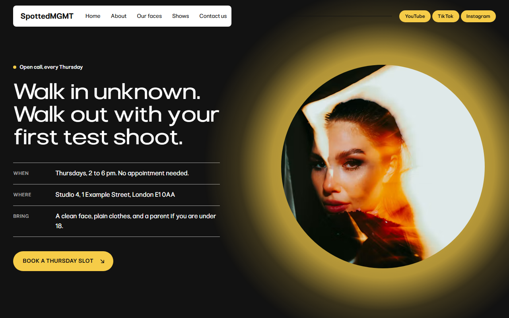
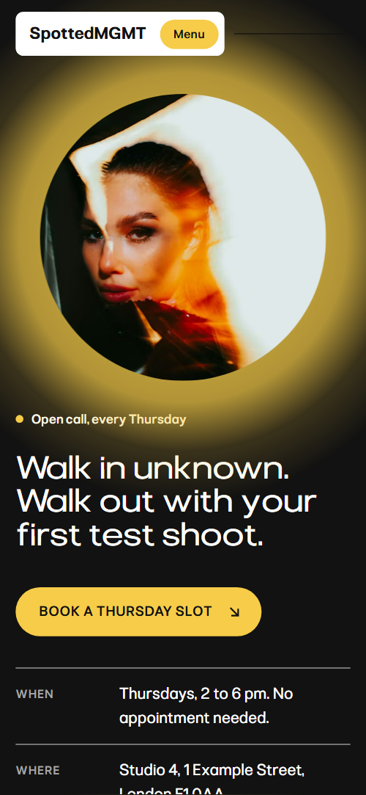
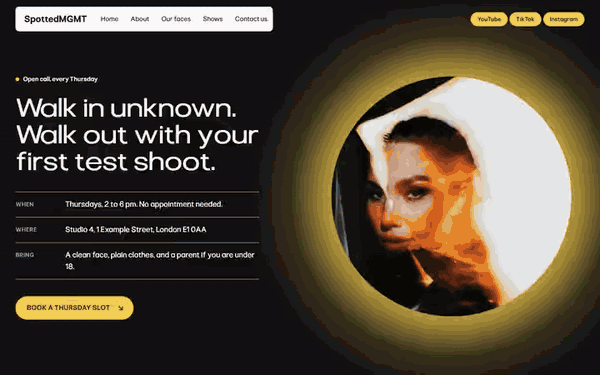

# Free HTML modeling agency website template with scroll animations and no libraries

Modeling agency website template: one free HTML file for a scouting agency that runs a weekly open call, with a casting board of new faces, a four-step path to a first booking, a no-fees promise and an application form. Yellow spots on light grey, a black open-call screen, and scroll motion in CSS with no libraries.

[](LICENSE)  

**[Live demo](https://8bsite.github.io/modeling-agency-website-template/)** · **[Use this template](https://github.com/new?template_name=modeling-agency-website-template&template_owner=8bsite)** · **[Download ZIP](https://github.com/8bsite/modeling-agency-website-template/archive/refs/heads/main.zip)** · **[Template page on 8b.com](https://8b.com/templates/spotted/)**

<a href="https://8bsite.github.io/modeling-agency-website-template/"></a> <a href="https://8bsite.github.io/modeling-agency-website-template/"></a>

<p align="center"><a href="https://8bsite.github.io/modeling-agency-website-template/"></a><br><sub>Scroll animation</sub></p>

## Use it with Claude Code, Cursor or Codex

Download the four files into your project folder (`curl.exe` in Windows PowerShell):

```bash
curl -LO https://raw.githubusercontent.com/8bsite/modeling-agency-website-template/main/index.html
curl -LO https://raw.githubusercontent.com/8bsite/modeling-agency-website-template/main/AGENTS.md
curl -LO https://raw.githubusercontent.com/8bsite/modeling-agency-website-template/main/LICENSE
curl -LO https://raw.githubusercontent.com/8bsite/modeling-agency-website-template/main/CREDITS.md
```

Then fill in the angle brackets and give your agent this prompt:

```text
Read AGENTS.md, then edit index.html. Make this my site: <my agency: name, city, what we scout, open call day and hours, address, phone and email, fees or commission, timings, the people we represent, partner cities, legal name>. Replace the name, board faces, stories, show claims, crossed-out charges and cities first. Keep the gate script, section ids, the board's name and photo order, four steps, nine frames, five show cards and the wordmark's len; motion is CSS, so add no library. Never invent fees, bookings, shows or contacts; ask me.
```

If you vibe code this modeling agency website template for Claude Code, Cursor or Codex, it goes fastest, as [with any editing agent](https://8b.com/templates/vibe-coding/), when the owner supplies the facts: open-call day and hours, address, fees or commission, timings, partner cities and real people. The agent should replace the demo faces, stories and crossed-out charges first, and ask before keeping any claim about shows or bookings. Keep the board's names and portraits in the same order and length, and set the footer wordmark's --len to the new name's character count.

No agent? Click **[Use this template](https://github.com/new?template_name=modeling-agency-website-template&template_owner=8bsite)**, edit `index.html` on GitHub and turn on **Settings > Pages**.

## Sections and motion

- **Navigation**: fixed white panel with the wordmark and five links, a hairline, three yellow social pills; hides on scroll down; phone menu overlay on black.
- **Walk in unknown. Walk out with your first test shoot.**: black open-call screen: label, headline, when, where and what to bring, a yellow button, and a round photo on a yellow glow. On load the copy blocks fade up one after another, the round photo opens from a small scale and its yellow glow grows, then breathes in a loop.
- **The new board**: casting index: six names with height, home town and where they were spotted, beside a sticky frame of six portraits. On wide screens six portraits stack in a sticky frame; each name turns dark with a yellow dot and slides right as its portrait opens over the last through a growing circle.
- **Where we found them**: four rows of places where people were found, each with a yellow spot, place, time, a short story and a photo. Each row's hairline draws from the left, its yellow dot pops in, and its photo goes from grey and dim to colour as it crosses the lower half of the screen.
- **From spotted to signed**: four steps along a diagonal line with a travelling yellow spot, on a white ground. A diagonal line draws down the section with scroll while a yellow spot travels along it, and each step fades from pale to full as the spot reaches it.
- **Nine test shoots this month**: white contact sheet on a black section, nine test frames dealt from a pile, a yellow square drawn round frame 07 and its note. The section holds in place: nine frames start as a pile in the middle of the sheet and are dealt into place, then a yellow square draws round frame 07 and its note fades in.
- **First shows, first campaigns**: horizontal track of five photo cards for first shows and campaigns. The section holds in place and the five cards travel sideways with scroll, each photo developing from grey to colour as it nears the middle.
- **No fees. Ever.**: yellow panel: "No fees. Ever.", a lead and four crossed-out charges against what the agency does instead. The heading rises, the row hairlines draw from the left and the strike through each crossed-out charge draws itself.
- **Five cities, one mother agency**: black section with five giant city names and a yellow tag for each. City names drift in alternating directions with scroll, while each yellow tag slides from the far left of its row to the right end.
- **Before you walk in**: heading with a short line beside six questions as native &lt;details&gt;.
- **Apply to be spotted**: checker flag, "Apply to be spotted", studio details and an application form. The squares of the checker flag unfurl in a diagonal wave as the section scrolls in.
- **Footer**: black footer: one line about the agency, three link columns, social pills, a hairline, a large wordmark and the base line.

## Design

 page ground, and the board, found-places, shows, questions and contact sections  
 text, buttons, and the black open-call screen, contact-sheet section, cities section, phone menu and footer  
 the accent: dots, halo, yellow buttons, city tags, checker flag and the whole promise panel  
 nav panel, method section ground, the contact sheet itself, form panel and button text  
 paragraphs beside headings, meta lines, board names not yet reached, form status line  
 the paler squares of the checker flag  
 muted text and hairlines on black: open-call labels, contact-sheet section text, footer headings  
 fill of the photo cards and frames behind the images

**Pliant**: the only typeface, a variable font: headings at regular weight in extended width, small uppercase labels at medium weight, the wordmark at semibold, regular body text (Google Fonts). A light grey ground broken by bands: black open call, white method, black contact-sheet section, yellow promise, black cities. Section heads mostly repeat one pattern, a large extended-width heading with a short paragraph beside it. Yellow is the repeating mark: dots beside the open-call label, the board names, the found places and the travelling spot, plus the halo and the city tags. Pill buttons fill with a growing circle on hover. A checker flag sits above the form.

## Questions

**Can I get an agency site like this without editing code?**  
Yes. [8B's AI website builder](https://8b.com/) designs a new site from a sentence you type, and designing and restyling are free. It will not be this template. Publishing with hosting and SSL, full HTML export and AI edits in chat are on Pro at $9 a month billed yearly. It also runs inside Claude and ChatGPT.

**Where does the application form send its messages?**  
Nowhere yet. The form needs a name, an age and an email, then shows a thank-you line and clears itself without sending anything. Connect Formspree or Netlify Forms as AGENTS.md describes, or delete it and keep the phone and email. Then edit the thank-you text if your reply time differs.

**Can a talent or casting agency use it, not only models?**  
Yes. Nothing in the structure is specific to models: swap the board for your roster, the found-place stories for your own discovery stories and the nine test shoots for audition frames. The age field's limits are 14 to 99 (the form does not enforce them) and the under-18 checkbox suits young talent; edit both if your rules differ.

## Is it the right base?

This suits an agency that scouts in person and wants to look young and direct. An agency that sells projects rather than people fits a [case-study layout](https://8b.com/templates/sillage/) better. This is the light build: the same look and scroll behaviour, no animation library and no script from a CDN, about 26 KB of code gzipped against 73 KB for the GSAP version. The weak spot is the form: it sends nothing until a service is connected, and there are no model profiles or login.

## Before you publish

- Replace what is marked `data-8b-placeholder` (social preview image, favicon, social, phone, email, form) and the invented demo facts; [AGENTS.md](AGENTS.md) lists them.
- The form sends nothing yet: connect it to Formspree or Netlify Forms, or remove it.

## Tech

No JavaScript libraries: CSS scroll-driven animations and a small inline motion script with its own smooth wheel scrolling, 102 KB, no build step. Chrome and Edge 111+, Safari 16.2+, Firefox 113+ (it uses color-mix(), container query units, cascade layers, small/dynamic viewport units). Without scroll-driven animations (Firefox today) the scroll motion and the smooth wheel are off and each section shows its finished layout (a load-in or a loop may still play); with "reduce motion" on, the page is complete and nothing moves on its own (hover effects stay).

A GSAP build of the same page is [`index.gsap.html`](index.gsap.html): GSAP 3.13.0, ScrollTrigger, SplitText, Lenis 1.3.27 from jsDelivr, 86 KB; its scroll motion also plays in Firefox. Use one of the two files.

## License

MIT, see [LICENSE](LICENSE). Photos, fonts and libraries keep their own licences: [CREDITS.md](CREDITS.md). More free templates: [8b.com/templates](https://8b.com/templates/) · [github.com/8bsite](https://github.com/8bsite).
