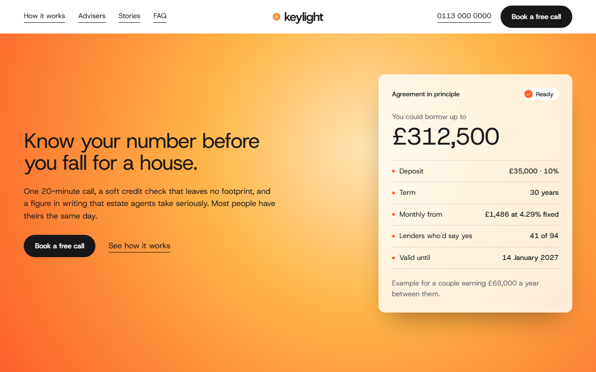
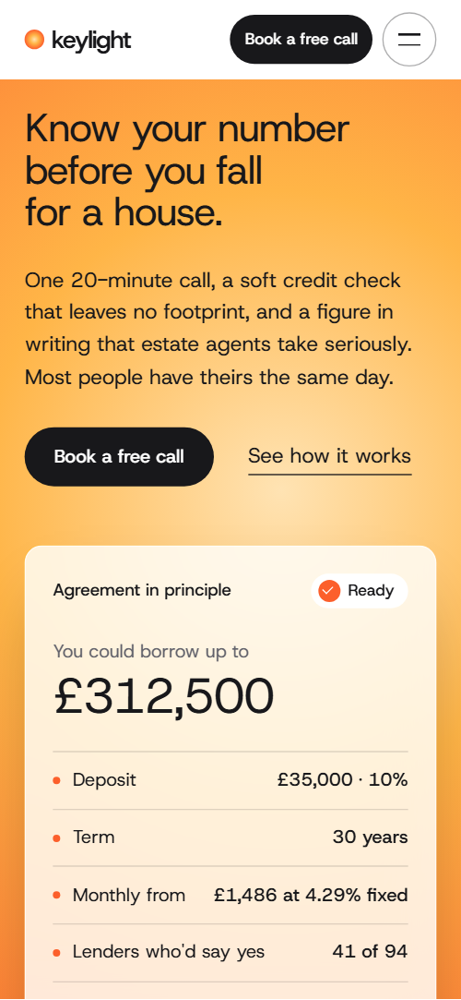
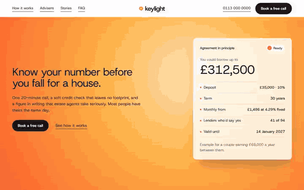

# Free HTML mortgage broker website template with GSAP scroll animations

Mortgage broker website template: one free HTML page for an adviser who compares the whole market and books free calls. It holds an example agreement in principle, a chart of 94 lenders, a fee ledger, adviser portraits and a call-back form, in white and zinc with an amber glow. AGENTS.md lets Claude Code, Cursor or Codex adapt it.

[](LICENSE)  

**[Live demo](https://8bsite.github.io/mortgage-broker-website-template/)** · **[Use this template](https://github.com/new?template_name=mortgage-broker-website-template&template_owner=8bsite)** · **[Download ZIP](https://github.com/8bsite/mortgage-broker-website-template/archive/refs/heads/main.zip)** · **[Template page on 8b.com](https://8b.com/templates/keylight/)**

<a href="https://8bsite.github.io/mortgage-broker-website-template/"></a> <a href="https://8bsite.github.io/mortgage-broker-website-template/"></a>

<p align="center"><a href="https://8bsite.github.io/mortgage-broker-website-template/"></a><br><sub>Scroll animation</sub></p>

## Use it with Claude Code, Cursor or Codex

Download the four files into your project folder (`curl.exe` in Windows PowerShell):

```bash
curl -LO https://raw.githubusercontent.com/8bsite/mortgage-broker-website-template/main/index.html
curl -LO https://raw.githubusercontent.com/8bsite/mortgage-broker-website-template/main/AGENTS.md
curl -LO https://raw.githubusercontent.com/8bsite/mortgage-broker-website-template/main/LICENSE
curl -LO https://raw.githubusercontent.com/8bsite/mortgage-broker-website-template/main/CREDITS.md
```

Then fill in the angle brackets and give your agent this prompt:

```text
Read AGENTS.md, then edit index.html. Make this the site for <my brokerage: name, city, regulator wording, fee model and amounts, lender count, advisers and specialities, client stories, rates to show, hours, booking>. Replace first the firm name, the fees, the lender count (data element, chart variables, every 94 in the text), the advisers and the stories. Keep the section ids, four method steps with four photos and four dots, and the classes AGENTS.md lists. Ask me for missing facts; never invent rates, fees, reviews, regulatory claims or contacts.
```

A mortgage broker website template for Claude Code, Cursor or Codex goes fastest when you hand the agent the facts only the firm has: fee model, regulator wording, lender count, rates, advisers and stories. The demo invents all of them, including the 4.9 rating. The agent should swap the name everywhere, then change the 94 in the lead paragraph's data element, the chart's inline count and the five other places it appears, keeping data-bank below the new count. The [steps for Claude Code](https://8b.com/templates/for-claude-code/) cover folder setup and a first prompt.

No agent? Click **[Use this template](https://github.com/new?template_name=mortgage-broker-website-template&template_owner=8bsite)**, edit `index.html` on GitHub and turn on **Settings > Pages**.

## Sections and motion

- **Navigation**: four links, a wordmark with a round mark, the phone, a Book a free call button and a Menu button; a menu overlay with five links. The bar slides up out of view when you scroll down and returns when you scroll up, with or without reduced motion.
- **Know your number before you fall for a house.**: a heading, a paragraph and two actions beside a card showing an example agreement in principle. On load the heading block rises in three beats and the agreement card follows a moment later.
- **Your bank shows you one shelf. We show you the whole market.**: a chart of 94 thin lines, your bank as one dark line, which light up and grow outward as you scroll, above three lender kinds. Scrubbed with the scroll, every line except the bank's grows from a fifth of its height to full and turns from pale grey to ember, outward from the dark line.
- **How it works**: four steps at the left; a held photo frame at the right wipes from one photo to the next with status chips. The photo frame is held by CSS while the steps scroll past; each new photo wipes up over the last, which shifts up and darkens, and the index dot moves on.
- **Brokers can charge up to £995. Our fee is £0.**: a headline about the fee and a ledger of nine included services. The headline rises line by line out of a mask, then the nine ledger rows light up one after another, once.
- **The adviser on your first call is the one who hands you the keys.**: four adviser portraits on a dark ground, each opening from a narrow pill to a full frame. Each portrait opens from a narrow pill to its full frame while the photo brightens, with a lag along the row, and the text rises into place.
- **Bought, moved, switched.**: three client stories with a photo, a quote, names and a result. The heading rises line by line, and each photo comes up from dim and slightly zoomed as it scrolls into view.
- **A fixed rate ends. We're already watching.**: a held section where a rate-switch timeline of four panels runs sideways while the ground warms from white to amber. Pinned: the intro and four panels run sideways for about 1,300 px of scrolling on a 1440 px screen, a line fills under them, each dot pops as it is reached and the ground warms from white to amber.
- **Start with a free mortgage review.**: a photo with a glass panel comparing two monthly payments beside the free review offer. The photo settles from a zoom, the glass panel rises from below and the payment line draws left to right.
- **Questions people ask before the first call**: six questions and answers (native details) with a phone line. The heading rises, then the six rows light up in turn, once; opening a question turns its plus into a minus.
- **The keys are closer than they look.**: a glowing disc behind a house photo, the contact details and a call-back form on a dark ground. The glow disc rises and swells behind the photo while the photo settles from a zoom.
- **Footer**: a white card on the near-black ground with the logo, a tagline, a button, two link columns and a regulatory text with the copyright.

## Design

 page ground, the nav bar, the footer card and the call-back form card, text on the dark sections  
 body text, the dark buttons, the advisers section ground, the bank's line in the chart, the switch dots and fill line  
 secondary small text and the descriptions in the fee ledger  
 alternate ledger rows, the FAQ section ground, the form fields  
 amber: the middle of the glow gradient, the switch section's final ground, adviser specialities, the method index dots, the line in the offer panel's chart  
 ember: the chart lines other than the bank's, bullets and step markers, the round badge icon behind the white tick, the link underline on hover, the end of the glow  
 warm near black: the contact section and footer ground, the backing of the photo frames, the dark photo chips and the offer panel  
 muted small text, such as the one-line adviser notes and the photo chip subtitles  
 hairlines, field borders, the pale start of the chart lines and the dimmed ledger and FAQ rows before they light up  
 the cream centre of every glow: the first screen, the button hover, the logo mark and the contact disc

**Host Grotesk**: the only typeface, loaded as one variable file for weights 400 to 600: regular headings with tight tracking, medium labels and buttons, a semibold wordmark (Google Fonts). Two-column grids carry most sections, heads mostly split 7 to 5, content mostly 6 to 5. A photo frame stays held beside four scrolling steps, the fee is a nine-row ledger with zinc stripes on alternate rows, advisers sit four across on a dark ground, and the stories swap photo sides. Small ember dots repeat as bullets and markers, and a glowing dot is the logo mark. Grounds run glow, white, dark zinc, white, amber, white, light zinc, near black.

## Questions

**Does it include regulatory wording for a UK or US broker?**  
It includes demo wording only. The footer says the firm is authorised and regulated by the Financial Conduct Authority and carries a repossession warning, and the prices are in pounds. Replace them with the wording your regulator and compliance officer require; the page shows no firm reference number.

**Does the call-back form send anything?**  
No. The script checks the required fields, clears the form and shows a thank-you line, and nothing is sent. Connect Formspree or Netlify Forms, or point the Book a free call buttons at a Calendly or Cal.com link. Replace the contact script when you do: it clears the fields before a plain post could send them.

**Can I get a site like this without editing code?**  
Yes, with [8B's AI website builder](https://8b.com/). You describe the firm in a sentence and its engine designs a new site, its own design and not this template. Designing and restyling are free; publishing with hosting and SSL, HTML export and AI edits in chat are on Pro at $9 a month billed yearly. It also runs inside Claude and ChatGPT.

## Is it the right base?

As a mortgage company website template it fits a small advice firm that sells a free call and explains a process. A practice that lists fixed monthly fee plans suits the [accountancy](https://8b.com/templates/evenkeel/) template better. The weak spot is booking: the buttons jump to a form that sends nothing, and there is no rate calculator. A financial advisor website template with many service pages needs more than one page. If you want no code at all, 8B's own builder designs a site from a sentence.

## Before you publish

- Replace what is marked `data-8b-placeholder` (social preview image, favicon, phone, email, form) and the invented demo facts; [AGENTS.md](AGENTS.md) lists them.
- The form sends nothing yet: connect it to Formspree or Netlify Forms, or remove it.

## Tech

GSAP 3.13.0, ScrollTrigger, SplitText, Lenis 1.3.27 from jsDelivr, 91 KB, no build step. Chrome and Edge 111+, Safari 16.2+, Firefox 113+ (it uses color-mix(), cascade layers, small/dynamic viewport units). With "reduce motion" on, the page is complete and still.

## License

MIT, see [LICENSE](LICENSE). Photos, fonts and libraries keep their own licences: [CREDITS.md](CREDITS.md). More free templates: [8b.com/templates](https://8b.com/templates/) · [github.com/8bsite](https://github.com/8bsite).
