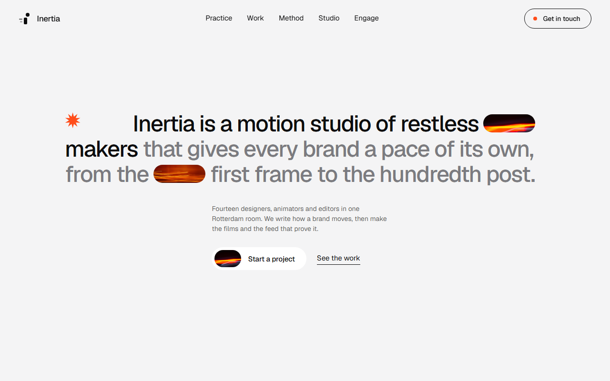
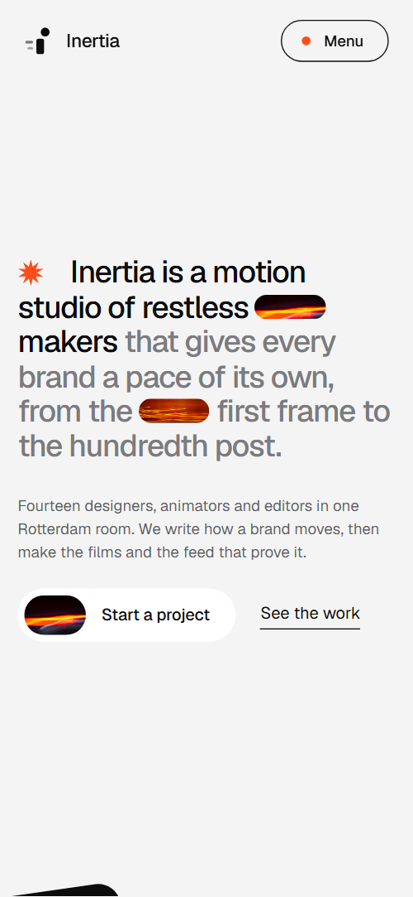
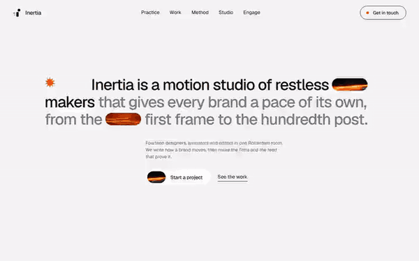

# Free HTML motion design studio website template with scroll animations and no libraries

Motion design studio website template: one free HTML file for a studio that sells motion systems, launch films and social content to brands. It has a two-tone opening, a five-project index, a method timeline and three priced engagements, in cool grey with orange light streaks. Scroll motion is plain CSS, and AGENTS.md lets Claude Code, Cursor or Codex adapt it.

[](LICENSE)  

**[Live demo](https://8bsite.github.io/motion-design-studio-website-template/)** · **[Use this template](https://github.com/new?template_name=motion-design-studio-website-template&template_owner=8bsite)** · **[Download ZIP](https://github.com/8bsite/motion-design-studio-website-template/archive/refs/heads/main.zip)** · **[Template page on 8b.com](https://8b.com/templates/inertia/)**

<a href="https://8bsite.github.io/motion-design-studio-website-template/"></a> <a href="https://8bsite.github.io/motion-design-studio-website-template/"></a>

<p align="center"><a href="https://8bsite.github.io/motion-design-studio-website-template/"></a><br><sub>Scroll animation</sub></p>

## Use it with Claude Code, Cursor or Codex

Download the four files into your project folder (`curl.exe` in Windows PowerShell):

```bash
curl -LO https://raw.githubusercontent.com/8bsite/motion-design-studio-website-template/main/index.html
curl -LO https://raw.githubusercontent.com/8bsite/motion-design-studio-website-template/main/AGENTS.md
curl -LO https://raw.githubusercontent.com/8bsite/motion-design-studio-website-template/main/LICENSE
curl -LO https://raw.githubusercontent.com/8bsite/motion-design-studio-website-template/main/CREDITS.md
```

Then fill in the angle brackets and give your agent this prompt:

```text
Read AGENTS.md, then edit index.html. Make this the site for <my studio: name, city, team and roles, services, past projects with client, kind and year, engagement types with duration and price, client quotes, how clients book a call, company number>. Replace the studio name, projects, quotes, prices and team first. Keep the gate script, section ids, the classes AGENTS.md lists and the data-pace values, and set the footer wordmark's --len to the name's length. Motion is CSS: add no library. Never invent clients, prices or contacts; ask me.
```

If you vibe code this motion design studio website template for Claude Code, Cursor or Codex, start with facts: studio name, city, people, the five projects with client, kind and year, the three engagements with duration and price, and the quotes. The demo invents all of them, and its photos are stock images, not anyone's work. The agent should also set the wordmark's --len to the name's character count, and leave the data-pace values and the classes AGENTS.md lists alone.

No agent? Click **[Use this template](https://github.com/new?template_name=motion-design-studio-website-template&template_owner=8bsite)**, edit `index.html` on GitHub and turn on **Settings > Pages**.

## Sections and motion

- **Navigation**: logo, five section links and a Get in touch pill; on phones a Menu button opens a full-screen overlay. The bar hides when you scroll down and returns when you scroll up; on phones the Menu button opens a full-screen overlay.
- **Inertia is a motion studio of restless makers that gives every brand a pace of its own, from the first frame to the hundredth post.**: one screen: a large two-tone statement with two picture pills, an orange starburst, a note and a Start a project button. On load the statement, note and actions rise, each photo pill shrinks from a stretched shape and the starburst spins in.
- **Practice**: four tall cards in a staggered row: a dark card, two photo cards and a light card. On wide screens the four cards start as a tilted pile and are dealt into the row as you scroll, each orange dot streaking in after its card; at 1024 px and below each card slides in from alternating sides.
- **Moving now**: five launches as a speed index: a huge title, client and kind, and a photo that opens from a pill. As a row crosses the screen its title stretches from condensed to extended while its photo opens from a small pill to the full frame, then both fall back as the row leaves.
- **Every brand gets a tempo**: dark band with three lanes, each with an orange runner looping at its own pace. Three orange runners loop on their own timing, Glide slow, Snap fast with a hard stop and Pulse with a heartbeat, and pause while the section is off screen.
- **From first call to final frame**: four project steps with photos that run under a fixed orange playhead as you scroll. The section holds in place and the four steps slide left under a fixed orange playhead, with the step under it turning from grey to colour and its number badge filling orange.
- **What clients say**: one large two-tone client quote with a photo pill, and two short quotes with faces. The main quote and the two small cards slide in with a braking skew as they arrive, and the portraits drift sideways inside their frames as you scroll.
- **One room in Rotterdam**: a wide crew photo that lines up from four shifted columns, and four portraits with names and roles. The crew photo arrives cut into four columns out of register and lines up by the middle of the screen, while the four portraits rise at different rates.
- **The lab, after hours**: dark band with six experiments as staggered tiles of long-exposure photos. The six photos drift sideways inside their frames as you scroll.
- **Three ways to start moving**: three engagement plans as hairline rows, each with a pace line and an orange runner. One scroll moves each runner at its plan's pace: Sprint crosses early and waits, Season takes the whole scroll through the plans and Always on laps three times.
- **Before you call**: heading and five questions as native details. A question's plus sign turns into a minus with a CSS transition when it opens.
- **Set something in motion**: large title with an orange streak band, email, address, phone and a brief form. The orange streak band grows from the heading's dot while the title words skid in from the right one after another.
- **Footer**: name and line, links, social links, the full-width wordmark and the legal line.

## Design

 page ground, and the nav bar once you scroll (at 90%)  
 the two light cards (practice and quotes), contact section ground, photo placeholders and the footer wordmark  
 text, dark cards, the tempo, lab and footer bands, the menu overlay and hairlines  
 small secondary text, such as card notes, step texts and contact details  
 the accent: dots, starburst, runners, method playhead, live step number, link hover and the outlined buttons' dot  
 the white pill button and text on dark surfaces  
 the quiet half of the opening statement and of the main quote  
 small text on black cards, the dark bands and the footer

**Geist**: everything except display titles: medium-weight headings, regular body text, buttons, labels and form fields. **TikTok Sans**: light-weight (300) display type with a width axis: the five project titles and the footer wordmark (Google Fonts). The opening statement is indented on a 12-column grid, with a starburst at its start. Most sections then open with a split head: heading left, short intro right. Cards and tiles are rounded, buttons are pills. The four practice cards form a staggered row with every second one lower, and lab tiles stagger the middle column. Work and engagement are hairline-ruled rows. Dark bands (tempo, lab, footer) alternate with light sections, and a wordmark spans the footer.

## Questions

**Can it work as a video production website template for a creative studio?**  
Yes. Rename the practice cards to your services and the five projects become sizzle reels, brand films or shorts. A creative studio website template needs real work, so swap the stock photos for stills of your films. Without fixed engagements, delete the engage section, its script and the Engage entries in the header and menu.

**Where does the project form send its messages?**  
Nowhere yet. The form needs a name, an email and a message, then shows a thank-you line and clears itself without sending anything. Connect Formspree or Netlify Forms with the steps in AGENTS.md, or delete the form and keep the email link. Also edit the thank-you line, which promises a reply within two working days.

**Can I get a site like this without editing code?**  
Yes, with [8B's AI website builder](https://8b.com/). Describe the site in a sentence and its engine designs a new site, its own design and not this template. Designing and restyling are free; publishing with hosting and SSL, full HTML export and AI edits in chat are on Pro at $9 a month billed yearly. It also runs inside Claude and ChatGPT.

## Is it the right base?

It suits a studio that sells fixed engagements, wants a monochrome look with one hot accent and can supply five real projects. A general design studio is closer to [another studio layout](https://8b.com/templates/onda/). This is the light build: the same look and motion with no animation library and no script from a CDN, about 29 KB of code gzipped against 75 KB for the GSAP version. The weak spot is the method, a sticky full-screen stage that can crop a step on very short screens.

## Before you publish

- Replace what is marked `data-8b-placeholder` (social preview image, favicon, email, phone, form, social) and the invented demo facts; [AGENTS.md](AGENTS.md) lists them.
- The form sends nothing yet: connect it to Formspree or Netlify Forms, or remove it.

## Tech

No JavaScript libraries: CSS scroll-driven animations and a small inline motion script with its own smooth wheel scrolling, 116 KB, no build step. Chrome and Edge 111+, Safari 16.2+, Firefox 121+ (it uses color-mix(), container query units, :has(), cascade layers, small/dynamic viewport units). Without scroll-driven animations (Firefox today) the scroll motion and the smooth wheel are off and each section shows its finished layout (a load-in or a loop may still play); with "reduce motion" on, the page is complete and nothing moves on its own (hover effects stay).

A GSAP build of the same page is [`index.gsap.html`](index.gsap.html): GSAP 3.13.0, ScrollTrigger, SplitText, Lenis 1.3.27 from jsDelivr, 93 KB; its scroll motion also plays in Firefox. Use one of the two files.

## License

MIT, see [LICENSE](LICENSE). Photos, fonts and libraries keep their own licences: [CREDITS.md](CREDITS.md). More free templates: [8b.com/templates](https://8b.com/templates/) · [github.com/8bsite](https://github.com/8bsite).
