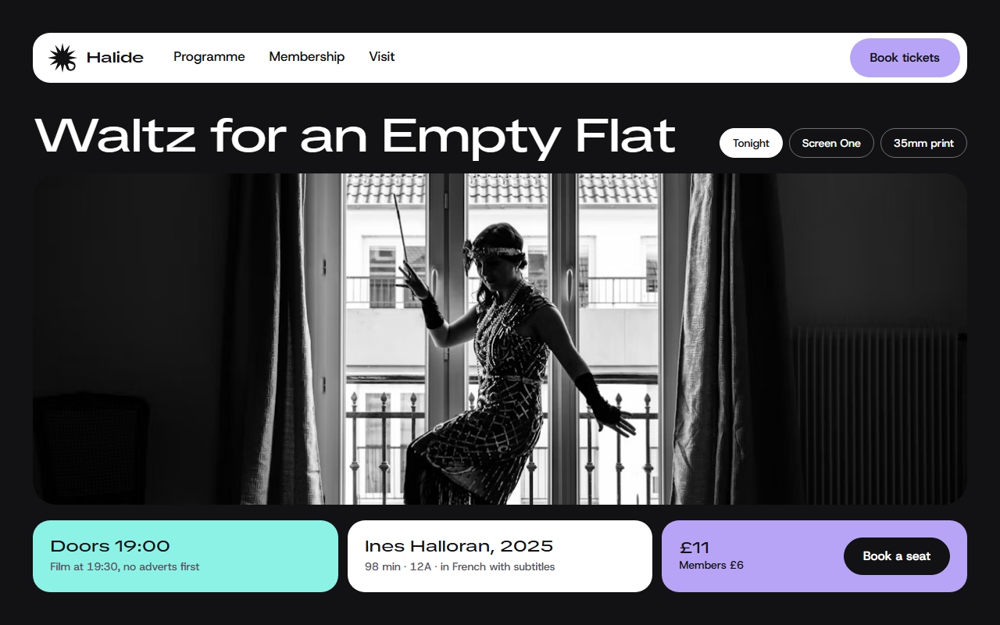
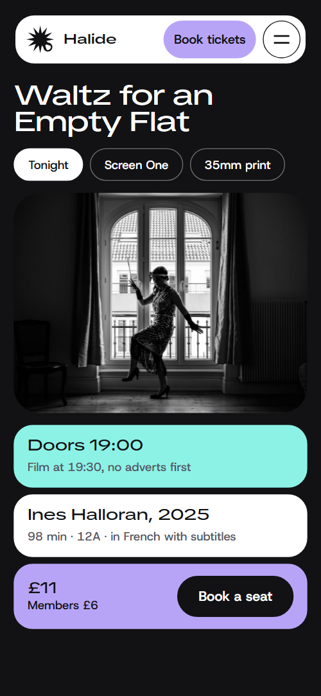
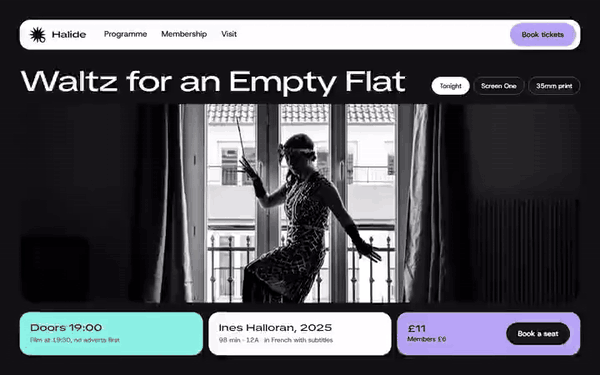

# Free HTML movie theater website template with GSAP scroll animations

Movie theater website template: one free HTML file for an independent cinema, film club or small screening venue that runs a weekly programme, a bar and a membership. It has a near-black page with white, mint and lavender tiles, film-edge perforation strips and photo windows turned in perspective. AGENTS.md is included, so Claude Code, Cursor or Codex can adapt it.

[](LICENSE)  

**[Live demo](https://8bsite.github.io/movie-theater-website-template/)** · **[Use this template](https://github.com/new?template_name=movie-theater-website-template&template_owner=8bsite)** · **[Download ZIP](https://github.com/8bsite/movie-theater-website-template/archive/refs/heads/main.zip)** · **[Template page on 8b.com](https://8b.com/templates/halide/)**

<a href="https://8bsite.github.io/movie-theater-website-template/"></a> <a href="https://8bsite.github.io/movie-theater-website-template/"></a>

<p align="center"><a href="https://8bsite.github.io/movie-theater-website-template/"></a><br><sub>Scroll animation</sub></p>

## Use it with Claude Code, Cursor or Codex

Download the four files into your project folder (`curl.exe` in Windows PowerShell):

```bash
curl -LO https://raw.githubusercontent.com/8bsite/movie-theater-website-template/main/index.html
curl -LO https://raw.githubusercontent.com/8bsite/movie-theater-website-template/main/AGENTS.md
curl -LO https://raw.githubusercontent.com/8bsite/movie-theater-website-template/main/LICENSE
curl -LO https://raw.githubusercontent.com/8bsite/movie-theater-website-template/main/CREDITS.md
```

Then fill in the angle brackets and give your agent this prompt:

```text
Read AGENTS.md, then edit index.html. Make this the site for <my cinema or club: name, screens and seat counts, this week's films with times, ticket and member prices, membership terms, bar menu and hours, programmers, address, ticketing link>. Replace the films, showings, prices and photos first. Keep the section ids, the classes AGENTS.md lists and one still per programme day, and set the footer wordmark's len to the new name's character count. Ask for missing facts; never invent showtimes, prices, ratings, reviews or contacts.
```

A movie theater website template for Claude Code, Cursor or Codex goes fastest, as in any [agent-led build](https://8b.com/templates/vibe-coding/), when you supply the facts only the venue has: film titles and times, screen sizes, ticket and member prices, the bar menu and hours. The demo invents all of it, including the 12A rating, the Leith address and both programmers. Point each of the 14 showing links at its booking page. Keep one still per programme day, because the script pairs days and stills by position.

No agent? Click **[Use this template](https://github.com/new?template_name=movie-theater-website-template&template_owner=8bsite)**, edit `index.html` on GitHub and turn on **Settings > Pages**.

## Sections and motion

- **Navigation**: fixed rounded white bar: wordmark, three links, Book tickets button; hides on scroll down; phone menu overlay. Smooth scrolling runs page-wide, and the nav bar slides up and away on a scroll down after the first 140px and returns on any scroll up.
- **Waltz for an Empty Flat**: one screen: tonight's film title with three pills, a wide photo window, door and show times, credits, ticket price and Book a seat button. On load the heading block rises, the photo window opens from a smaller size and the three tiles rise one after another.
- **This week at Halide**: "This week at Halide": a sticky photo screen beside six day tiles with times, titles and screen notes. The photo screen stays beside the list while each day tile turns white as it reaches the reading line and the screen wipes in that day's still from the right edge with a small swing.
- **Still on film**: "Still on film": text about 35mm projection beside a film gate that steps four captioned frames between running sprocket columns. The section holds for about two screens of scroll while the gate steps through four frames in three moves, with a dark shutter flash and jumping sprocket columns at each move.
- **Two rooms, one booth**: "Two rooms, one booth": two photo windows turned in perspective with a description and a row of facts each. The perforation divider slides sideways as it rises, each room photo turns from a steep angle to its resting tilt, and the fact pills rise one after another.
- **Picked by people**: "Picked by people": two programmer tiles and six note tiles, each a film with a line from one programmer. Six note tiles start as one tilted pile and are dealt into the grid as you scroll, each straightening as it lands.
- **The bar opens an hour early**: "The bar opens an hour early": two tilted bar photos and a five-line menu with sizes and prices. Both bar photos turn from a steep angle to their resting tilt, and the five menu rows rise one after another.
- **Become a member**: "Become a member": one ticket with a benefits sheet of five points and a stub with the price that tears off along a perforation. The price stub starts joined to the sheet and is pulled away along the perforation, swinging to rest sideways on wide screens and downward on phones.
- **Every month, whatever is on**: "Every month, whatever is on": four panels on a horizontal track, each with a tilted photo, title, when and a paragraph. The section holds while the four panels slide sideways, about two and a half screens of scroll at 1440 by 900 and a little over one on a phone, and each photo turns from a steep angle to its resting tilt as its panel arrives.
- **Before you come**: "Before you come": six questions as native details elements beside a heading tile with the email. The six question tiles rise one after another the first time the list comes into view.
- **Lights up. Come and visit.**: "Lights up. Come and visit.": night photo, address, opening hours, contacts and a message form; the section brightens from dark to white. The section brightens from near-black to white as it arrives, the heading turns dark and the photo window turns square on.
- **Footer**: dark footer: six links, address and phone, a pill row of Instagram, Letterboxd, YouTube and Newsletter, a wide wordmark, copyright with the Design: 8B credit.

## Design

 page ground, text on white, mint and lavender tiles, label on the lavender buttons, the phone menu ground and the shutter flash over the booth frames  
 nav bar, white tiles and question tiles, text on the dark ground, the visit section once it has brightened, the lit programme day  
 main buttons, lavender tiles (the Book a seat tile, the second programmer, the membership stub, the visit form, one season panel), focus outline, hover tint on programme rows, the open-question marker  
 mint tiles: the doors tile on the first screen, the first programmer, the questions heading tile and one season panel  
 the film gate frame in the booth, the perforation strips in the rooms section and the footer, the background behind photos while they load  
 secondary text on the dark ground: section intro lines, room descriptions, programme notes, bar note, footer address, text inside the dark visit tiles  
 secondary text on white, mint and lavender tiles: first-screen captions, question answers, the visit intro line after it brightens

**TikTok Sans**: display face at weights 500 and 600 in its expanded width: section headings and the film title (32 to 70px, tight tracking), tile titles, uppercase tracked pills, the nav wordmark, the large membership price and the footer wordmark. **Host Grotesk**: body face for the page: regular 16 to 17px text, medium-weight intro lines and 14px captions, semibold button labels (Google Fonts). A fluid full-width page on a near-black ground, with a rounded white bar floating above it. Content sits in rounded tiles (white, mint, lavender or outlined dark) with 22px corners (30px on the first photo and the booth gate) and pill-shaped tags. Photos sit in windows turned in perspective. Rows and columns of punched holes like film edges divide the rooms section and the footer and run beside the booth gate and the ticket. Headings are in an expanded face.

## Questions

**Is it a cinema booking website template that sells tickets?**  
No. Nothing checks seats or takes payment. The Book tickets and Book a seat buttons scroll to the programme and the 14 showing links scroll to the visit section until you point them at your ticketing page. The visit form shows a thank-you line and sends nothing until you connect Formspree or Netlify Forms.

**Can I get a site like this without editing code?**  
Yes, in another form. [8B's AI website builder](https://8b.com/) designs a new site from a sentence about your cinema, in its own design rather than this template. Designing and restyling are free. Publishing with hosting and SSL, full HTML export and AI edits in chat are on Pro at $9 a month billed yearly. It also runs in Claude and ChatGPT.

**What happens on a phone, with reduced motion or without JavaScript?**  
On a phone the nav links give way to a menu button with a five-link overlay, and the programme photo becomes a short band pinned above the days. With reduced motion, entrance and scroll animations and smooth scrolling are off. Without JavaScript the menu cannot open, but the Book tickets button, the six footer links and the questions work.

## Is it the right base?

Choose it when the content is a changing timetable plus a few steady offers, and you want a dark, film-edge look. The weak spot is the timetable: six day tiles edited by hand each week, with no listing feed, no seat map and no payment. A cinema that sells seats online should link out to a ticketing service. A [podcast](https://8b.com/templates/gabble/) network or audio collective is better served by a template built around shows.

## Before you publish

- Replace what is marked `data-8b-placeholder` (social preview image, favicon, email, map, phone, form, social) and the invented demo facts; [AGENTS.md](AGENTS.md) lists them.
- The form sends nothing yet: connect it to Formspree or Netlify Forms, or remove it.

## Tech

GSAP 3.13.0, ScrollTrigger, Lenis 1.3.4 from jsDelivr, 101 KB, no build step. Chrome and Edge 111+, Safari 16.2+, Firefox 113+ (it uses color-mix(), cascade layers, small/dynamic viewport units). With "reduce motion" on, the page is complete and still.

## License

MIT, see [LICENSE](LICENSE). Photos, fonts and libraries keep their own licences: [CREDITS.md](CREDITS.md). More free templates: [8b.com/templates](https://8b.com/templates/) · [github.com/8bsite](https://github.com/8bsite).
