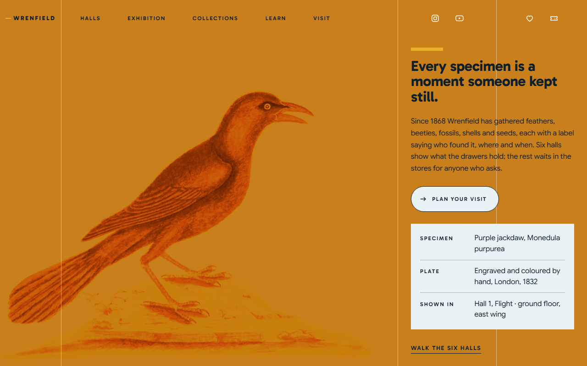
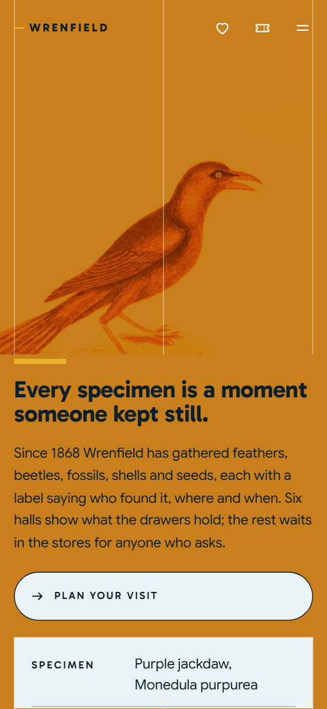
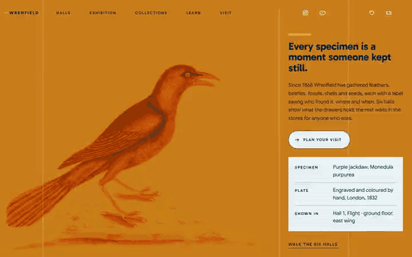

# Free HTML museum website template with scroll animations and no libraries

Museum website template: one free HTML page for a natural history museum or any collection, with six halls, a main exhibition, drawer tours, learning sessions, monthly late openings and membership. Plates sit on teal, amber and ice grounds. Its scroll motion runs on CSS with no libraries, one file of about 29 KB gzipped for Claude Code, Cursor or Codex.

[](LICENSE)  

**[Live demo](https://8bsite.github.io/museum-website-template/)** · **[Use this template](https://github.com/new?template_name=museum-website-template&template_owner=8bsite)** · **[Download ZIP](https://github.com/8bsite/museum-website-template/archive/refs/heads/main.zip)** · **[Template page on 8b.com](https://8b.com/templates/wrenfield/)**

<a href="https://8bsite.github.io/museum-website-template/"></a> <a href="https://8bsite.github.io/museum-website-template/"></a>

<p align="center"><a href="https://8bsite.github.io/museum-website-template/"></a><br><sub>Scroll animation</sub></p>

## Use it with Claude Code, Cursor or Codex

Download the four files into your project folder (`curl.exe` in Windows PowerShell):

```bash
curl -LO https://raw.githubusercontent.com/8bsite/museum-website-template/main/index.html
curl -LO https://raw.githubusercontent.com/8bsite/museum-website-template/main/AGENTS.md
curl -LO https://raw.githubusercontent.com/8bsite/museum-website-template/main/LICENSE
curl -LO https://raw.githubusercontent.com/8bsite/museum-website-template/main/CREDITS.md
```

Then fill in the angle brackets and give your agent this prompt:

```text
Read AGENTS.md, then edit index.html. Make this the site for <my museum: name, founding year, halls, exhibition with dates and price, tour and late prices, sessions, membership, hours, access, charity number, ticketing link>. Use one photo address for the opening plate and its tinted copy, and one for the four exhibition copies. Motion is CSS scroll-driven animation plus the inline kit: keep the gate script, section ids, data-8b-section and data-8b-motion attributes and the classes AGENTS.md lists; add no library. Never invent dates, prices, charity numbers or contacts; ask me.
```

Give Claude Code, Cursor or Codex the facts only the museum has: founding year, specimen counts, hall names and floors, exhibition dates, ticket and tour prices, opening hours and charity number. The demo invents all of them, and its plates and photos are stock images to swap for your own collection. Vibe coding goes fastest when the agent also updates each style="--len:N" number after renaming a hall, and asks instead of guessing a price. Renamed halls keep their motion: the six [slide sideways as you scroll](https://8b.com/templates/animated/).

No agent? Click **[Use this template](https://github.com/new?template_name=museum-website-template&template_owner=8bsite)**, edit `index.html` on GitHub and turn on **Settings > Pages**.

## Sections and motion

- **Navigation**: top bar with the brand, five links, social icons, member and ticket icons and a menu button; full-screen menu. The bar turns solid after 40 px and slides away on scroll down and back on scroll up, which still happens with reduced motion; the menu opens a full-screen overlay.
- **Every specimen is a moment someone kept still.**: a hand-coloured bird plate tinted amber across the screen, beside a text panel with the h1, a button and a specimen label. On load the amber plate settles from a slight zoom, the panel lines slide in from the right and the bar over the heading and the label rules grow.
- **Six halls, one family tree.**: six halls sliding past sideways, each with its name, a plate, floor and a line. The six halls slide sideways in a stage that stays on screen, each plate drifting slower than its hall and each name faster; without scroll-driven support or with reduced motion they become a plain grid.
- **The Colour of Flight**: the main exhibition: a plate printed in three colour layers that slide into register, with title lines and facts. Three colour layers of one plate slide together into register as it crosses the screen, and the two title lines close in from opposite sides.
- **Ninety-seven in every hundred specimens never go on show.**: a cabinet of four drawers whose trays slide out as you scroll, with a drawer-tour button. Each tray slides out of its drawer front as the drawer rises, alternately from left and right on desktop.
- **A third of the year, our curators are out there.**: fieldwork: a photo under a lens, text and three research projects. A yellow lens travels up the photo, a bar grows by the heading and two small glyphs rise and turn upright at their own rate.
- **Learn**: four session cards arriving scattered and tilted, then lining up. The four session cards start scattered and tilted and turn into one straight row on scroll.
- **After hours, the halls are yours.**: evening openings: a gallery photo that lights up from grey, a large word and four dated events. The photo comes up from dark grey to full colour on arrival and each date rule lights yellow when its row reaches the reading line.
- **Keep a drawer open.**: membership: a heading, a plate under a lens and four label cards (three levels and a one-off adoption).
- **Free, Tuesday to Sunday.**: visiting information in a two-by-two table beside a gallery photo that narrows into its column. On desktop the photo starts across the whole section and narrows to its column while the information slides in from the right.
- **Before you come**: six questions in native &lt;details&gt;.
- **Write to the curators.**: four ways to reach the museum: a message form, phone, address with email and a newsletter form. The four columns start as a staircase and rise into one level row as the section arrives.
- **Footer**: large wordmark, four link columns and a charity line.

## Design

 teal page ground of the halls, sessions and contact sections, the solid nav bar and the frame under the two lens photos  
 the large uppercase words and text on the deep teal blocks, the exhibition print sheet  
 body text, the nav, the menu overlay and the ground of the exhibition, Lates, FAQ and footer  
 yellow accent: filled buttons, grown underlines, nav hover bar, Lates glow, FAQ plus marks  
 pale yellow ground of the field section and the lens discs, and the fill that floods outlined buttons on hover  
 amber ground of the membership section and of the whole opening, where it tints the plate, and the opening panel on phones  
 pale ice ground of the drawers and visit sections, session cards, membership labels and specimen label

**Gabarito**: headings, hall names, uppercase labels and buttons, in weights 600 to 800. **Google Sans**: body text and form fields at regular weight, larger lead lines at medium weight (Google Fonts). Content hangs on one left line at a tenth of the width, which three hairlines mark in the opening. The opening is a full-screen plate tinted amber beside a text panel with a three-row specimen label (Specimen, Plate, Shown in). Six halls follow as big names over plates, then an exhibition with a facts list, four drawers, three research projects, four session cards, four dated events, four membership cards, a two-by-two visit table, a FAQ and four contact columns.

## Questions

**Is this free web design for museums and heritage charities?**  
Yes. It is one index.html under the MIT license, so a museum, a charity or a freelancer building for one can use it at no cost. It loads no animation library and needs no build step, and the Unsplash photos are listed in CREDITS.md. [GitHub Pages can host it](https://8b.com/templates/github/) free.

**Can this museum template work for an art gallery or another collection?**  
Yes, after a text pass. The six halls become galleries, the drawer tours become tours of the archive or store, and the plates become your own images. It then works as a free gallery website template for a library, archive or botanic garden, and suits gallery websites that lean on a collection.

**Do the booking buttons and forms send anything?**  
No. Both forms only validate and show a thank-you line, and the Book, Join and Tickets buttons jump to #visit or #contact. Connect Formspree or Netlify Forms for the forms and point each button at a ticketing, membership or donation page.

## Is it the right base?

This museum website design suits a place with a real collection and a calendar of events; a gallery that mostly runs night programmes fits the [kunsthalle](https://8b.com/templates/nocturna/) template better. This is the light build: the same look and scroll behaviour with no animation library and no script from a CDN, about 29 KB of code gzipped against 73 KB and three extra requests for the GSAP version. Booking is the weak spot: Book buttons jump to sections of the page and both forms send nothing yet.

## Before you publish

- Replace what is marked `data-8b-placeholder` (social preview image, favicon, social, map, form, phone, email) and the invented demo facts; [AGENTS.md](AGENTS.md) lists them.
- The form sends nothing yet: connect it to Formspree or Netlify Forms, or remove it.

## Tech

No JavaScript libraries: CSS scroll-driven animations and a small inline motion script with its own smooth wheel scrolling, 119 KB, no build step. Chrome and Edge 111+, Safari 16.2+, Firefox 113+ (it uses color-mix(), cascade layers). Without scroll-driven animations (Firefox today) the scroll motion and the smooth wheel are off and each section shows its finished layout (a load-in or a loop may still play); with "reduce motion" on, the page is complete and nothing moves on its own (hover effects stay).

A GSAP build of the same page is [`index.gsap.html`](index.gsap.html): GSAP 3.13.0, ScrollTrigger, Lenis 1.3.4 from jsDelivr, 111 KB; its scroll motion also plays in Firefox. Use one of the two files.

## License

MIT, see [LICENSE](LICENSE). Photos, fonts and libraries keep their own licences: [CREDITS.md](CREDITS.md). More free templates: [8b.com/templates](https://8b.com/templates/) · [github.com/8bsite](https://github.com/8bsite).
