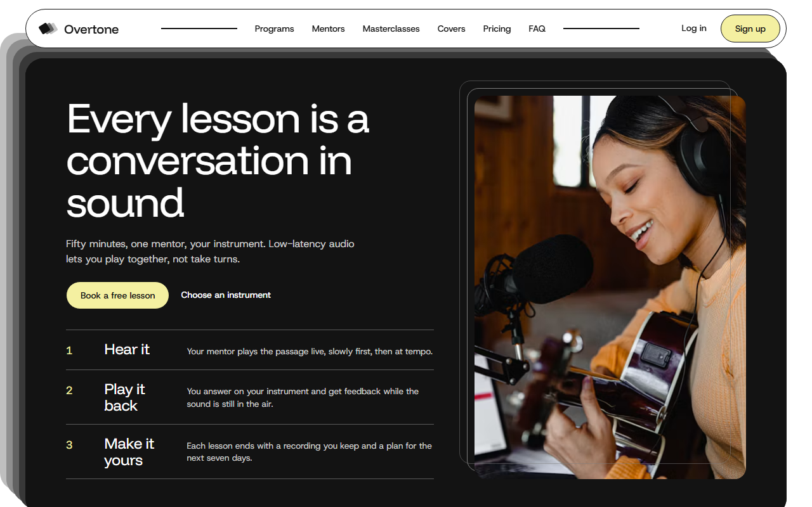
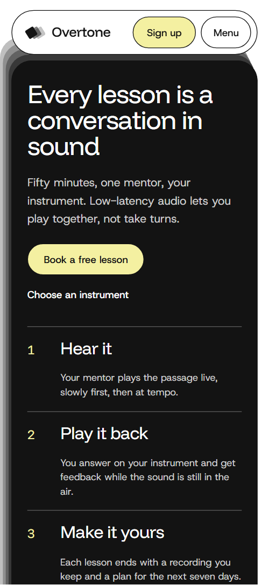
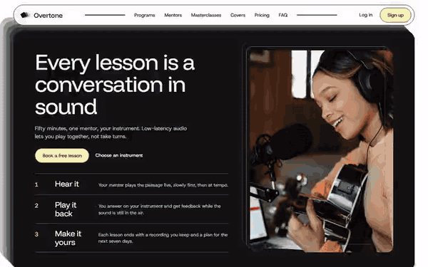

# Free HTML music school website template with scroll animations and no libraries

Music school website template: one free HTML file for an online lesson studio, with five instrument programs, five mentors, masterclass tickets, a sheet-music shop, three plans and a free-lesson booking form. The look is white with thin black outlines, beige cards and one orange accent. Its scroll motion runs on CSS with no JavaScript libraries.

[](LICENSE)  

**[Live demo](https://8bsite.github.io/music-school-website-template/)** · **[Use this template](https://github.com/new?template_name=music-school-website-template&template_owner=8bsite)** · **[Download ZIP](https://github.com/8bsite/music-school-website-template/archive/refs/heads/main.zip)** · **[Template page on 8b.com](https://8b.com/templates/overtone/)**

<a href="https://8bsite.github.io/music-school-website-template/"></a> <a href="https://8bsite.github.io/music-school-website-template/"></a>

<p align="center"><a href="https://8bsite.github.io/music-school-website-template/"></a><br><sub>Scroll animation</sub></p>

## Use it with Claude Code, Cursor or Codex

Download the four files into your project folder (`curl.exe` in Windows PowerShell):

```bash
curl -LO https://raw.githubusercontent.com/8bsite/music-school-website-template/main/index.html
curl -LO https://raw.githubusercontent.com/8bsite/music-school-website-template/main/AGENTS.md
curl -LO https://raw.githubusercontent.com/8bsite/music-school-website-template/main/LICENSE
curl -LO https://raw.githubusercontent.com/8bsite/music-school-website-template/main/CREDITS.md
```

Then fill in the angle brackets and give your agent this prompt:

```text
Read AGENTS.md, then edit index.html. Make it the site for <my music school: name, instruments, mentors and bios, lesson lengths, plan prices, masterclass dates, sheet music titles, stage night date, hours>. Motion is CSS scroll-driven animation plus the inline motion kit: keep the gate script in the head, the data-8b-section, data-8b-motion and data-8b-items attributes, five program cards, four path steps, three plans and six covers rows with six disc layers; add no animation library. Never invent reviews, ratings, student counts or contacts; ask me.
```

If you vibe code this music school website template for Claude Code or Cursor, it goes fastest when you hand over the facts only the school has: instruments, mentors and bios, lesson lengths, plan prices, masterclass dates, shop titles, languages and hours. The demo invents all of them, including the 4.9 rating and the 2,140 students. Replace the name everywhere, set the footer wordmark's --len to its length, and ask the owner before writing any review or contact.

No agent? Click **[Use this template](https://github.com/new?template_name=music-school-website-template&template_owner=8bsite)**, edit `index.html` on GitHub and turn on **Settings > Pages**.

## Sections and motion

- **Navigation**: pill bar: logo, six section links between two rules, Log in link and Sign up button; hides on scroll down; phone menu overlay. The pill bar slides out of view when you scroll down past 120 px and returns after a short scroll up.
- **Every lesson is a conversation in sound**: dark rounded lesson screen: h1, short paragraph, two actions, three numbered steps and a framed photo of a student with a guitar. On load, four grey layers step out behind the dark panel, the panel scales in and its content fades up into place; the mouse wheel scrolls smoothly throughout.
- **Choose what you want to play**: five tall outlined program cards in one overlapping row (demo: piano, guitar, voice, drums, production). The five cards start as a fanned pile in the middle of the row and are dealt out, outer cards first, with the scroll; on desktop the section is held while it runs.
- **Mentors who still play every weekend**: five overlapping round portraits with name, instrument and one line each (demo: piano, guitar, voice, drums, production). Each portrait arrives with two outline echoes, each instrument diamond turns a quarter, and the heading rises line by line.
- **Masterclasses: two evenings, one skill**: one featured ticket with photo, host, dates, time, discount, price, barcode and button, plus two smaller beige tickets (demo: three two-evening masterclasses). The featured photo starts enlarged to fill the screen and shrinks into its slot while the ticket text slides in, with the section held while it runs.
- **Covers shop: songs you love, at your level**: tracklist of six sheet-music arrangements beside a large sticky disc that swaps cover images (demo: a covers shop). The row near the middle of the screen turns into a black pill and its cover opens over the big disc from a dot.
- **From the first lesson to the first stage**: four outlined step pills laid as a descending staircase on a beige band, with an orange diamond marker (demo: trial lesson to stage night). An orange diamond hops from step to step with the scroll, turning on the way, and the step it stands on fills black.
- **Stage nights**: wide concert photo with an outlined card on its lower left: heading, text, next date and two actions (demo: term-end stage nights). The photo arrives with outline echoes, the heading rises, and the date diamond turns into place.
- **4.9 from 2,140 students**: rating line with five large diamonds, one large quote and three overlapping review cards. The quote's words ink from pale grey to black with the scroll, and the five rating diamonds light up orange one by one.
- **One price a month, a lesson every week**: three plan cards joined by two black bridges, the middle one beige with a discount badge (demo: Monthly, Term, Family). The outer plan cards start piled on the middle one, tilted, and are pulled apart while the two black bridges stretch between them.
- **Questions before the first lesson**: five questions as native details rows in outlined pills beside a sticky heading. The heading rises on arrival, and the diamond in a row turns 45 degrees when it opens.
- **Book your free first lesson**: beige card with the free-lesson form beside a cascade of six squares and email, phone and hours lines. Six squares start scattered and turned, then fold into a cascade as it scrolls into view.
- **Footer**: footer: a full-width wordmark with the three-square mark, brand line, three link columns, contact links and small print.

## Design

 page background, nav pill, the odd program cards, the outer plan cards, the outer review cards and text on the dark lesson panel  
 text, all outlines, primary buttons, the dark lesson panel, the mobile menu overlay, the active covers row  
 beige cards: the two small tickets, middle plan, contact card, even program cards, the middle review card, alternate FAQ rows and the path band  
 the accent: diamonds, the disc backdrop in the covers shop and the favicon tile  
 pale yellow fill of the small buttons, discount badges and round icon buttons, plus the colour of a program card or small ticket while its button is hovered  
 struck-through old prices and the mentors' one-line bios

**Funnel Display**: headings, prices, step and track titles, mentor names, FAQ questions and the footer wordmark, at weights 400 to 500. **Host Grotesk**: body text, buttons, labels, form fields and captions, at weights 400 to 600 (Google Fonts). A single scroll of rounded cards with 1.5px black outlines on white. The first screen is a dark rounded panel holding the h1, three numbered steps and a framed photo. Neighbours overlap in rows: five program cards, five round portraits, three reviews. The featured ticket carries a dashed stub and a barcode drawing, the three plans are joined by black bridges, and a beige band holds a four-step staircase. Headings use Funnel Display.

## Questions

**Where does the free-lesson booking form send its messages?**  
Nowhere yet. The script checks the required name and email, shows a thank-you line and clears the fields without sending anything. Connect Formspree or Netlify Forms with the steps in AGENTS.md, and edit the line, which promises a reply within a day.

**Can I get a site like this without editing code?**  
Yes, through [8B's AI website builder](https://8b.com/). You describe the school in a sentence and its engine designs a new site, its own design and not this template. Designing and restyling are free; publishing with hosting, full HTML export and AI edits in chat are on Pro at $9 a month billed yearly. It also runs inside Claude and ChatGPT.

**What happens on a phone, in Firefox or with reduced motion?**  
On a phone the program cards and the plans stack in a column. Browsers without CSS scroll-driven animations, Firefox today, and reduced motion get the finished static page: the opening shows without its load-in, nothing is dealt or held, scrolling is plain and the disc shows the last cover. The nav still hides on scroll and hover effects stay.

## Is it the right base?

It suits a school selling weekly lessons on monthly plans, with tickets and a shop on the same page. This build looks and scrolls the same with no animation library and no script from a CDN: about 30 KB of code gzipped, against 77 KB and four more requests for the GSAP version. For [a site that mostly lists gigs and event dates](https://8b.com/templates/ondo/), another template fits better. Weak spots: Log in and Add only jump to the form; there is no cart or calendar.

## Before you publish

- Replace what is marked `data-8b-placeholder` (social preview image, favicon, form, email, phone) and the invented demo facts; [AGENTS.md](AGENTS.md) lists them.
- The form sends nothing yet: connect it to Formspree or Netlify Forms, or remove it.

## Tech

No JavaScript libraries: CSS scroll-driven animations and a small inline motion script with its own smooth wheel scrolling, 128 KB, no build step. Chrome and Edge 111+, Safari 16.2+, Firefox 121+ (it uses color-mix(), :has(), cascade layers, small/dynamic viewport units). Without scroll-driven animations (Firefox today) the scroll motion and the smooth wheel are off and each section shows its finished layout (a load-in or a loop may still play); with "reduce motion" on, the page is complete and nothing moves on its own (hover effects stay).

A GSAP build of the same page is [`index.gsap.html`](index.gsap.html): GSAP 3.13.0, ScrollTrigger, SplitText, Lenis 1.3.11 from jsDelivr, 114 KB; its scroll motion also plays in Firefox. Use one of the two files.

## License

MIT, see [LICENSE](LICENSE). Photos, fonts and libraries keep their own licences: [CREDITS.md](CREDITS.md). More free templates: [8b.com/templates](https://8b.com/templates/) · [github.com/8bsite](https://github.com/8bsite).
