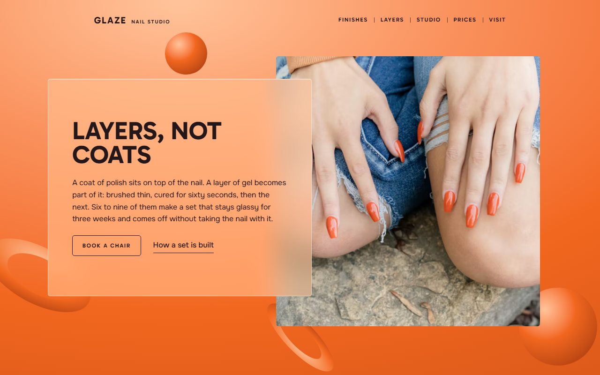
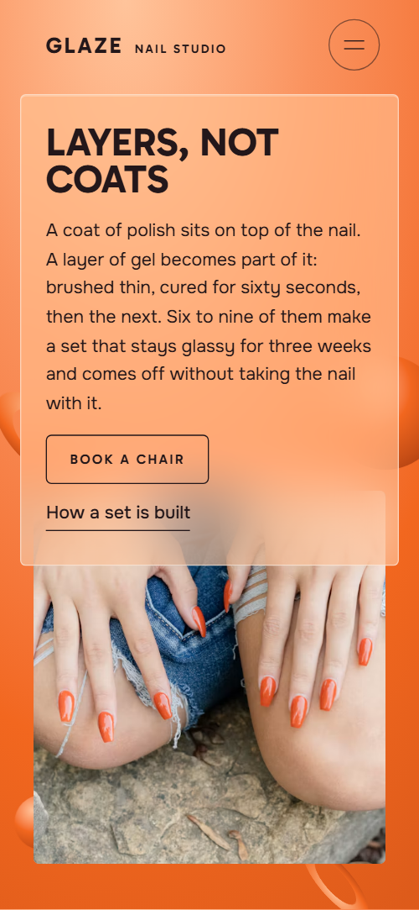
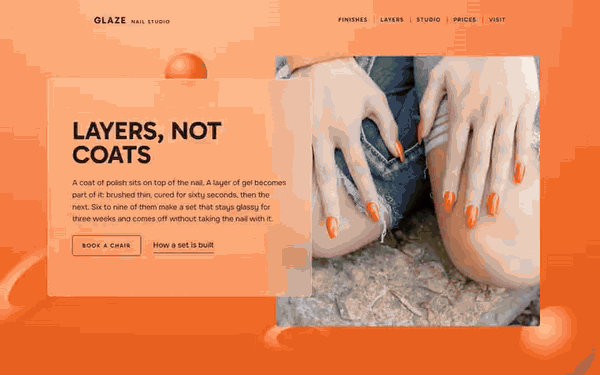

# Free HTML nail salon website template with GSAP scroll animations

This nail salon website template is one free HTML file for a gel studio or beauty salon whose clients book a chair. It has finish prices, a four-layer process, four artists, a price sheet, a club card and a booking form, all in frosted glass over orange orbs. AGENTS.md is included, so Claude Code, Cursor or Codex can adapt it.

[](LICENSE)  

**[Live demo](https://8bsite.github.io/nail-salon-website-template/)** · **[Use this template](https://github.com/new?template_name=nail-salon-website-template&template_owner=8bsite)** · **[Download ZIP](https://github.com/8bsite/nail-salon-website-template/archive/refs/heads/main.zip)** · **[Template page on 8b.com](https://8b.com/templates/glaze/)**

<a href="https://8bsite.github.io/nail-salon-website-template/"></a> <a href="https://8bsite.github.io/nail-salon-website-template/"></a>

<p align="center"><a href="https://8bsite.github.io/nail-salon-website-template/"></a><br><sub>Scroll animation</sub></p>

## Use it with Claude Code, Cursor or Codex

Download the four files into your project folder (`curl.exe` in Windows PowerShell):

```bash
curl -LO https://raw.githubusercontent.com/8bsite/nail-salon-website-template/main/index.html
curl -LO https://raw.githubusercontent.com/8bsite/nail-salon-website-template/main/AGENTS.md
curl -LO https://raw.githubusercontent.com/8bsite/nail-salon-website-template/main/LICENSE
curl -LO https://raw.githubusercontent.com/8bsite/nail-salon-website-template/main/CREDITS.md
```

Then fill in the angle brackets and give your agent this prompt:

```text
Read AGENTS.md, then edit index.html. Make this the site for <my salon: name, address, opening hours, finishes or services with prices, artists with specialties and working days, any membership, how people book, phone and email>. Replace first the studio name, the six finishes, the 14 price rows, the artists, the hours and the 14 photos. Keep the section ids, the classes AGENTS.md lists and the footer wordmark's --len at the new name's letter count. Ask me for missing facts and never invent prices, hours, addresses or contacts.
```

Vibe coding this in Claude Code or Cursor starts with facts only the salon has: prices, the artists and their days, address, hours, phone and what the club includes. The demo invents all of it, including the seven-day repair promise, and its footer hours disagree with the Visit hours, so set one version. Replace the 14 Unsplash photos, set the footer wordmark's --len to the new name's letters, and after changing the number of finish cards or layer sheets, scroll through to check the pin lengths.

No agent? Click **[Use this template](https://github.com/new?template_name=nail-salon-website-template&template_owner=8bsite)**, edit `index.html` on GitHub and turn on **Settings > Pages**.

## Sections and motion

- **Navigation**: glass top bar: Glaze wordmark with a nail studio line, five section links, menu button on phones; hides on scroll down. The nav bar sits at the top of the opening with dark text, floats as a glass bar after 24 px of scrolling, hides on scroll down and returns on scroll up.
- **Layers, not coats**: one screen: a peach glass pane with the heading "Layers, not coats", a paragraph, a Book a chair button and a link, beside a photo of orange gel nails, over floating orbs and rings. On load the glass pane and the photo rise into place, and the two orbs float and the two rings turn in loops that pause when the field is off screen.
- **Six finishes, one gloss**: six finishes as cards with photo, name, a line and a from-price (demo: Glass, Chrome, Milk, Bare, Duo, Sculpt), sliding through a window in frosted glass. The section pins and the six cards run sideways past a clear window between two frosted bands, while the photos drift inside their frames.
- **Built in four layers**: a photo of a nail artist at work with four smoked glass sheets laid over its edge (demo: Prep, Base, Colour, Seal). On desktop the stage pins for two screens and the four sheets land one by one from below with a band of light, while the photo settles from a larger scale.
- **The room on Example Street**: a photo of the waiting corner in a sticky frame beside three glass notes (demo: The sofa, The side table, The long window). The photo sits in a sticky frame and zooms and pans to a new spot for each of the three notes, then pulls back to the whole room.
- **Four people, six tables**: four artists as glass strips with name, specialty and working days, each with a photo of their work (demo: Mara Osei, Juno Bell, Ines Varga, Theo Lam). An orb behind the heading drifts up into place and a band of light sweeps once across each artist strip.
- **Your file is yours**: a heading with a photo on a sticky column, and four numbered care notes passing a turning ring (demo: Oil at night, File one way, Gloves at the sink, Back at three weeks). A ring in the middle of the screen turns one and a half times as the care notes pass, and each note's title turns ember red while its number disc fills orange.
- **Prices**: one light glass price sheet with three groups, Hands, Feet and Extras, over orbs and a ring. Two orbs and a ring behind the sheet drift into place at different speeds and a band of light sweeps once across the sheet.
- **The three-week club**: a membership card that turns over: front with price, back with five perks (demo: £39 a month). The section pins for about 1.6 screens: the front card rises and faces you, turns edge-on, and the back card turns in with a band of light.
- **Before you come**: five questions and answers as native &lt;details&gt; rows on light glass, with an orb behind and a sticky heading. An orb settles behind the rows as the section scrolls in, and each row opens and closes natively.
- **Book a chair**: one peach glass pane with address, hours, phone, email and a booking request form, over an orb, a ring and a dot. As the section scrolls in, the large orb sinks into its corner, the ring rolls in from the right and a small dot rises, while the pane and form stay still.
- **Footer**: dark footer: large wordmark filling the width, studio name with address and hours, section links, phone, email and Instagram, copyright with the Design: 8B credit. The wordmark rises up out of a mask as the footer arrives.

## Design

 light taupe at the upper end of the booking section's background gradient  
 page background, the ground of the finishes, artists and club sections, and the bottom of the booking gradient  
 text on dark sections, the pale glass edges and borders, button text on the near black fill  
 near black: the layers and footer backgrounds, text on light sections, the filled Request a time button  
 orange of the opening ground, the orbs and rings, the button hover fill, the number discs in the care notes as they pass and the favicon  
 peach: the top of the opening ground, the care section's ground, finish prices, small labels on dark glass, the light end of the orb gradients and the tint of the peach panes  
 deep ember: the dark end of the orb and ring gradients and the care note titles as they pass the middle of the screen  
 sand: the ground of the studio, prices and questions sections

**Gabarito**: weights 600 and 700: uppercase headings, the wordmark, card titles, the finish and club prices, tracked small labels and button text. **Onest**: weights 400 and 500: body text, form fields, text links and the figures of the price sheet (Google Fonts). Frosted glass panes sit over orange orbs and rings, over a peach to orange opening, then bands of taupe, sand, peach and near black. Headings are heavy uppercase type, and corners are a square 5 px. Panes overlap their photos and step sideways: the four layer sheets are staggered by a few vw, the artist strips alternate left and right, and the price sheet is pushed to the right edge. The footer opens with a wordmark filling the width.

## Questions

**Can a lash studio, hair salon or barbershop use it?**  
Yes, after a text pass. The finishes, price sheet, artist strips and club card suit any appointment business. The opening, layers, care notes, questions and the Finish list in the form talk about gel nails, so rewrite them or drop the layers section with its script and links. All 14 photos show nails or the nail room.

**Where does the booking form send requests?**  
Nowhere yet. The form checks that name and phone are filled, shows its thank-you line and clears itself without sending anything. Connect Formspree or Netlify Forms with the steps in AGENTS.md, or point the Book a chair and Join at your visit buttons at your own booking page. There is no calendar and no live availability.

**Can I get a salon site like this without editing code?**  
Not this page, which is an HTML file that a person or an AI agent edits. [8B's AI website builder](https://8b.com/templates/8b/) is the no-code route: describe the salon in a sentence and its engine designs a new site, its own design. Designing is free; publishing with hosting, HTML export and AI edits are on Pro at $9 a month billed yearly.

## Is it the right base?

It suits a studio that sells finishes from a price list and wants clients to meet the artists and join a membership. Among beauty salon website templates, a salon that mostly cuts and colours hair fits the [hair salon](https://8b.com/templates/undertone/) template better. A business with many service pages or online payment needs more pages. The weak spot is booking: the buttons only jump to a form that sends nothing until it is connected, and there is no calendar. Without code, 8B's builder is the other route.

## Before you publish

- Replace what is marked `data-8b-placeholder` (social preview image, favicon, phone, email, form, social) and the invented demo facts; [AGENTS.md](AGENTS.md) lists them.
- The form sends nothing yet: connect it to Formspree or Netlify Forms, or remove it.

## Tech

GSAP 3.13.0, ScrollTrigger, SplitText, Lenis 1.3.27 from jsDelivr, 93 KB, no build step. Chrome and Edge 111+, Safari 16.2+, Firefox 113+ (it uses color-mix(), cascade layers, small/dynamic viewport units). With "reduce motion" on, the page is complete and still.

## License

MIT, see [LICENSE](LICENSE). Photos, fonts and libraries keep their own licences: [CREDITS.md](CREDITS.md). More free templates: [8b.com/templates](https://8b.com/templates/) · [github.com/8bsite](https://github.com/8bsite).
