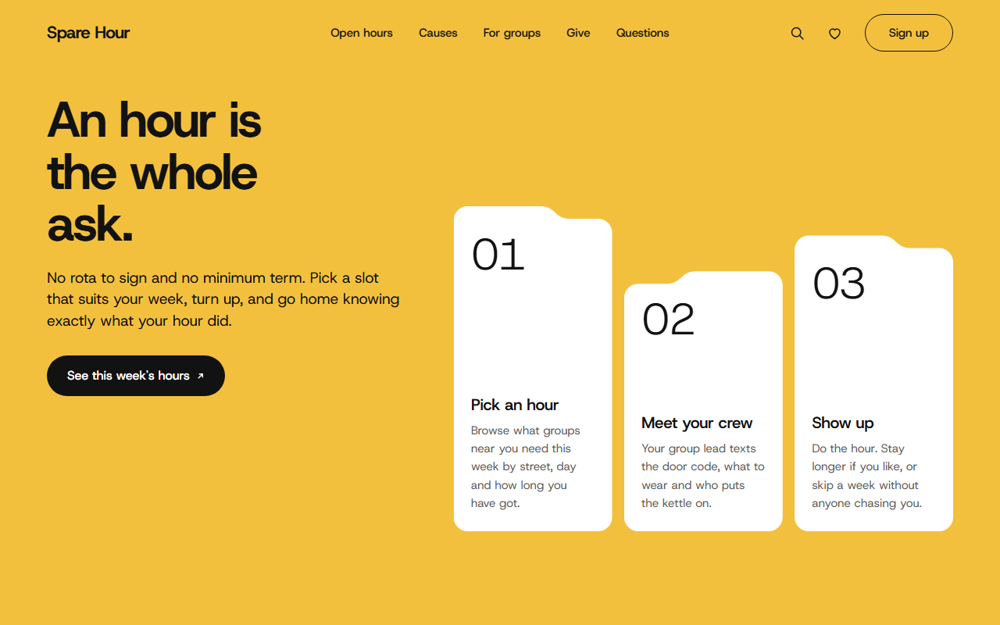
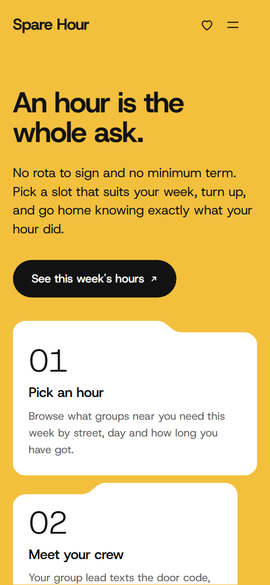
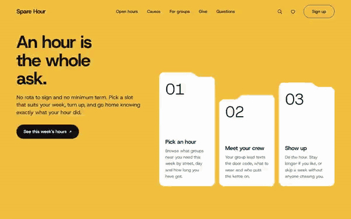

# Free HTML nonprofit website template with GSAP scroll animations

Nonprofit website template: one free HTML file for a volunteering network, charity or community group that lists open volunteer hours, takes sign-ups and asks for donations. Six colour-coded folders hold the open hours, a donation picker follows, and AGENTS.md lets Claude Code, Cursor or Codex adapt the whole page.

[](LICENSE)  

**[Live demo](https://8bsite.github.io/nonprofit-website-template/)** · **[Use this template](https://github.com/new?template_name=nonprofit-website-template&template_owner=8bsite)** · **[Download ZIP](https://github.com/8bsite/nonprofit-website-template/archive/refs/heads/main.zip)** · **[Template page on 8b.com](https://8b.com/templates/spare-hour/)**

<a href="https://8bsite.github.io/nonprofit-website-template/"></a> <a href="https://8bsite.github.io/nonprofit-website-template/"></a>

<p align="center"><a href="https://8bsite.github.io/nonprofit-website-template/"></a><br><sub>Scroll animation</sub></p>

## Use it with Claude Code, Cursor or Codex

Download the four files into your project folder (`curl.exe` in Windows PowerShell):

```bash
curl -LO https://raw.githubusercontent.com/8bsite/nonprofit-website-template/main/index.html
curl -LO https://raw.githubusercontent.com/8bsite/nonprofit-website-template/main/AGENTS.md
curl -LO https://raw.githubusercontent.com/8bsite/nonprofit-website-template/main/LICENSE
curl -LO https://raw.githubusercontent.com/8bsite/nonprofit-website-template/main/CREDITS.md
```

Then fill in the angle brackets and give your agent this prompt:

```text
Read AGENTS.md, then edit index.html. Make this the site for <my organisation: name, city, registered charity number, causes, real opportunities with day, time, length and places left, age and background check rules, donation amounts, budget, contacts>. Replace first the demo name, Glasgow places and Scottish terms, the six open hours, the quotes and the money figures. Keep the ids and the classes AGENTS.md lists, and set the footer wordmark's len to the new name's length. Ask me for missing facts and never invent figures, quotes, charity numbers or contacts.
```

Using a nonprofit website template for Claude Code, Cursor or Codex goes fastest when the agent gets the facts only the organisation has: name, charity number, causes, real opportunities with day, time and places, age and background check rules, gift amounts. The demo invents all of these, with the quotes and money figures. Replace them first, then the Glasgow names and Scottish terms such as the PVG check. The whole site is [one long volunteering page](https://8b.com/templates/one-page/), so the agent reads it in one pass.

No agent? Click **[Use this template](https://github.com/new?template_name=nonprofit-website-template&template_owner=8bsite)**, edit `index.html` on GitHub and turn on **Settings > Pages**.

## Sections and motion

- **Navigation**: fixed bar: wordmark, five links, two icon buttons, Sign up button; phone menu overlay with phone and email. The bar is clear at the top, gains a white ground and hairline after a few pixels of scroll, slides away on scrolling down past 120px and returns on scrolling up.
- **An hour is the whole ask.**: yellow screen: "An hour is the whole ask.", a paragraph, a button and three numbered step cards. Smooth scrolling runs page-wide; on load the heading, lead and button slide up and the three step cards rise from below with a short stagger.
- **This week's open hours**: "This week's open hours": six folder cards in a drawer, each with neighbourhood tab, cause, title, day and time, length, places left and a Book link. The six folders stack as a drawer that stays in place for about three screens of scrolling, and each step lifts the front folder, tilts it slightly and slips it to the back.
- **Six ways to spend an hour**: "Six ways to spend an hour": six tall cause cards in a stepped skyline, each with a photo, name and line. When the row reaches the lower part of the screen the six cards rise once, the outer ones first and the middle pair last.
- **One Saturday at the Govan larder**: "One Saturday at the Govan larder": a horizontal strip of six timed photo frames with captions. The six timed frames slide sideways while the page scrolls down, and the notch in each photo's top edge leans with the scroll speed.
- **Why they keep coming back**: "Why they keep coming back": one large quote and two smaller ones, portraits in tab frames and handwritten names over a yellow stroke. Each portrait rises with a slight zoom out as it enters, and the yellow stroke draws across each handwritten name.
- **Thirty neighbourhoods, one network**: "Thirty neighbourhoods, one network": a wrapping block of thirty Glasgow names on teal, each with its open hours, lighting up in cause colours. The thirty names start faded and light up in their cause colours as they pass the lower part of the screen, row by row, and fade again on scrolling back.
- **Run a community group? Post an hour in five minutes.**: "Run a community group? Post an hour in five minutes.": a photo of a circle of chairs, a pitch, three points and a button. The photo rises as it enters and the yellow stroke draws behind the words Post an hour.
- **Can't spare an hour? Spare a fiver.**: "Can't spare an hour? Spare a fiver.": yellow ground, amount picker with monthly checkbox, and three gift cards that deal out. The three gift cards start stacked in the middle, tilted, and deal out to their places as you scroll.
- **Questions before your first hour**: "Questions before your first hour": six questions as native details elements beside a heading and the phone number.
- **Start with one hour**: "Start with one hour": five photo cards in a peak, a sign-up form and drop-in, phone and email details. The five portrait cards rise from below on scroll, the outer ones first and the middle one last.
- **Footer**: dark footer: brand line, three link columns, a wide wordmark, charity registration, address and copyright with the Design: 8B credit.

## Design

 page ground, step cards, input fields, white neighbourhood pills, text on the dark sections  
 text, buttons, the Saturday section and footer grounds  
 yellow: opening screen and giving section grounds, Repairs colour, button hover fill, highlighter stroke  
 lead paragraphs, answers and other secondary text  
 hairlines between rows, the nav bar's shadow line, quotation marks  
 orange: Food folders, cards and pills, and one sign-up photo card  
 green: Gardens folders, cards and pills, and one sign-up photo card  
 blue: Reading folders, cards and pills, and one sign-up photo card  
 pale green: Company folders, cards and pills, the sign-up thank-you note, the groups photo ground  
 deep teal: River folders and cards, the neighbourhoods section ground, one sign-up photo card

**Host Grotesk**: all text: bold tight headings, light oversized step numbers, regular body text and the extra-bold footer wordmark. **Playwrite US Trad**: handwriting used only for the three volunteer names under the quotes, at regular weight (Google Fonts). White ground with flat colour blocks and cards shaped like folder tabs, most of them with a notched top edge and the rest plain rounded boxes. Rows of cards stand at stepped heights: the causes row dips towards the middle, the sign-up photo row peaks there. Five blocks change ground: yellow for the opening and the giving block, black for the Saturday story and the footer, teal for the neighbourhoods. Text-and-visual splits repeat down the page.

## Questions

**Is this a free non-profit website template?**  
Yes. The code is MIT licensed and sits in one index.html with inline CSS and scripts. GSAP and Lenis load from jsDelivr, the fonts from Google Fonts, and the 24 photos stay on Unsplash's servers and are listed in CREDITS.md. On Replit, [the volunteer network card](https://8b.com/templates/for-replit/) opens Agent with this design's prompt.

**Do the donation and sign-up forms work?**  
No, neither sends anything. The donation form only shows a preview message and the sign-up form checks the name and email, then shows a thank-you line. Connect sign-up with Formspree or Netlify Forms, and point Give now at your own donation page or payment link.

**Can I get a site like this without editing code?**  
Yes, with [8B's AI website builder](https://8b.com/). Describe the site in a sentence and it designs a new one, not this template. Designing and restyling are free; publishing with hosting, HTML export and AI edits in chat are on Pro at $9 a month billed yearly. It also runs inside Claude and ChatGPT.

## Is it the right base?

As an ngo website template it suits a network that lists dated slots near the visitor and asks for small gifts. The folder drawer and the neighbourhood block fit a city with many local groups; a single-site charity can cut both. A [members' workspace](https://8b.com/templates/isoline/) with day passes needs a different page. The weak spot is function: Book links, See all hours and Sign up all jump to the form, and a plain sentence on 8B's builder covers the no-code route.

## Before you publish

- Replace what is marked `data-8b-placeholder` (social preview image, favicon, phone, email, form) and the invented demo facts; [AGENTS.md](AGENTS.md) lists them.
- The form sends nothing yet: connect it to Formspree or Netlify Forms, or remove it.

## Tech

GSAP 3.13.0, ScrollTrigger, Lenis 1.3.27 from jsDelivr, 105 KB, no build step. Chrome and Edge 111+, Safari 16.2+, Firefox 113+ (it uses color-mix(), cascade layers, small/dynamic viewport units). With "reduce motion" on, the page is complete and still.

## License

MIT, see [LICENSE](LICENSE). Photos, fonts and libraries keep their own licences: [CREDITS.md](CREDITS.md). More free templates: [8b.com/templates](https://8b.com/templates/) · [github.com/8bsite](https://github.com/8bsite).
