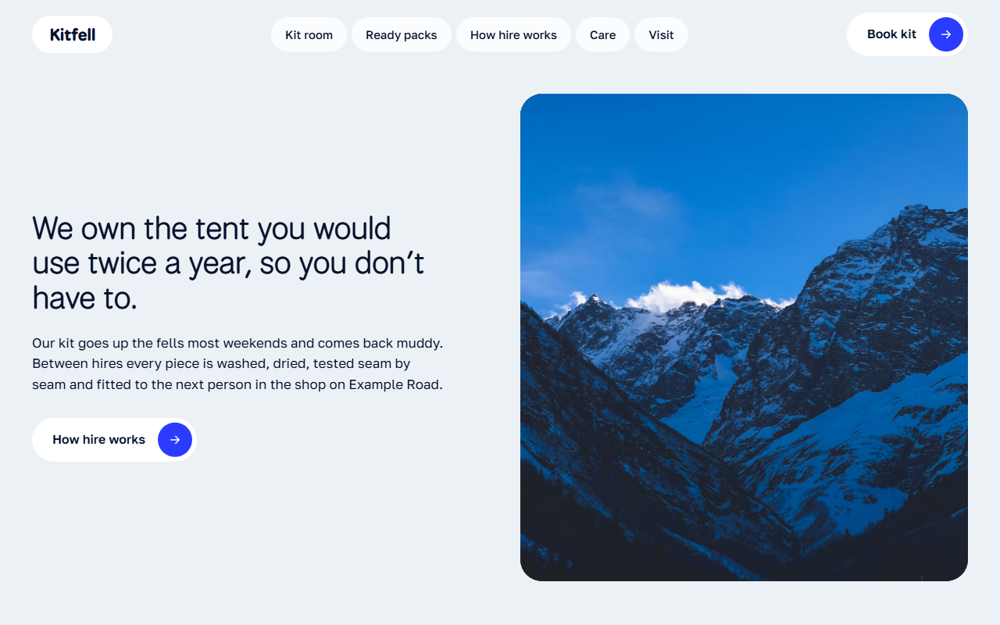
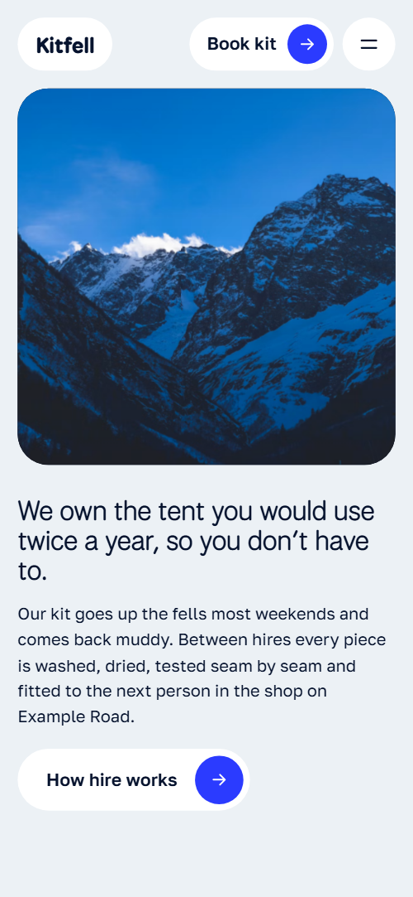
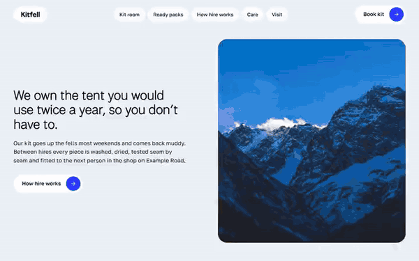

# Free HTML outdoor gear rental website template with scroll animations and no libraries

Outdoor gear rental website template: a free HTML file for a shop hiring out tents, packs and boots by the night. It has six priced kit shelves, four ready packs with a nights switch, a fitting section and a route table, on pale blue. Its scroll motion runs on CSS with no libraries; AGENTS.md guides Claude Code, Cursor or Codex.

[](LICENSE)  

**[Live demo](https://8bsite.github.io/outdoor-gear-rental-website-template/)** · **[Use this template](https://github.com/new?template_name=outdoor-gear-rental-website-template&template_owner=8bsite)** · **[Download ZIP](https://github.com/8bsite/outdoor-gear-rental-website-template/archive/refs/heads/main.zip)** · **[Template page on 8b.com](https://8b.com/templates/kitfell/)**

<a href="https://8bsite.github.io/outdoor-gear-rental-website-template/"></a> <a href="https://8bsite.github.io/outdoor-gear-rental-website-template/"></a>

<p align="center"><a href="https://8bsite.github.io/outdoor-gear-rental-website-template/"></a><br><sub>Scroll animation</sub></p>

## Use it with Claude Code, Cursor or Codex

Download the four files into your project folder (`curl.exe` in Windows PowerShell):

```bash
curl -LO https://raw.githubusercontent.com/8bsite/outdoor-gear-rental-website-template/main/index.html
curl -LO https://raw.githubusercontent.com/8bsite/outdoor-gear-rental-website-template/main/AGENTS.md
curl -LO https://raw.githubusercontent.com/8bsite/outdoor-gear-rental-website-template/main/LICENSE
curl -LO https://raw.githubusercontent.com/8bsite/outdoor-gear-rental-website-template/main/CREDITS.md
```

Then fill in the angle brackets and give your agent this prompt:

```text
Read AGENTS.md, then edit index.html. Make this the site for <my hire shop: name, town, shelves of kit with nightly prices, ready packs with prices for 2 nights, 3 nights and a week, hire terms, deposit and damage rules, delivery area, hours, phone, email, company number>. Motion is CSS scroll-driven animation plus the inline motion kit: keep the gate script, the classes and data-8b attributes AGENTS.md lists and each pack's three data-price values; add no library. Never invent prices, terms, routes, reviews or contacts; ask me.
```

As an outdoor gear rental website template for Claude Code, Cursor or Codex it starts with the facts only the shop has: shelf prices, pack contents, hire terms, delivery area and hours. If you vibe code the shop, note that the demo invents them all, with the Lake District routes, quotes and company number. Change each pack price in the visible text, its value attribute and its three data-price attributes, and keep the id on every kit card, because the shelf index is built from the card titles and ids.

No agent? Click **[Use this template](https://github.com/new?template_name=outdoor-gear-rental-website-template&template_owner=8bsite)**, edit `index.html` on GitHub and turn on **Settings > Pages**.

## Sections and motion

- **Navigation**: top bar with wordmark, five links and a Book kit button; on small screens a menu button opens a full-screen overlay. The bar slides up out of view when you scroll down and returns on scrolling up; this keeps working with reduced motion.
- **We own the tent you would use twice a year, so you don’t have to.**: a statement as the h1, a paragraph and a How hire works button on a pale ground beside a framed mountain photo. Smooth wheel scrolling throughout; on load the photo frame opens from a pill shaped slit to its rounded shape while the heading, text and button lift in, and the photo then drifts sideways in a slow loop.
- **Everything in the kit room, by the night.**: heading with a Reserve kit button beside six kit cards (tents, sleep, packs, cook, boots, shells) with an index of shelves. A sticky index of the six shelf names follows the card in the middle of the screen, and each card grows from tilted and dimmed to full size as it arrives.
- **Ready packs, so you only choose the weekend.**: ready packs with a nights switch: four cards with photo, five items, and a price that follows the choice of 2 nights, 3 nights or a week. The four pack cards travel from one tilted pile to their places as the grid rises, and the prices change when you pick 2 nights, 3 nights or a week.
- **How hire works**: four numbered hire steps: Book, Get fitted, Go, Bring it back muddy. The intro line fills word by word from grey to ink as you scroll, and each step title rises into view.
- **Fitted, not handed over.**: a held photo frame that swaps between three photos while three fitting stories scroll past. Three photos stack in one sticky frame and each wipes up over the last as its fitting story reaches the middle of the screen.
- **Between every hire, the same six checks.**: six care checks as a horizontal track of panels, each with a tick, a sentence and a photo. The section pins and the six check panels slide sideways, each tick swelling from a pale dot as its panel arrives.
- **A route card with every hire.**: a photo and a table of four walking routes with distance, ascent, time and grade. The photo opens from a pill shaped slit to its full rounded frame.
- **Where the kit went last month.**: a 3 by 3 grid of six customer photos and three quotes that zooms out from the centre photo. On wide screens the section pins and the grid shrinks from the centre photo until all nine cells show.
- **Questions people ask at the counter**: a heading with a photo beside six questions and answers in native &lt;details&gt; elements.
- **Come and get fitted.**: a village photo that widens to full width beside a card with shop address, hours, phone, email and buttons. Scrubbed with scroll, the village photo widens from a rounded window to full width while the details card stays still.
- **Footer**: route notes sign-up form, four links, a large wordmark and legal lines.

## Design

 page ground and the opening screen  
 text, the packs band, the footer and the full-screen menu  
 the only accent: button fills on hover, kit prices, the shelf index marker, focus outlines  
 background of the care section  
 kit cards and other surfaces, text on navy  
 descriptions under headings, table headings, detail labels and unselected shelf links  
 small text on navy: the packs intro and legend, field placeholders, the form message and the legal lines  
 round buttons, small badges, photo backing and link underlines

**National Park**: headings and the h1 at regular weight, card titles and pack prices at medium, the logo and the footer wordmark at 800. **Golos Text**: body text, labels, kit prices and form fields at regular and medium weights, buttons at semibold 600 (Google Fonts). Rounded cards and pill buttons carry the page: white kit cards with wide photos, round arrow buttons, a table of four routes and a three by three grid of trip photos and quotes. Headings are large and light, set in lines that rise into view. The ground alternates pale blue, a navy packs band, a light blue care band and a navy footer, so each stage of a hire has its own screen.

## Questions

**Does the Book kit button take bookings?**  
No. Every Book kit and Reserve kit button, and the arrow on each card, jumps to the visit card, and the Book by email button opens a mail draft. There is no calendar or payment. Point the buttons at your own booking page, or keep them as enquiry links.

**Does the route notes sign-up form send anything?**  
No. The form in the footer checks the email, shows a thank-you line and sends nothing. Connect Formspree or Netlify Forms with the steps in AGENTS.md, or delete the form and its script before publishing. In Base44, [rebuilding from the demo address](https://8b.com/templates/for-base44/) lets you add its own form instead.

**Does it need GSAP, and what shows in Firefox or with reduced motion?**  
No library: [its sliding check panels](https://8b.com/templates/animated/) and every other effect run on CSS scroll-driven animations and a short inline script, 28 KB gzipped against 75 KB. In Firefox the opening still plays, but the photo stops drifting, the shelf index is not built and sections show their finished layout. With reduced motion only the nav hiding and hover fills move.

## Is it the right base?

It suits a shop with a fixed price list, bundles and a hands-on fitting. This light build keeps the look and motion with no animation library or CDN script: about 28 KB of code gzipped, where the GSAP version needs 75 KB and four extra requests. A venue selling timed sessions and lessons, such as a [skating venue](https://8b.com/templates/spinway/), needs a different base. The weak spot is booking: Book kit jumps to the visit card, with no calendar of free dates.

## Before you publish

- Replace what is marked `data-8b-placeholder` (social preview image, favicon, phone, email, map, form, social) and the invented demo facts; [AGENTS.md](AGENTS.md) lists them.
- The form sends nothing yet: connect it to Formspree or Netlify Forms, or remove it.

## Tech

No JavaScript libraries: CSS scroll-driven animations and a small inline motion script with its own smooth wheel scrolling, 108 KB, no build step. Chrome and Edge 111+, Safari 16.2+, Firefox 121+ (it uses color-mix(), :has(), cascade layers, small/dynamic viewport units). Without scroll-driven animations (Firefox today) the scroll motion and the smooth wheel are off and each section shows its finished layout (a load-in or a loop may still play); with "reduce motion" on, the page is complete and nothing moves on its own (hover effects stay).

A GSAP build of the same page is [`index.gsap.html`](index.gsap.html): GSAP 3.13.0, ScrollTrigger, SplitText, Lenis 1.3.4 from jsDelivr, 99 KB; its scroll motion also plays in Firefox. Use one of the two files.

## License

MIT, see [LICENSE](LICENSE). Photos, fonts and libraries keep their own licences: [CREDITS.md](CREDITS.md). More free templates: [8b.com/templates](https://8b.com/templates/) · [github.com/8bsite](https://github.com/8bsite).
