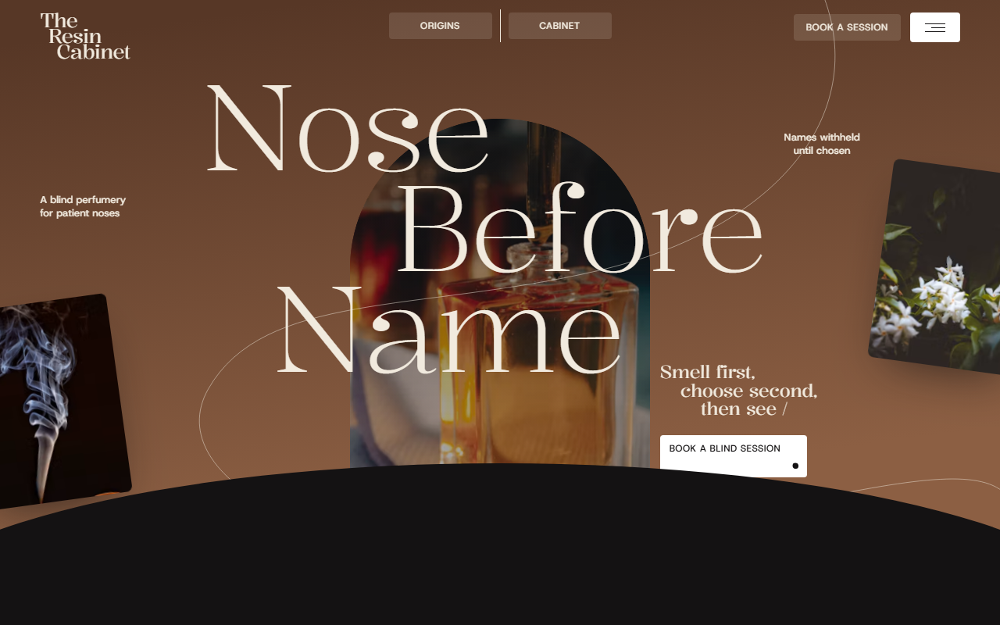
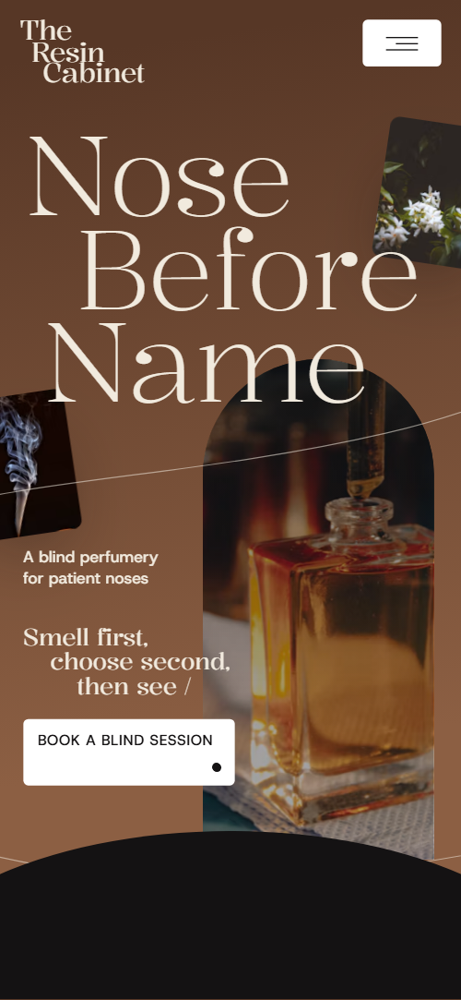
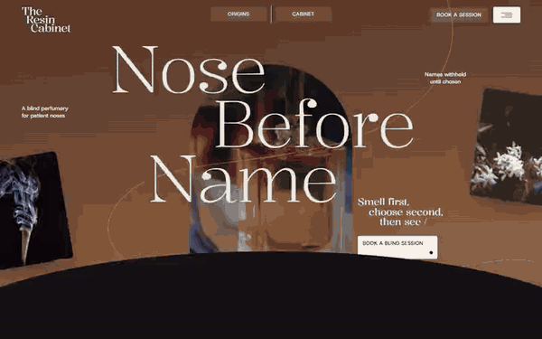

# Free HTML perfumery website template with GSAP scroll animations

This perfumery website template is one free HTML file for an independent perfumer who sells by appointment and by post. It has a blind-tasting opening, six harvest origins, four signature extraits with notes and prices, a six-vial sample set and a booking form, on a near-black ground with cream type. AGENTS.md lets an AI agent adapt it.

[](LICENSE)  

**[Live demo](https://8bsite.github.io/perfumery-website-template/)** · **[Use this template](https://github.com/new?template_name=perfumery-website-template&template_owner=8bsite)** · **[Download ZIP](https://github.com/8bsite/perfumery-website-template/archive/refs/heads/main.zip)** · **[Template page on 8b.com](https://8b.com/templates/resin-cabinet/)**

<a href="https://8bsite.github.io/perfumery-website-template/"></a> <a href="https://8bsite.github.io/perfumery-website-template/"></a>

<p align="center"><a href="https://8bsite.github.io/perfumery-website-template/"></a><br><sub>Scroll animation</sub></p>

## Use it with Claude Code, Cursor or Codex

Download the four files into your project folder (`curl.exe` in Windows PowerShell):

```bash
curl -LO https://raw.githubusercontent.com/8bsite/perfumery-website-template/main/index.html
curl -LO https://raw.githubusercontent.com/8bsite/perfumery-website-template/main/AGENTS.md
curl -LO https://raw.githubusercontent.com/8bsite/perfumery-website-template/main/LICENSE
curl -LO https://raw.githubusercontent.com/8bsite/perfumery-website-template/main/CREDITS.md
```

Then fill in the angle brackets and give your agent this prompt:

```text
Read AGENTS.md, then edit index.html. Make this the site for <my perfumery: name, address, how I sell (appointment, post), my signature scents with notes, sizes and prices, where each material is grown, who chooses the scents, session price, sample set price, shipping and returns, opening hours>. Replace first the name, the six origins, the four extrait cards and the three people. Keep the section ids, the classes AGENTS.md lists, six origin tiles, four cabinet cards and six vials. Ask for missing facts; never invent prices, hours, addresses or contacts.
```

A perfumery website template for Claude Code, Cursor or Codex needs you to hand the agent the facts only the perfumer has: extrait names, notes, sizes and prices, origins and seasons, session terms, batch status, shipping and returns. The demo invents all of them, along with the three people and the address. Update the Noses heading's --len whenever its text changes. Keep the section ids and the six, four and six counts of tiles, cards and vials.

No agent? Click **[Use this template](https://github.com/new?template_name=perfumery-website-template&template_owner=8bsite)**, edit `index.html` on GitHub and turn on **Settings > Pages**.

## Sections and motion

- **Navigation**: the name at the left, Origins, Cabinet and Book a session links and a menu button; a full-screen menu with five links, address and hours.
- **Nose Before Name**: a dark first screen with a split three-line heading, two floating photo cards, an arch window and a button; then a dome of ink rises over it with four numbered strips. On load the heading lines rise and the arch and two cards slide in, then the cards float and the arch photo pans slowly; on scroll the first screen stays pinned for about one screen while the heading parts, the cards fly up, an ink dome rises over it and four strips slide in from the centre.
- **Origins Before the Bottle**: six harvest photos in a grid; the stage opens on one filling the screen, which shrinks into its slot while the others fly in. Pinned for about 1.4 screens: the rose photo fills the stage, then shrinks into the middle slot while the other five tiles fly in from the edges of the stage, turning as they land.
- **No Window, No Sign**: a text about a room with no window or sign, a booking button and a photo of a curved bench of bottles. The heading lines rise from a mask and the tag lines settle in from the left on scroll; the amber thread line draws as the section passes.
- **The Cabinet**: four extraits dealt one by one out of a stack while the two title words part to the edges. Pinned for about 2.3 screens: the two title words start together and part to the edges while the four extrait cards are dealt one by one out of a stack, each turning flat as it lands.
- **The Accord**: one photo of resin on bark that splits down the middle and slides apart to frame a finished bottle. As the frame scrolls in, the resin photo splits down the middle and its two halves slide apart to frame the bottle photo, which settles from a zoomed-in size.
- **Now Resting**: three batches aging in the dark with their status and a thread line. The heading rises on scroll and a thread line draws behind the three batch rows.
- **Noses**: a giant word Noses, a lead and three portraits in arched windows. The huge word slides in from the right as you scroll, and each of the three portraits opens from a narrow arch to its full window while its photo zooms out.
- **Questions**: five questions as native &lt;details&gt; with a thread line. The heading rises, the tag line settles and a thread line draws; the five answers open as native details elements.
- **The Blind Set**: the sample set: six numbered vials seen through six round openings that widen into the whole photo. On scroll six round openings in the photo widen until the whole picture shows, while the numbered discs scale and turn into place.
- **Request a Blind Session**: a booking request form beside address, hours, phone and email, with a thread line. The two-line heading rises and the tag line settles in on scroll, and a white thread line draws behind the form.
- **Footer**: a one-line description, five links, copyright, address and email, with a thread line. Only the thread line draws, tied to scroll.

## Design

 near-black: page ground, nav bar once it turns solid, opening second screen, origins, noses and footer grounds, and the text colour on cream and white sections  
 warm cream: type on the dark sections, ground of shelf, accord, resting, questions and visit, the four tasting strips, the numbered vial discs and the hover fill of dark buttons  
 dark brown: top of the first screen's gradient, ground of the sample set section and backing of the portrait arches  
 mid brown: lower end of the first screen's gradient  
 white: ground of the cabinet section, the footer card, white buttons and the menu button, the disc behind the number on the shelf, and the thread line on the visit section  
 muted brown-grey: small print, batch numbers, notes labels, FAQ answers and form placeholders on the light sections  
 muted warm grey: secondary text on the dark sections, such as the origin places, the second heading half and the portrait bios  
 amber: the thread lines on the cream sections and footer card, and the ring around the number of scents on the shelf

**Kalnia**: serif for headings, tag lines, extrait names, the sample set price and form fields; weight 300 for the large display type, 400 for the smaller serif lines. **Host Grotesk**: sans for body text, small labels, captions and the extrait prices at 400 and 500, and uppercase 500 for the buttons and the status badges (Google Fonts). Display type is Kalnia, set large and light, with lines stepped to the right so each heading reads like a staircase. Dark sections (opening, origins, noses, footer, and the sample set on deep brown) alternate with cream or white ones (shelf, cabinet, accord, resting, questions, visit). Photos sit in arched windows, soft rectangles and a six-tile grid. Hairline amber thread lines wander behind the cream sections, and the footer is a white card on the dark ground.

## Questions

**Does the perfume website with notes show a full note pyramid?**  
Each of the four extrait cards lists notes in three rows, from the first impression to the base, with a number, a name and a 50 ml price. On phones the rows run together, separated by slashes. The scents, notes and prices are invented demo content that you replace with your own.

**Can it sell perfume online as a perfume ecommerce website template?**  
Not as shipped. There is no cart or payment. The Order the Blind Set button opens an email, and the booking form sends nothing. Point the button to your shop or checkout link, or connect a form service such as Formspree or Netlify Forms.

**Can I get a site like this without editing code?**  
Yes, in a different way. [8B's AI website builder](https://8b.com/) designs a new site from a sentence, in its own design rather than this one. Designing and restyling are free. Publishing with hosting and SSL, full HTML export and AI edits in chat are on Pro at $9 a month billed yearly. It also runs inside Claude and ChatGPT.

## Is it the right base?

This is a good base for a small shop with a few signature products and a dark, quiet page that tells a story. A jeweller or other maker working to commission may prefer the [goldsmith](https://8b.com/templates/oriel/) template. Two limits matter: the Order the Blind Set button only opens an email, so it is not a perfume store website template with a cart, and the form sends nothing until you connect a service. Without code, 8B's builder is an alternative.

## Before you publish

- Replace what is marked `data-8b-placeholder` (social preview image, favicon, email, form, phone) and the invented demo facts; [AGENTS.md](AGENTS.md) lists them.
- The form sends nothing yet: connect it to Formspree or Netlify Forms, or remove it.

## Tech

GSAP 3.13.0, ScrollTrigger, SplitText, Lenis 1.3.27 from jsDelivr, 100 KB, no build step. Chrome and Edge 111+, Safari 16.2+, Firefox 113+ (it uses color-mix(), cascade layers, small/dynamic viewport units). With "reduce motion" on, the page is complete and still.

## License

MIT, see [LICENSE](LICENSE). Photos, fonts and libraries keep their own licences: [CREDITS.md](CREDITS.md). More free templates: [8b.com/templates](https://8b.com/templates/) · [github.com/8bsite](https://github.com/8bsite).
