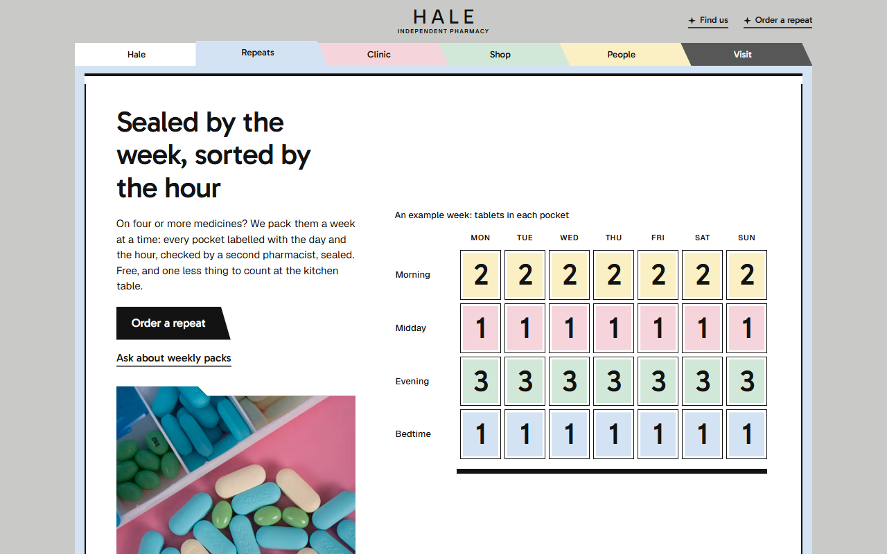
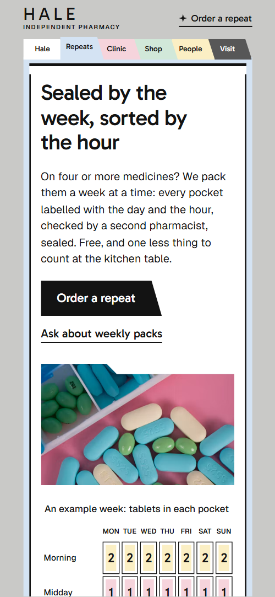
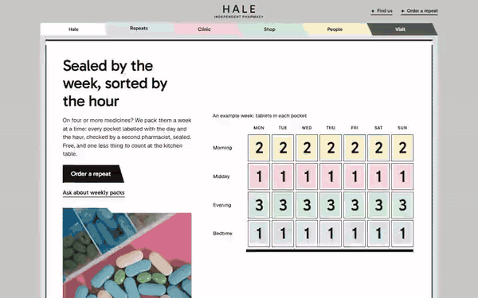

# Free HTML pharmacy website template with GSAP scroll animations

Pharmacy website template: one free HTML file for an independent chemist, with weekly packs, a walk-in clinic, a vaccination table, a four-shelf shop, a bike delivery round and a repeat form. Each part is a pastel paper folder on a grey ground, filed under a header tab. AGENTS.md is included, so Claude Code, Cursor or Codex can adapt it.

[](LICENSE)  

**[Live demo](https://8bsite.github.io/pharmacy-website-template/)** · **[Use this template](https://github.com/new?template_name=pharmacy-website-template&template_owner=8bsite)** · **[Download ZIP](https://github.com/8bsite/pharmacy-website-template/archive/refs/heads/main.zip)** · **[Template page on 8b.com](https://8b.com/templates/hale/)**

<a href="https://8bsite.github.io/pharmacy-website-template/"></a> <a href="https://8bsite.github.io/pharmacy-website-template/"></a>

<p align="center"><a href="https://8bsite.github.io/pharmacy-website-template/"></a><br><sub>Scroll animation</sub></p>

## Use it with Claude Code, Cursor or Codex

Download the four files into your project folder (`curl.exe` in Windows PowerShell):

```bash
curl -LO https://raw.githubusercontent.com/8bsite/pharmacy-website-template/main/index.html
curl -LO https://raw.githubusercontent.com/8bsite/pharmacy-website-template/main/AGENTS.md
curl -LO https://raw.githubusercontent.com/8bsite/pharmacy-website-template/main/LICENSE
curl -LO https://raw.githubusercontent.com/8bsite/pharmacy-website-template/main/CREDITS.md
```

Then fill in the angle brackets and give your agent this prompt:

```text
Read AGENTS.md, then edit index.html. Make this the site for <my pharmacy: name, town, address, services (repeats, packs, clinic, jabs, shop, delivery), hours, delivery days and stops, team, how people order a repeat>. Replace first the name, Leeds address, hours, delivery stops, people, and the clinic and jab rules. Keep the section ids, the data-tab and data-step numbers and the three portraits; set the footer wordmark's --len to the new name's length. Ask me for missing facts; never invent prices, eligibility rules, hours, registration numbers or contacts.
```

Give the agent the facts only the pharmacy has: name, address, hours, which conditions the clinic treats, who qualifies for each jab, delivery days and area, and the team. The demo invents all of them, NHS Pharmacy First wording included. Replace the pharmacy name, and set the footer wordmark's --len to match it. Vibe coding this in Claude Code is quick if the agent leaves the counts the animations are written for: four conditions with four photos, three people, and each shelf button tied to its panel by aria-controls.

No agent? Click **[Use this template](https://github.com/new?template_name=pharmacy-website-template&template_owner=8bsite)**, edit `index.html` on GitHub and turn on **Settings > Pages**.

## Sections and motion

- **Navigation**: fixed header: HALE wordmark with a caption, two quick links and a strip of six coloured file tabs that marks where you are. The tab of the section in view is raised as you scroll, and any tab rises on hover; both are CSS transitions that keep running with reduced motion.
- **Sealed by the week, sorted by the hour**: first screen: headline about weekly packs, a paragraph, a button, a link, a photo of pill boxes and an example week grid. On load the intro lifts into place, the bars draw and the week grid fades in, then a black seal bar runs down the grid once and each row of pockets fills as it passes.
- **Seen today in the room behind the counter, with no appointment**: folder with four photos that wipe over each other beside a column of four conditions, with a marker that steps down the list. Scrubbed with the scroll, a white marker steps down the four conditions and the matching photo wipes down over the one before.
- **Jabs by the season, given in the same room**: sheet with a photo and a table of four vaccines: who, when and a Book link. A thick bar draws along the sheet and the photo opens from its tab as they come into view.
- **The shop: four shelves chosen by our pharmacists**: four shelf rows, one open at a time, each with a photo, a list of three things and a link. As the section comes up the four rows deal down from a stacked pad, and pressing a row opens its panel and closes the others.
- **Delivered by bike, Tuesdays and Fridays**: delivery round: heading and paragraph, a route bar and five stops that slide sideways under the header. The stage is held under the header while the five stops slide sideways and the route bar fills, scrubbed with the scroll.
- **The people at the counter**: three portraits as slats that widen in turn beside three name cards (owner, clinic lead, counter). The three portrait slats widen in turn while the other two narrow, and the card beside each is ruled off with a bar.
- **Independent since 1987, and still nobody's branch**: the story of the shop as a letter with a photo of the shop dog. The photo opens from its tab and a bar draws along the letter.
- **Asked at the counter**: seven questions as native details elements, each with a coloured tab naming its part of the pharmacy. The decorative tabs slide from the left edge of their rows into place while the list scrolls in.
- **1 Example Street, Leeds LS0 0AA**: address, hours, phone, email and a shop-door photo beside the repeat order form. The photo opens from its tab and a bar draws along the repeat form.
- **Footer**: footer with a large HALE wordmark, shop name and address, phone, five links, email and a legal line.

## Design

 grey page ground and header bar, empty photo frames, the Visit tab of the questions  
 white sheets, the first header tab, question cards, text on the dark folders  
 text, black bars and rules, table lines, the seal bar and the route fill  
 pale blue: weekly packs folder, bedtime row, form fields, default button fill, Repeats tab  
 pink: clinic and vaccination folders, midday row, Clinic tab  
 green: shop and delivery folders, evening row, the thank-you line, Shop tab  
 yellow: people and story folders, morning row, the form button, People tab  
 dark grey: questions and contact folders, the Visit tab in the header

**Gabarito**: headings, the big Walk in line, numbers in the pack grid and condition names at weight 500, links, and the wordmark at weight 400. **Geist**: body text, captions, table labels, small uppercase labels and form fields at weights 400 to 600 (Google Fonts). Every part is a pastel paper folder; the clinic, shop, people and questions folders carry a slanted tab on top, set at their position in the six-tab strip of the fixed header. Sheets carry heavy black bars top and bottom, photos have a notched top edge, and tables use thick ruled lines. Clinic, people, story and contact split into two columns. The name sits in wide-spaced capitals in the header and as the huge footer line.

## Questions

**Does the repeat form send anything?**  
No. The script checks the fields, shows a thank-you line and clears the form; nothing leaves the page. Connect Formspree, Netlify Forms or your own secure endpoint and add a privacy notice, because the form asks for name, date of birth, phone and medicines, which is health data.

**How to create a pharmacy website like this without editing code?**  
Use [8B's AI website builder](https://8b.com/). You describe the site in a sentence and it designs a new one, not this template. Designing and restyling are free; publishing with hosting and SSL, full HTML export and AI edits in chat are on Pro at $9 a month billed yearly. It also runs inside Claude and ChatGPT.

**Can a US or Canadian pharmacy use it?**  
Yes, after a text pass. The layout suits any counter-based practice, but the demo is British: pounds, NHS Pharmacy First, a Leeds address and a 0113 phone number. Replace those, and the eligibility lines for the flu and Covid jabs, with your own region's rules.

## Is it the right base?

If you are comparing templates for pharmacy sites, this is the right base when one counter offers several services and you want each filed as its own part of a single page. A business that sells timed classes, like a [class studio](https://8b.com/templates/hundred/), needs a different page shape. The weak spot is health data: the form sends nothing and asks for a date of birth. A no-code route exists too: 8B's builder designs a site from a sentence.

## Before you publish

- Replace what is marked `data-8b-placeholder` (social preview image, favicon, phone, email, form) and the invented demo facts; [AGENTS.md](AGENTS.md) lists them.
- The form sends nothing yet: connect it to Formspree or Netlify Forms, or remove it.

## Tech

GSAP 3.13.0, ScrollTrigger, Lenis 1.3.27 from jsDelivr, 84 KB, no build step. Chrome and Edge 111+, Safari 16.2+, Firefox 113+ (it uses color-mix(), cascade layers, small/dynamic viewport units). With "reduce motion" on, the page is complete and still.

## License

MIT, see [LICENSE](LICENSE). Photos, fonts and libraries keep their own licences: [CREDITS.md](CREDITS.md). More free templates: [8b.com/templates](https://8b.com/templates/) · [github.com/8bsite](https://github.com/8bsite).
