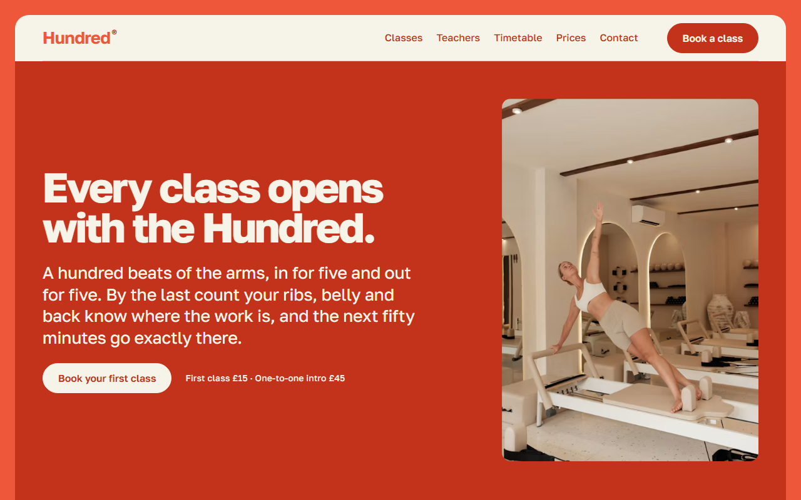
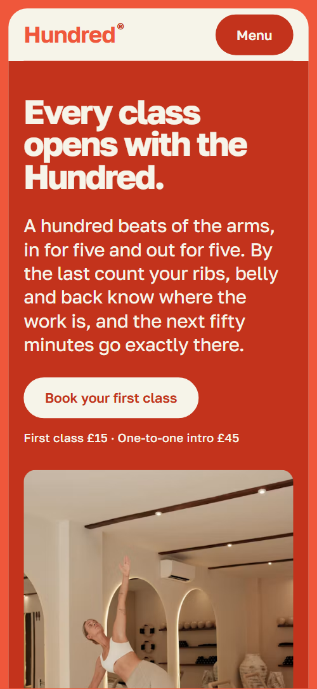
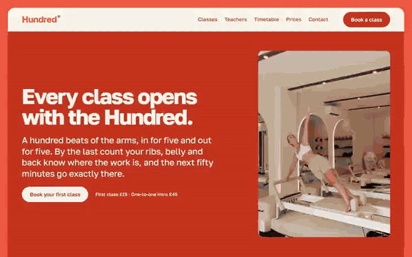

# Free HTML pilates studio website template with scroll animations and no libraries

Pilates studio website template: a free one-page HTML site for a reformer studio, with four class formats, a fifty-minute class plan, teacher cards, a seven-day timetable, three prices and a form. Coral headings and deep coral panels sit on a cream sheet in a coral frame. Scroll motion is plain CSS, no libraries, in one index.html of 22 KB gzipped.

[](LICENSE)  

**[Live demo](https://8bsite.github.io/pilates-studio-website-template/)** · **[Use this template](https://github.com/new?template_name=pilates-studio-website-template&template_owner=8bsite)** · **[Download ZIP](https://github.com/8bsite/pilates-studio-website-template/archive/refs/heads/main.zip)** · **[Template page on 8b.com](https://8b.com/templates/hundred/)**

<a href="https://8bsite.github.io/pilates-studio-website-template/"></a> <a href="https://8bsite.github.io/pilates-studio-website-template/"></a>

<p align="center"><a href="https://8bsite.github.io/pilates-studio-website-template/"></a><br><sub>Scroll animation</sub></p>

## Use it with Claude Code, Cursor or Codex

Download the four files into your project folder (`curl.exe` in Windows PowerShell):

```bash
curl -LO https://raw.githubusercontent.com/8bsite/pilates-studio-website-template/main/index.html
curl -LO https://raw.githubusercontent.com/8bsite/pilates-studio-website-template/main/AGENTS.md
curl -LO https://raw.githubusercontent.com/8bsite/pilates-studio-website-template/main/LICENSE
curl -LO https://raw.githubusercontent.com/8bsite/pilates-studio-website-template/main/CREDITS.md
```

Then fill in the angle brackets and give your agent this prompt:

```text
Read AGENTS.md, then edit index.html. Adapt it to <my studio: name, address, class formats, teachers, timetable, prices, booking terms, hours, contacts>. The opening heading, lead and first class plan block name a Pilates warm-up sharing the demo's name: keep or rewrite them on purpose. Motion is CSS scroll-driven animation plus the inline motion kit: keep the gate script, data-8b attributes, the first rail's is-on and each class plan block's data-from and data-to; add no animation library. Never invent prices, hours, training, health claims or contacts; ask me.
```

When vibe coding this pilates studio website template for Claude Code, start with the four formats, the teachers, the 24 timetable chips, the three prices and the form's class menu, which repeats the format names. Filled chips (m-surface-2) mark Reformer classes, as the line above the week says: change both together. Keep the section ids, the classes AGENTS.md lists and the data-from and data-to that time each class plan block's fill. Teacher training, cancelling rules and promises about backs, pregnancy or bone strength must come from the owner.

No agent? Click **[Use this template](https://github.com/new?template_name=pilates-studio-website-template&template_owner=8bsite)**, edit `index.html` on GitHub and turn on **Settings > Pages**.

## Sections and motion

- **Navigation**: cream top bar inside the coral frame: wordmark, five section links, Book a class button; hides on scroll down; full-screen menu on phones. The bar slides up out of view while you scroll down and comes back on the way up or when a link in it gets focus, and mouse wheel scrolling is smoothed page-wide.
- **Every class opens with the Hundred.**: deep coral first screen: large heading, a lead paragraph, a booking button with the first-class prices, and a tall reformer photo. On load the heading, the lead and the button row rise 26 px into place with a fade, a beat apart, and the tall photo opens from a thin band across its middle to full height.
- **Four ways onto the apparatus**: four class formats as full-width rounded rails: big name, description, length, level and class size, and a photo (demo: Reformer, Tower, Mat, Ring). A deep coral carriage the size of one rail travels down the four rails with the scroll, resting on whichever rail is at the middle of the screen and turning its text cream.
- **Six rules we teach by**: six teaching rules as one large paragraph, each rule's name a coral lead-in. The heading and the paragraph of six rules rise and fade in as they reach the screen.
- **Fifty minutes, in order**: one class in order: six blocks on a held track under a minute rail from 0 to 50 (demo: warm-up, legs, arms, centre, length, release). Held on screen while you scroll: the six blocks travel sideways under a minute rail whose dot and fill run from 0 to 50, and the block holding the dot's minute fills deep coral.
- **Teachers who watch**: four teacher cards: name, the glyph of their class, portrait, role and a two-line bio. The heading and paragraph rise in, then the four cards slide in from the right a beat apart.
- **Who walks in on a Monday**: who the classes are for: four tall portrait frames with a heading and one line each (demo: runners, pregnancy, desk backs, over sixty). Tied to the scroll, each tall frame opens from a band across its middle to full height, one after another from left to right, its heading and line riding the frame's edges; on phones each item opens on its own as it arrives.
- **One room on Example Street**: the room: heading, a paragraph, four facts and two lanes of studio photos. The two photo lanes start pushed to opposite sides, the first to the right and the second to the left, and slide into line as you scroll to them.
- **This week on the floor**: a week of classes in seven day columns, Reformer slots filled coral, with a booking button. The heading and the booking line rise in, then the seven day columns slide in from the right, a beat apart on wide screens.
- **Three ways to pay**: three price cards, the middle one filled, each with a price, terms, a line and a button (demo: first class, ten classes, unlimited). The three cards start lower by different amounts and settle into one straight line as the section scrolls in, or come in from alternate sides on phones.
- **Come in for a first class**: contact details (address, hours, phone, email; placeholders) beside a short first-class form. The heading, the paragraph, the details and the form rise and fade in as they arrive.
- **Footer**: deep coral panel: wordmark, tagline, address, phone, email, Instagram, page links, copyright with the Design: 8B credit.

## Design

 cream sheet under the page, the fixed bar and the phone menu; text on deep coral; the cream buttons in the opening and on the middle price card  
 bright coral frame round the sheet; section headings, class, plan, teacher and day names, prices; card outlines, glyphs, hairlines and form underlines  
 deep coral opening and footer panels, the carriage and every filled card or chip, buttons, links, rule lead-ins, meta lines, form labels, the minute rail's dot and fill  
 warm grey body text, the six rules paragraph, the address and hours in contact, and typed form text

**Golos Text**: the only typeface, a variable font from weight 400 to 800: 760 to 800 headings, class names and prices with tight negative letter spacing; 700 card titles and day labels; 600 buttons, form labels and coral lead-ins; 400 to 500 body, lead and small meta text (Google Fonts). A bright coral frame runs round one cream sheet, topped by the fixed cream bar; the footer is a deep coral panel below it. Most sections pair a heading on the left with a short paragraph on the right, and hairlines divide several. Outlined or filled cards with 14 px corners hold the class rails, class plan blocks, teachers, timetable chips and prices. Four glyphs, one per class format, mark the teacher cards and two class plan blocks.

## Questions

**Does it work as a yoga studio website template?**  
Yes, after a copy pass. Websites for yoga studios need what this page already has: class styles with levels, teachers, a week of times and passes. Rename the four rails and the form's class menu, replace the apparatus photos and the class plan blocks, and rewrite the line that says filled slots are Reformer classes.

**Should I give the agent the demo link or the files?**  
The files. Run the four curl lines in your project folder, open it in Claude Code or Cursor and paste the prompt above with the angle brackets filled in. Lovable, v0 or Bolt build their own code, so paste the Pilates studio website design prompt below into them. A demo link reaches the agent only as a summary.

**Can I get a Pilates studio site without editing any code?**  
Yes, with [8B's AI website builder](https://8b.com/): describe your studio in a sentence and its engine designs a new site, not this template. Designing and restyling are free. Publishing with hosting and SSL, full HTML export and AI edits in chat are on Pro, $9 a month billed yearly. It also runs inside Claude and ChatGPT through the 8B connector.

## Is it the right base?

Choose it when a studio sells small classes by the place and wants beginners to see a whole class first. It is a narrow fitness studio website template: a gym with coached blocks fits the [training club](https://8b.com/templates/arcline/) template, a wellness studio website with treatments needs other sections, and two corals are loud for quiet yoga web design. This build loads no animation library: about 22 KB of code gzipped against 68 KB for the GSAP one. Booking is the weak spot: the form sends nothing.

## Before you publish

- Replace what is marked `data-8b-placeholder` (social preview image, favicon, phone, email, form, social) and the invented demo facts; [AGENTS.md](AGENTS.md) lists them.
- The form sends nothing yet: connect it to Formspree or Netlify Forms, or remove it.

## Tech

No JavaScript libraries: CSS scroll-driven animations and a small inline motion script with its own smooth wheel scrolling, 86 KB, no build step. Chrome and Edge 111+, Safari 16.2+, Firefox 113+ (it uses color-mix(), cascade layers, small/dynamic viewport units). Without scroll-driven animations (Firefox today) the scroll motion and the smooth wheel are off and each section shows its finished layout (a load-in or a loop may still play); with "reduce motion" on, the page is complete and nothing moves on its own (hover effects stay).

A GSAP build of the same page is [`index.gsap.html`](index.gsap.html): GSAP 3.13.0, ScrollTrigger, Lenis 1.3.4 from jsDelivr, 84 KB; its scroll motion also plays in Firefox. Use one of the two files.

## License

MIT, see [LICENSE](LICENSE). Photos, fonts and libraries keep their own licences: [CREDITS.md](CREDITS.md). More free templates: [8b.com/templates](https://8b.com/templates/) · [github.com/8bsite](https://github.com/8bsite).
