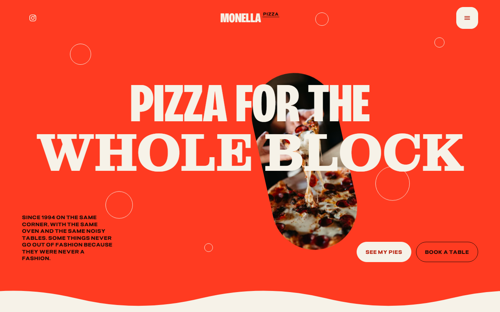
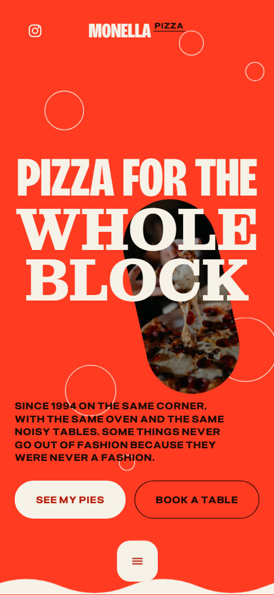
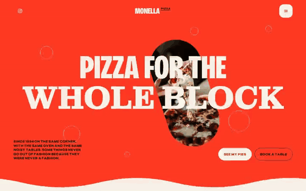

# Free HTML pizzeria website template with GSAP scroll animations

Pizzeria website template: one free HTML file for a neighbourhood pizzeria with a slice window, four priced pies, the dough told in five steps, weekly nights and a table request form. The look is tomato red and cream with wavy section edges and loud type. AGENTS.md is included, so Claude Code, Cursor or Codex can adapt it.

[](LICENSE)  

**[Live demo](https://8bsite.github.io/pizzeria-website-template/)** · **[Use this template](https://github.com/new?template_name=pizzeria-website-template&template_owner=8bsite)** · **[Download ZIP](https://github.com/8bsite/pizzeria-website-template/archive/refs/heads/main.zip)** · **[Template page on 8b.com](https://8b.com/templates/monella/)**

<a href="https://8bsite.github.io/pizzeria-website-template/"></a> <a href="https://8bsite.github.io/pizzeria-website-template/"></a>

<p align="center"><a href="https://8bsite.github.io/pizzeria-website-template/"></a><br><sub>Scroll animation</sub></p>

## Use it with Claude Code, Cursor or Codex

Download the four files into your project folder (`curl.exe` in Windows PowerShell):

```bash
curl -LO https://raw.githubusercontent.com/8bsite/pizzeria-website-template/main/index.html
curl -LO https://raw.githubusercontent.com/8bsite/pizzeria-website-template/main/AGENTS.md
curl -LO https://raw.githubusercontent.com/8bsite/pizzeria-website-template/main/LICENSE
curl -LO https://raw.githubusercontent.com/8bsite/pizzeria-website-template/main/CREDITS.md
```

Then fill in the angle brackets and give your agent this prompt:

```text
Read AGENTS.md, then edit index.html. Make this the site for <my pizzeria: name, address, year founded, pies with prices, slice window list, opening hours, delivery area, group booking rule, weekly nights, regulars, phone, email, how people book>. Replace first the name in every letter case, the pound prices, the founding story, the four regulars and their quotes. Keep the ids, the classes AGENTS.md lists, one dough photo per step and each --len matching its text. Ask me for missing facts; never invent prices, hours, addresses, allergens, reviews or contacts.
```

Vibe coding with Claude Code, Cursor or Codex goes fastest when the agent gets the facts only the shop has: pie names and prices, the slice list, hours, address, founding year, delivery area and group rules. It then replaces the name in every letter case, the invented regulars and quotes, and the pound prices. Leave the ids and the classes AGENTS.md lists alone, and set each big line's --len to its new character count.

No agent? Click **[Use this template](https://github.com/new?template_name=pizzeria-website-template&template_owner=8bsite)**, edit `index.html` on GitHub and turn on **Settings > Pages**.

## Sections and motion

- **Navigation**: an Instagram round button, the name Monella pizza and a round menu button; a full-screen menu with six links, address, phone and email. The bar slides away on a scroll down and returns on a scroll up, and the logo and round buttons change colour to stay readable over red and cream bands.
- **Pizza for the Whole block**: a red first screen with a two-part heading, a pill photo and rings, then a cream screen with a circular photo window and a first-person statement. On load the heading lines rise and the pill photo swings in and bobs; on scroll the two lines slide apart, the pill tips over, the wavy edge swells and a round window opens onto hands reaching for slices.
- **I take my time**: five steps of the dough held in one tilted frame, each next photo wiping up over the last as the step names light up. Pinned for about three screens: the framed photo swings through 13 degrees, each next photo wipes up over the last and step names 2 to 5 turn from dark to cream.
- **The house rule**: the house rule: a huge slab line that enters at nearly three times its size and shrinks to fit, beside a pill photo. Pinned for a little over two screens: on wider screens the line enters from the right at 2.8 times its size and shrinks into place, while on phones its three words slide in from alternating sides.
- **My pies**: four pies dealt out of a pile, each with a photo, a description, a tag and a price. On wider screens the four cards start fanned in a pile in the middle and slide out to their places; on phones each slides in from alternating sides.
- **The little slice window**: a photo of trays and a price list for the slice window. The wavy edge grows as it arrives, two rings float up, the pill photo swings into its slight tilt and the heading's raised word pops up.
- **My people**: four regulars as portraits with a short quote each. Each portrait climbs into the row from its own depth, the far ones further, and each outline ring springs to size.
- **Every single week**: three weekly nights with a day, a time and a photo. Each night's photo floats up into place and the heading's raised word pops up.
- **Find me**: a giant 14 circled by an ellipse that closes in, with a photo, the address, hours, directions and phone. An outlined ellipse starts oversized and turned, then shrinks and untwists while its stroke draws round the number 14, and the neon photo rises from below.
- **Asked at the counter**: five questions as native &lt;details&gt;. The wavy edge grows and the heading's raised word pops up; each question's plus turns to a cross when it opens.
- **What brings you here?**: a request form with a reason select and a round send button ringed by ripples. Six rings drift in from scattered positions and settle as ripples round the round send button.
- **Footer**: visit, hours, page links and contacts above a huge wordmark with a bar and rings. The wordmark rises from under the bottom edge and tips into its 6 degree slant, the bar draws across beneath it and five rings climb into place.

## Design

 page background and the grounds of the first screen, dough, house rule, slice window, nights, questions and footer; heading colour on cream bands; one pie card, the send button and the street number  
 cream grounds of the second opening screen, pies, people, find me, contact and the menu overlay; large heading text on red bands; the light button fill and the footer wordmark  
 body text, logo and raised words on cream bands, the ellipse drawn round 14 and the text of the light button  
 body text, rules, button ink and raised-word underlines on red bands, and the backing of the capsule photos  
 background of the first pie card  
 background of the second pie card  
 background of the third pie card, with cream text

**Bricolage Grotesque**: weight 800 in a condensed width, all caps: section headings, pie and step names, the statement lines, the logo and the question rows. **Montagu Slab**: weight 700, all caps: the second line of the main heading, the house rule line, the day names, the street number and the footer wordmark. **Pliant**: wide variable sans: body text at weight 400, prices, labels and buttons in bold tracked caps, and form fields at weight 400 (Google Fonts). Full-width bands alternate tomato red and cream, and ten wavy edges join the bands, each in the colour of the band below. Headings are huge condensed caps with a heavy slab serif for the biggest words. Photos are capsules, circles ringed in outline, and arch-topped pie cards in four colours. Prices, nights and opening hours sit as ruled rows, with Tue, Thu and Sun and the street number 14 set giant.

## Questions

**Does the table request form send bookings?**  
No. The form checks for a name and a phone or email, shows a thank-you line and clears itself; nothing is sent, and nothing checks for a free table. Connect Formspree or Netlify Forms using AGENTS.md, point the Book a table buttons at OpenTable or Resy, or keep the phone.

**Can it work as a restaurant website template with online ordering?**  
Not as shipped. There is no cart, payment or menu data: the pies are plain text with prices. The Call to order button is a phone link, which you can point at your own ordering or delivery page, and an ordering widget would be a developer's or agent's addition.

**What has to stay the same when I edit it?**  
Keep every id, the data-8b-section, data-8b-motion and data-8b-part attributes, the classes AGENTS.md lists, one dough photo per step and a --len equal to each big line's length. Keep the header comment and the 8B meta tag in the head. Keep the Design: 8B footer link unless the site owner asks to remove it.

## Is it the right base?

This pizza website design suits a pizzeria or family restaurant that wants to sound like its owner: loud, warm and first person. A [brasserie or bistro](https://8b.com/templates/ombrelle/) with a long menu and service times fits a different template better. The weak spots are ordering and booking: Call to order is a phone link, and the form sends nothing until connected. Owners who would rather not edit code can describe the site to 8B's AI website builder instead.

## Before you publish

- Replace what is marked `data-8b-placeholder` (social preview image, favicon, social, phone, email, map, form) and the invented demo facts; [AGENTS.md](AGENTS.md) lists them.
- The form sends nothing yet: connect it to Formspree or Netlify Forms, or remove it.

## Tech

GSAP 3.13.0, ScrollTrigger, Lenis 1.3.27 from jsDelivr, 97 KB, no build step. Chrome and Edge 108+, Safari 15.4+, Firefox 101+ (it uses cascade layers, small/dynamic viewport units). With "reduce motion" on, the page is complete and still.

## License

MIT, see [LICENSE](LICENSE). Photos, fonts and libraries keep their own licences: [CREDITS.md](CREDITS.md). More free templates: [8b.com/templates](https://8b.com/templates/) · [github.com/8bsite](https://github.com/8bsite).
