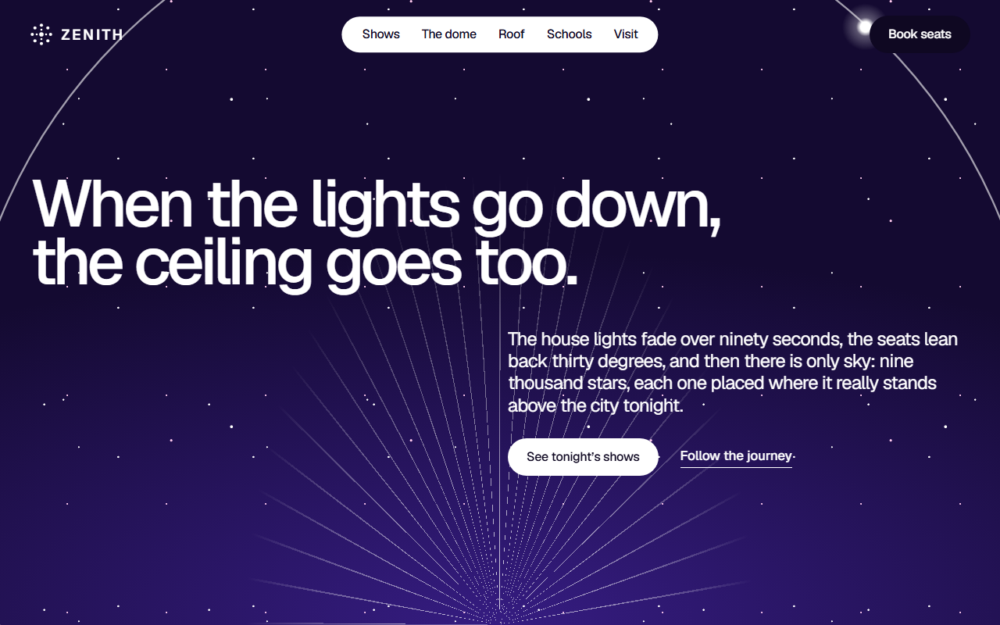
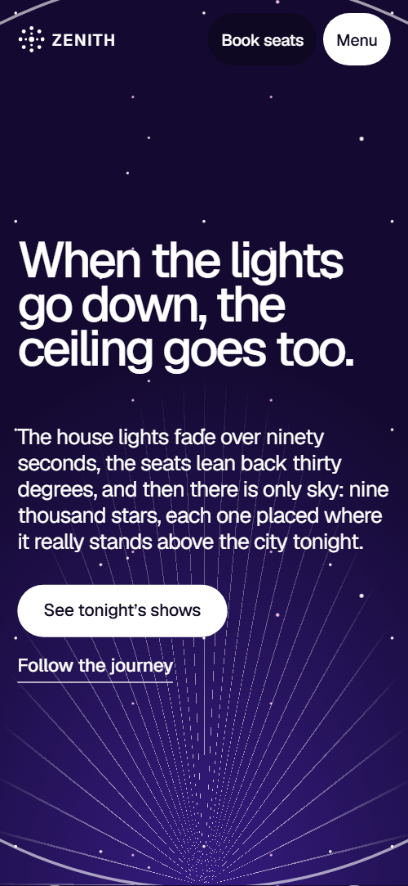
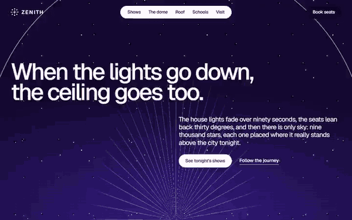

# Free HTML planetarium website template with scroll animations and no libraries

Planetarium website template: one free HTML file for a dome or observatory that runs timed, live-narrated shows. It has a sideways space journey, shows with time buttons, a rooftop telescope, school trips, late events and a box-office form, on night violet with orange and magenta. Scroll motion is plain CSS, no libraries; AGENTS.md serves Claude Code, Cursor or Codex.

[](LICENSE)  

**[Live demo](https://8bsite.github.io/planetarium-website-template/)** · **[Use this template](https://github.com/new?template_name=planetarium-website-template&template_owner=8bsite)** · **[Download ZIP](https://github.com/8bsite/planetarium-website-template/archive/refs/heads/main.zip)** · **[Template page on 8b.com](https://8b.com/templates/zenith/)**

<a href="https://8bsite.github.io/planetarium-website-template/"></a> <a href="https://8bsite.github.io/planetarium-website-template/"></a>

<p align="center"><a href="https://8bsite.github.io/planetarium-website-template/"></a><br><sub>Scroll animation</sub></p>

## Use it with Claude Code, Cursor or Codex

Download the four files into your project folder (`curl.exe` in Windows PowerShell):

```bash
curl -LO https://raw.githubusercontent.com/8bsite/planetarium-website-template/main/index.html
curl -LO https://raw.githubusercontent.com/8bsite/planetarium-website-template/main/AGENTS.md
curl -LO https://raw.githubusercontent.com/8bsite/planetarium-website-template/main/LICENSE
curl -LO https://raw.githubusercontent.com/8bsite/planetarium-website-template/main/CREDITS.md
```

Then fill in the angle brackets and give your agent this prompt:

```text
Read AGENTS.md, then edit index.html. Make this the site for <my venue: name, address, what I show or teach, the programme with lengths, ages, times and prices, dome or telescope figures, astronomers, events, school offer, opening hours and how people book>. Replace first the venue name, the five shows, the journey stops, the astronomers and the prices. Keep the section ids, the gate script, the classes AGENTS.md lists and the footer wordmark's len; add no animation library. Never invent prices, times, figures, names, dates or contacts; ask me.
```

Replace the venue name first, in any letter case, then the dome figures, show names, lengths, ages, times and prices, which the demo invents. Ask the owner for opening hours, astronomers, school rates, event dates and the telescope policy. Keep the section ids, the data-8b-section, data-8b-motion and data-8b-part attributes and the classes AGENTS.md lists, and set the footer wordmark's --len to the new name's length. As a planetarium website template for Claude Code or Cursor, vibe coding goes fastest when these facts arrive in one message.

No agent? Click **[Use this template](https://github.com/new?template_name=planetarium-website-template&template_owner=8bsite)**, edit `index.html` on GitHub and turn on **Settings > Pages**.

## Sections and motion

- **Navigation**: round mark and wordmark top-left, five links, a Book seats button and a Menu button that opens a full-screen overlay. The bar slides up out of view while you scroll down and returns when you scroll up; the phone menu is a full-screen overlay.
- **When the lights go down, the ceiling goes too.**: a night field with a thin ring, rays and a small glowing dot orbiting it behind one big statement, a paragraph and two actions. On load the statement rises in and the paragraph and buttons lift in a beat later, while a dot circles the ring in a 42 second loop that pauses off screen.
- **Outward**: a held section where five space stops slide sideways as a road, with a glowing runner on a progress line. Held on screen while the strip of five stops slides sideways, each photo drifting into its frame and a glowing runner travelling along the progress line.
- **A ceiling that isn’t there**: the dome in words: a porthole of star trails that turns and widens to fill the screen behind a heading split over a grid. A small circle of star-trail photo rotates from minus 80 degrees to level and opens to fill the screen over about 1.3 screens of held scroll, as a ring grows and fades.
- **This season’s shows**: five shows as rows with a colour band, description, length and age, and time buttons. The heading words gather toward the middle and move out to place as you scroll, the intro sharpens in once, and each row's rule draws across once.
- **“Nothing here is recorded. Ask the sky anything.”**: a large quote in scattered words over a presenter photo, with a line about the astronomers. The quote words start packed toward the middle and spread out to place while the presenter photo drifts in from the side and fades up, losing a blur on large screens.
- **When it’s clear, the roof opens**: two panels carrying halves of the heading part like a sliding roof to reveal a telescope photo. The two panels start closed over the telescope photo and slide apart, sideways on wide screens and vertically on phones, as the section arrives.
- **School trips to the edge**: a photo of pupils and the school offer in three age stages on a line. The heading words spread, the intro and the photo fade in once, and the thin vertical line beside the stages appears.
- **After dark**: four late events with dates, photos and prices, settling onto one line. The four events start scattered at different heights and slightly tilted, then settle onto a line that draws out across the page; on phones they slide in from alternate sides beside a vertical line.
- **Before you lie back**: five questions and answers (native details). The heading words spread and a rule draws above each question; opening one turns its plus sign through 45 degrees.
- **Come and lie down**: a heading in a closing ring that lifts out of the night, four details and a message form. A night layer fades out while the ring closes from far outside the screen back around the heading.
- **Footer**: the wordmark across the width, four link columns and a legal line. The wordmark across the width sharpens in once from a blur on large hover screens.

## Design

 flat orange ground of the shows section and the footer, and the warm end of the contact gradient  
 main night ground: body, first screen, journey, nights, the logo's pill once you scroll and the start of the live and contact gradients  
 blue-violet ground of the dome and schools sections and of the full-screen phone menu  
 magenta: the roof's right panel, the journey runner, the event dots, text selection and the glow in the live and contact gradients  
 type on dark grounds, the white nav pill, filled buttons, the question section ground and the stars  
 type on orange, white and magenta grounds, button text, dark buttons and the rules in the shows list and questions  
 pale pink for captions, stop distances, event dates and meta lines, contact labels and the thank-you line  
 rust: the roof's left panel and the colour bands of the first and fifth shows

**Geist**: the only typeface, weights 300 to 600: medium-weight headings with tight negative tracking, light numerals and dates, regular body text, medium buttons and a semibold uppercase wordmark in the bar (Google Fonts). Twelve-column grids carry most sections, and several headings are split into words or halves that sit apart, in opposite corners of the dome, either side of the roof photo, staggered over the questions. The first screen is one large statement on a night field with a ring and a fan of rays. A held strip of five stops, a five-column show list, a three-part roof frame and a four-event line follow. Hairline rules separate rows.

## Questions

**Where does the box-office form send its messages?**  
Nowhere yet. Name, email and message are all required, and a valid submit clears the form and shows a thank-you line without sending anything. Connect Formspree or Netlify Forms with the steps in AGENTS.md, or delete the form and keep the email link. Edit the thank-you line, which promises an answer within a day.

**Can I get a site like this without editing code?**  
Yes, with a different tool. [8B's AI website builder](https://8b.com/) designs a new site from a one-sentence description, in its own design, not this template. Designing and restyling are free; hosting with SSL, full HTML export and AI edits in chat are on Pro at $9 a month billed yearly. It also runs inside Claude and ChatGPT through the 8B connector.

**What happens with reduced motion, in Firefox or without scripts?**  
The motion is CSS scroll-driven animation, so in Firefox today and with reduced motion the scroll effects, the ring's circling dot and the smooth wheel are off: the journey shows five stops as a grid and nothing is held. Firefox still plays the load-in; the bar's hide on scroll and hovers run in both. Without JavaScript the Menu cannot open.

## Is it the right base?

Choose this when the venue sells timed sessions and wants one scroll that explains the room, the shows and the visit. A [museum with a permanent collection](https://8b.com/templates/wrenfield/) fits better when objects are the product. This light build keeps the look and motion with no script from a CDN: about 25 KB of code gzipped in one file, where the GSAP version needs 70 KB and three more requests. The weak spot is booking: every time button jumps to the form, which sends nothing.

## Before you publish

- Replace what is marked `data-8b-placeholder` (social preview image, favicon, phone, email, form, social) and the invented demo facts; [AGENTS.md](AGENTS.md) lists them.
- The form sends nothing yet: connect it to Formspree or Netlify Forms, or remove it.

## Tech

No JavaScript libraries: CSS scroll-driven animations and a small inline motion script with its own smooth wheel scrolling, 97 KB, no build step. Chrome and Edge 111+, Safari 16.2+, Firefox 113+ (it uses color-mix(), cascade layers, small/dynamic viewport units). Without scroll-driven animations (Firefox today) the scroll motion and the smooth wheel are off and each section shows its finished layout (a load-in or a loop may still play); with "reduce motion" on, the page is complete and nothing moves on its own (hover effects stay).

A GSAP build of the same page is [`index.gsap.html`](index.gsap.html): GSAP 3.13.0, ScrollTrigger, Lenis 1.3.4 from jsDelivr, 90 KB; its scroll motion also plays in Firefox. Use one of the two files.

## License

MIT, see [LICENSE](LICENSE). Photos, fonts and libraries keep their own licences: [CREDITS.md](CREDITS.md). More free templates: [8b.com/templates](https://8b.com/templates/) · [github.com/8bsite](https://github.com/8bsite).
