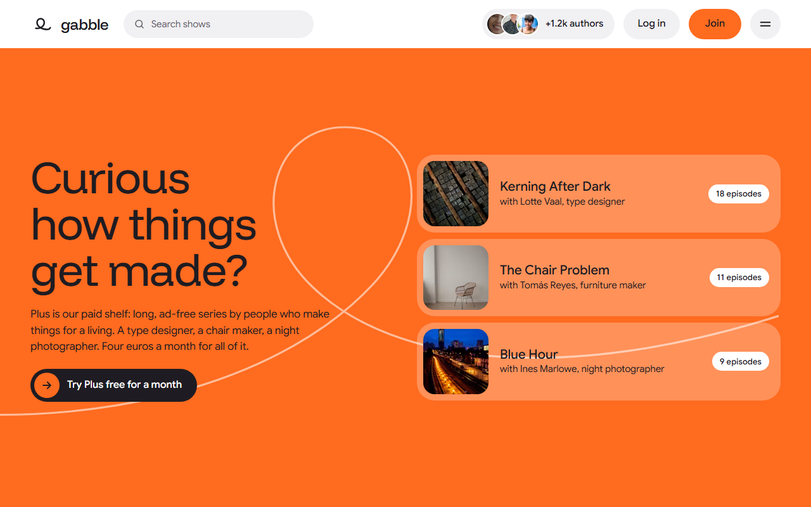
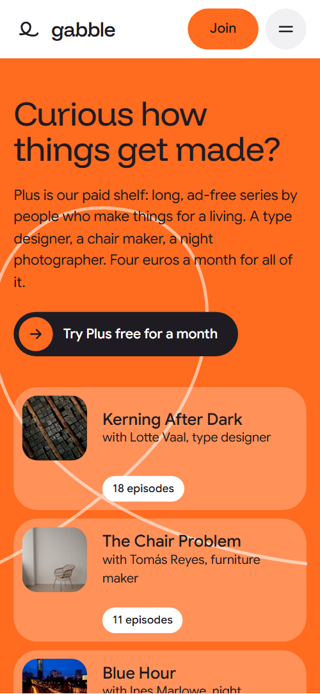
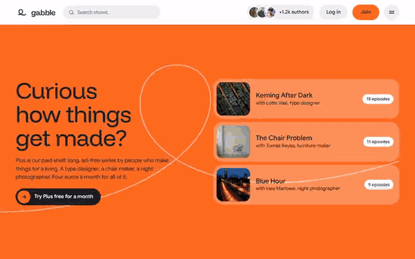

# Free HTML podcast website template with GSAP scroll animations

Podcast website template: one free HTML file for a podcast network or audio collective, with a paid shelf, a featured episode, a sideways row of eight shows, an author grid, a free studio, live dates and voice notes. White ground with orange, yellow and lavender tiles. AGENTS.md is included, so Claude Code, Cursor or Codex can adapt it.

[](LICENSE)  

**[Live demo](https://8bsite.github.io/podcast-website-template/)** · **[Use this template](https://github.com/new?template_name=podcast-website-template&template_owner=8bsite)** · **[Download ZIP](https://github.com/8bsite/podcast-website-template/archive/refs/heads/main.zip)** · **[Template page on 8b.com](https://8b.com/templates/gabble/)**

<a href="https://8bsite.github.io/podcast-website-template/"></a> <a href="https://8bsite.github.io/podcast-website-template/"></a>

<p align="center"><a href="https://8bsite.github.io/podcast-website-template/"></a><br><sub>Scroll animation</sub></p>

## Use it with Claude Code, Cursor or Codex

Download the four files into your project folder (`curl.exe` in Windows PowerShell):

```bash
curl -LO https://raw.githubusercontent.com/8bsite/podcast-website-template/main/index.html
curl -LO https://raw.githubusercontent.com/8bsite/podcast-website-template/main/AGENTS.md
curl -LO https://raw.githubusercontent.com/8bsite/podcast-website-template/main/LICENSE
curl -LO https://raw.githubusercontent.com/8bsite/podcast-website-template/main/CREDITS.md
```

Then fill in the angle brackets and give your agent this prompt:

```text
Read AGENTS.md, then edit index.html. Make this the site for <my podcast network or studio: name, shows and hosts, author count, paid tier and price, featured episode, studio address and hours, live dates and venues, how people submit a pilot, contact details>. Replace first the name, shows, authors and Plus series. Keep the section ids, the classes AGENTS.md lists and three submission steps, and set the footer wordmark's len to the new name's character count. Ask me for missing facts and never invent prices, payouts, dates or contacts.
```

Vibe coding a podcast template with Claude Code, Cursor or Codex goes fastest when you hand the agent the facts only the network has: author count, Plus price, show names and hosts, studio address and hours, live dates and venues, how pilots are submitted. The demo invents all of them, including the guest and the transcript. Faces carry named alt texts, so swap names and photos together.

No agent? Click **[Use this template](https://github.com/new?template_name=podcast-website-template&template_owner=8bsite)**, edit `index.html` on GitHub and turn on **Settings > Pages**.

## Sections and motion

- **Navigation**: sticky top bar: wordmark, search field, author count with three faces, Log in, Join, a menu button; hides on scroll down; menu overlay with search and ten links. The bar slides away after a short downward scroll and returns on scroll up, and this keeps running with reduced motion.
- **Curious how things get made?**: the first screen: a full orange field with the headline, a paragraph about the paid Plus shelf, a button and three Plus series rows. On load a white loop draws itself while the heading block and the three series rows fade and slide in from the right, one after another.
- **This week: the bridge that sings**: a featured episode: sticky player card beside a six-line transcript whose words light up as you scroll. Scrubbed to scroll: transcript words go from faint to full ink while the orange waveform fills left to right, and the heading rises line by line.
- **Shows for every odd curiosity**: eight show tiles in a row that scrolls sideways while the section is pinned, with colour trails behind the tiles. Pinned: the row of eight tiles travels sideways, each tile dragging three colour copies in proportion to scroll speed that fold back when scrolling stops.
- **1,200 authors, one rule: be curious out loud**: grid of six author cards with round photos plus a count card, "+1,194 authors and a chair for you". The six faces and the count circle start as one fanned stack and slide to their places as the grid scrolls in, then names and bios fade up.
- **A booth with a red floor, free for our authors**: a free recording studio for authors: heading, text, button, two photos and four fact tiles. The heading rises, and the four fact tiles slide in from the left trailed by two colour copies each.
- **Add your podcast in three steps**: three numbered steps along a looped line; an orange chevron disc rides the line as you scroll. An orange chevron disc rides the looped line, or a vertical rail on phones, and each numbered disc fills with colour as it arrives.
- **Gabble Live: shows with an audience that laughs back**: four live show dates in a list beside a photo of an audience. The heading rises and each of the four date rows slides in from the left trailed by colour copies.
- **Ask a show anything**: a pinned chat of three voice notes from listeners and three replies from shows. Pinned for about 1.3 screens of scroll: the first of the six chat messages is already in place and the other five pop in from their own sides while the thread slides up.
- **Questions people ask before they press play**: five questions as native details rows. Question rows slide in from the left with colour copies, and the plus icon turns into a cross as a row opens.
- **Say hello**: three colour bands: Write (email), Call (phone), Visit (address). Scrubbed to scroll: the three bands slide in from alternating sides, and each value follows a beat later.
- **Footer**: footer: seven links, two social links, a drawn loop with a large wordmark, copyright with the Design: 8B credit and a privacy link. The loop line at the top right of the wordmark draws itself once its top reaches 88% of the screen height.

## Design

 page ground, listener chat bubbles, live date rows, two studio fact tiles, FAQ rows, text on the ink sections  
 text, the shows, live and footer grounds, dark buttons, favicon letter  
 the opening field, main buttons, show replies in the chat, the author count circle, the submission marker, the footer loop  
 studio ground, yellow show and contact tiles, live date blocks, the first step's fill  
 letters ground, player card, lavender tiles, light text on the ink sections  
 FAQ ground, grey pills such as search and Log in, the FAQ icon discs and the menu button  
 secondary text, captions, search placeholder  
 submission loop line, step ring borders and phone rail, the voice note waveform marks  
 only in leftover rules for a first screen that is no longer in the page, nothing visible uses it  
 show names on the author cards

**Funnel Display**: section headings, the logo and footer wordmark, the large menu links, transcript quotes and step titles, at regular weight except the medium logo and wordmark. **Google Sans**: body text, buttons, badges, labels and the card and show titles, at regular and medium weight (Google Fonts). Big rounded tiles carry the page. The opening is a full-height orange field with a drawn white loop, the heading and three paid series rows. A sticky player card runs beside a six-line transcript, the shows are tall photo tiles in one row, and authors are round faces in a wrapped grid. A looped line with three numbered discs links the submission steps. The footer wordmark fills the width.

## Questions

**Does it have an audio player or an RSS feed?**  
No. The waveform and the timestamps are decoration, and Listen to episode 41 only jumps to the shows section. Link that button to your episode page or embed your host's player, and make the apps answer in the questions describe your real feed. The page neither reads nor builds a feed.

**What do I have to connect before launch?**  
The search fields send people to /search, which does not exist, so build that page or delete the fields. The pilot button opens a mailto link, and the tickets, Plus, voice note, Log in and listen buttons point to placeholder paths or anchors. There is no contact form. Without JavaScript the menu overlay cannot open.

**Can I get a site like this without editing code?**  
Yes. [8B's AI website builder](https://8b.com/templates/8b/) designs a new site from a one-sentence description, in its own design rather than this template. Designing and restyling are free; hosting with SSL, full HTML export and AI edits in chat come with Pro at $9 a month billed yearly. It also runs inside Claude and ChatGPT through the 8B connector.

## Is it the right base?

As a podcast site template, pick it for a network, collective or studio that wants a bright, friendly front door with a paid shelf and live nights. A single show needs far fewer sections, and a [membership community](https://8b.com/templates/softlife/) with its own sign-in suits a different template. The weak spot is audio: there is no player, only a decorative waveform, so you link or embed your own. If you would rather not touch code, 8B also has an AI website builder.

## Before you publish

- Replace what is marked `data-8b-placeholder` (social preview image, favicon, form, email, phone, map, social) and the invented demo facts; [AGENTS.md](AGENTS.md) lists them.
- The form sends nothing yet: connect it to Formspree or Netlify Forms, or remove it.

## Tech

GSAP 3.13.0, ScrollTrigger, SplitText, Lenis 1.3.27 from jsDelivr, 110 KB, no build step. Chrome and Edge 111+, Safari 16.2+, Firefox 113+ (it uses color-mix(), cascade layers, small/dynamic viewport units). With "reduce motion" on, the page is complete and still.

## License

MIT, see [LICENSE](LICENSE). Photos, fonts and libraries keep their own licences: [CREDITS.md](CREDITS.md). More free templates: [8b.com/templates](https://8b.com/templates/) · [github.com/8bsite](https://github.com/8bsite).
