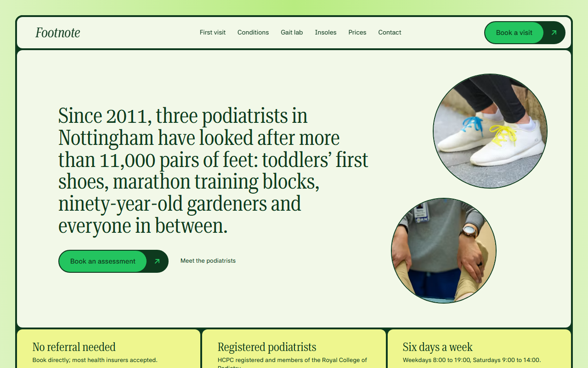
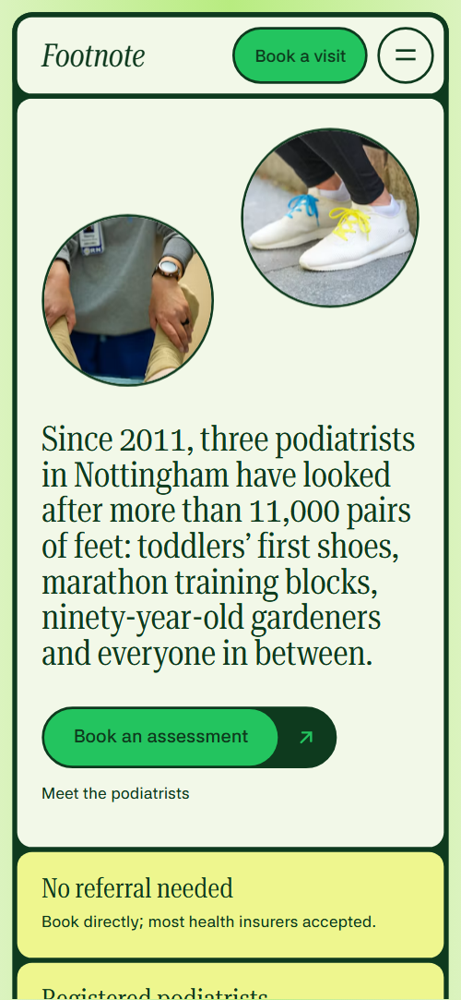
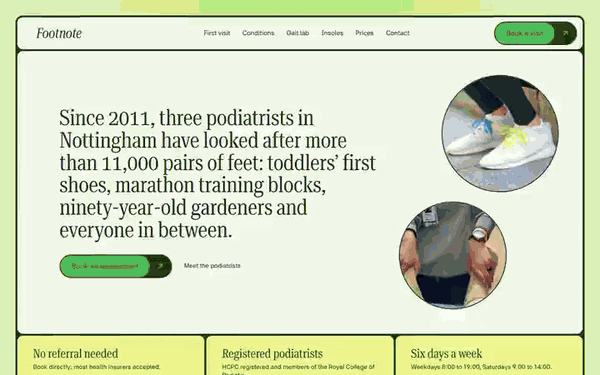

# Free HTML podiatrist website template with GSAP scroll animations

Podiatrist website template: one free HTML file for a foot clinic that takes bookings and home visits, with a four-step first visit, six condition areas, a gait lab, custom insoles, a seven-row price list and a call-back form. Pale lime and deep green tiles carry a condensed serif. AGENTS.md is included, so Claude Code, Cursor or Codex can adapt it.

[](LICENSE)  

**[Live demo](https://8bsite.github.io/podiatrist-website-template/)** · **[Use this template](https://github.com/new?template_name=podiatrist-website-template&template_owner=8bsite)** · **[Download ZIP](https://github.com/8bsite/podiatrist-website-template/archive/refs/heads/main.zip)** · **[Template page on 8b.com](https://8b.com/templates/footnote/)**

<a href="https://8bsite.github.io/podiatrist-website-template/"></a> <a href="https://8bsite.github.io/podiatrist-website-template/"></a>

<p align="center"><a href="https://8bsite.github.io/podiatrist-website-template/"></a><br><sub>Scroll animation</sub></p>

## Use it with Claude Code, Cursor or Codex

Download the four files into your project folder (`curl.exe` in Windows PowerShell):

```bash
curl -LO https://raw.githubusercontent.com/8bsite/podiatrist-website-template/main/index.html
curl -LO https://raw.githubusercontent.com/8bsite/podiatrist-website-template/main/AGENTS.md
curl -LO https://raw.githubusercontent.com/8bsite/podiatrist-website-template/main/LICENSE
curl -LO https://raw.githubusercontent.com/8bsite/podiatrist-website-template/main/CREDITS.md
```

Then fill in the angle brackets and give your agent this prompt:

```text
Read AGENTS.md, then edit index.html. Make this the site for <my clinic: name, town, address, treatments with durations and prices, opening hours, registration body, insurers accepted, podiatrists with specialities, home-visit radius and charge, how people book>. Replace first the clinic name, address, prices, staff, the three patient stories and the 23 photos. Keep the section ids, the data-8b-section, data-8b-motion and data-8b-part attributes, the classes AGENTS.md lists and one condition photo per row in order. Ask me for missing facts; never invent prices, registrations, clinical claims, patient quotes or contacts.
```

Vibe coding goes fastest when the agent gets the facts only the clinic has: name, address, hours, registration body, prices and times, staff, insurers and the home-visit radius. The demo invents all of them, along with three patient quotes. The agent should replace the clinic name in the logo, the phone menu, the footer wordmark, the copyright line and the title tags, then swap the photos. Real patient stories need written consent.

No agent? Click **[Use this template](https://github.com/new?template_name=podiatrist-website-template&template_owner=8bsite)**, edit `index.html` on GitHub and turn on **Settings > Pages**.

## Sections and motion

- **Navigation**: wordmark, six links and a booking button; a round menu button and full-screen sheet on small screens.
- **Since 2011, three podiatrists in Nottingham have looked after more than 11,000 pairs of feet: toddlers’ first shoes, marathon training blocks, ninety-year-old gardeners and everyone in between.**: one screen: a long statement as the h1 with two actions and two round photo discs in a pale cell, and three lime trust notes under it. On load the statement and buttons rise into place, and the two round photos pop in while a green fill shrinks away from each; this is CSS, not GSAP.
- **Your first visit, step by step**: your first visit as four numbered cards in a green frame beside a photo, each card washed by a green fill in turn. Scroll-driven: a green wash sweeps across each of the four step cards in turn, its numeral nudges right, and the round photos shrink and bounce back.
- **Where does it hurt?**: six body regions from toes to skin as a list, beside a held green cell whose photo changes for each region. A light green stage stays in view while the six rows scroll; each new row opens its photo as a circle growing from the left edge.
- **We watch you walk**: a held stage with a runner photo cut into strips that slide into one frame, then four gait observations in a row. Pinned for a little over one screen on a desktop: the runner photo is cut into nine strips (seven on phones) that slide into one picture as you scroll.
- **Insoles made from your own feet**: insole offer with a button, then four stages from scan to fit on a grid. The four stage cards slide in from alternating sides with a small tilt as each reaches the lower part of the screen.
- **Back on their feet**: three patient stories with round portraits, each quote filling from faint to full ink word by word. Each quote fills from faint to full ink word by word while you scroll, and each round portrait shrinks slightly and springs back once on arrival.
- **Three podiatrists, one standard**: a green heading cell and three podiatrist cards with portraits, specialities and an ask-about line. The three podiatrist cards slide in from alternating sides as they arrive.
- **We come to you**: home visit offer on the left, a round portrait with three growing rings on the right. Scroll-driven: the round portrait turns upright and grows while three rings scale up and fade in around it.
- **Prices, plainly**: lime note cell and a pale list of seven services with duration and price. Each of the seven rows slides in from alternating sides once.
- **Questions we hear at the door**: six questions and answers (native &lt;details&gt;) with a green heading cell and the front desk phone. The six question rows start piled toward the first and deal down into the list as it scrolls into view; opening one turns its plus into a minus.
- **Book an assessment**: call-back form with eight topics and a lime cell with the clinic address, contacts and opening hours. The three detail blocks slide in from alternating sides on arrival.
- **Footer**: lime footer: wordmark with a line, two link columns, the address and phone, and the legal line. The three link columns slide in from alternating sides when the footer reaches the lower part of the screen.

## Design

 lime tiles (trust notes, first visit, condition rows, insole intro, price note, contact details, footer), the phone menu sheet and the focus colour inside form fields, and the text of the home visit section  
 text everywhere outside the home visit section, the frame and 4px gaps between tiles, button rims, borders, price row rules and the FAQ plus marks  
 light green tiles (conditions stage, team and FAQ headings), hover fill on buttons, the wash across each first-visit card, photo-disc fills, the top of the page background and the rings on the home visit section  
 pale tiles (opening, price list, stories, team cards, FAQ rows, form), the navigation bar, form fields and the lower page background  
 the fill of the label pill in the main buttons and the arrow on their dark caps  
 step numerals, the Day labels in the insole stages and the background of the home visit section

**Roboto Serif**: headings, the opening statement, prices and card titles at weight 400, condensed to 62% width; uppercase for section headings, italic for the logo and footer wordmark. **Asta Sans**: body text at 400, small labels at 500, buttons and form labels at 600 (Google Fonts). Every section is a set of rounded 12px tiles separated by 4px gaps of deep green, all inside one green frame, so the page reads like a tiled board. Tiles alternate pale, lime and light green. Most sections split 4/8, 5/7 or 7/5. Photos are round discs in the opening, first visit, stories and home visit, and masked portraits in the team. Section headings are uppercase condensed serif; the opening statement is sentence case.

## Questions

**Does the call-back form send anything?**  
No. The script needs a name and a phone number, shows a thank-you line and clears the fields; nothing leaves the page. Connect Formspree or Netlify Forms with the steps in AGENTS.md. The form has a free-text box, so add a privacy notice and tell patients not to write sensitive details.

**Can I get a clinic site like this without editing code?**  
Yes: use [8B's AI website builder](https://8b.com/templates/8b/). You describe the site in a sentence and it designs a new one, not this template. Designing and restyling are free; publishing with hosting and SSL, full HTML export and AI edits in chat are on Pro at $9 a month billed yearly. It also runs inside Claude and ChatGPT.

**Can a physiotherapist or a clinic outside the UK use it?**  
Yes, after a text pass. The demo is British: pounds, HCPC, the Royal College of Podiatry, GP referrals and a Nottingham address. The condition list, gait lab and insole stages describe feet, so a physio rewrites them. Podiatry websites for other countries swap the registration body, insurers and currency.

## Is it the right base?

This podiatrist website template is the right base for a clinic that wants a calm, rounded look and plain medical explanations on one scroll. A counter-based business such as a [pharmacy](https://8b.com/templates/hale/) fits a different page shape. The weak spot is booking: every booking button jumps to a call-back form that sends nothing until it is connected, and no calendar shows free slots. No code? 8B's builder designs a site from a sentence.

## Before you publish

- Replace what is marked `data-8b-placeholder` (social preview image, favicon, phone, form, email) and the invented demo facts; [AGENTS.md](AGENTS.md) lists them.
- The form sends nothing yet: connect it to Formspree or Netlify Forms, or remove it.

## Tech

GSAP 3.13.0, ScrollTrigger, Lenis 1.3.27 from jsDelivr, 144 KB, no build step. Chrome and Edge 111+, Safari 16.2+, Firefox 113+ (it uses color-mix(), cascade layers, small/dynamic viewport units). With "reduce motion" on, the page is complete and still.

## License

MIT, see [LICENSE](LICENSE). Photos, fonts and libraries keep their own licences: [CREDITS.md](CREDITS.md). More free templates: [8b.com/templates](https://8b.com/templates/) · [github.com/8bsite](https://github.com/8bsite).
