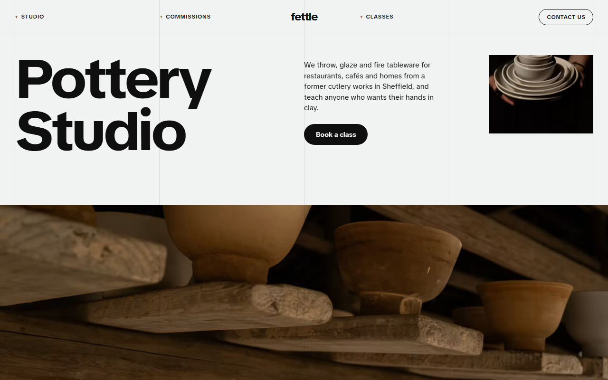
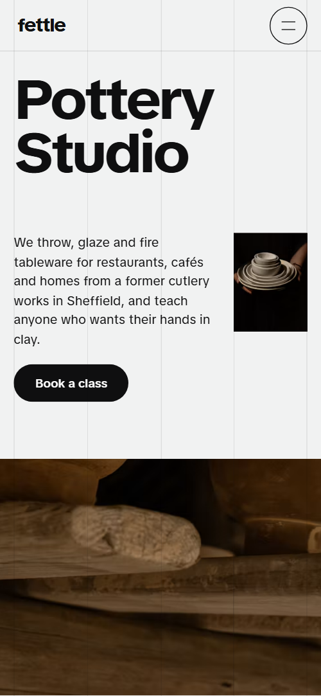
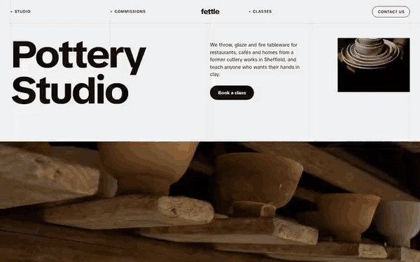

# Free HTML pottery studio website template with scroll animations and no libraries

Pottery studio website template: one free HTML file for a studio that makes tableware to order, teaches classes and sells a few pieces. It holds commissions, a six-step process, four glazes, class prices, makers, membership and a shop, in pale grey with huge type and visible grid lines. Scroll motion is CSS, no JavaScript library; AGENTS.md guides an AI agent.

[](LICENSE)  

**[Live demo](https://8bsite.github.io/pottery-studio-website-template/)** · **[Use this template](https://github.com/new?template_name=pottery-studio-website-template&template_owner=8bsite)** · **[Download ZIP](https://github.com/8bsite/pottery-studio-website-template/archive/refs/heads/main.zip)** · **[Template page on 8b.com](https://8b.com/templates/fettle/)**

<a href="https://8bsite.github.io/pottery-studio-website-template/"></a> <a href="https://8bsite.github.io/pottery-studio-website-template/"></a>

<p align="center"><a href="https://8bsite.github.io/pottery-studio-website-template/"></a><br><sub>Scroll animation</sub></p>

## Use it with Claude Code, Cursor or Codex

Download the four files into your project folder (`curl.exe` in Windows PowerShell):

```bash
curl -LO https://raw.githubusercontent.com/8bsite/pottery-studio-website-template/main/index.html
curl -LO https://raw.githubusercontent.com/8bsite/pottery-studio-website-template/main/AGENTS.md
curl -LO https://raw.githubusercontent.com/8bsite/pottery-studio-website-template/main/LICENSE
curl -LO https://raw.githubusercontent.com/8bsite/pottery-studio-website-template/main/CREDITS.md
```

Then fill in the angle brackets and give your agent this prompt:

```text
Read AGENTS.md, then edit index.html. Make this the site for <my studio: what we make, classes with days and prices, commission terms, glazes, makers, membership, shop pieces, address and hours>. Replace first the name, Sheffield address, three client venues, prices and makers. Keep the classes AGENTS.md lists, the gate script, the data-8b attributes, the five grid lines and the counts AGENTS.md fixes, and set --len on each glaze name and the footer wordmark; add no animation library. Never invent prices, firing details, food-safety claims or contacts; ask me.
```

If you vibe code the site, it goes fastest when you give the agent the facts only the studio has: class days and prices, commission minimums and lead times, firing temperatures, glaze safety claims, membership terms, makers, address and hours. The agent should replace the name in every letter case, then write the character count of each glaze name and of the footer wordmark into its --len. A glaze is recoloured on its own row. It must not invent food-safe or dishwasher claims.

No agent? Click **[Use this template](https://github.com/new?template_name=pottery-studio-website-template&template_owner=8bsite)**, edit `index.html` on GitHub and turn on **Settings > Pages**.

## Sections and motion

- **Navigation**: a bar with three plus-marked links around a lowercase logo and a Contact us pill (a menu button on phones); a full-screen menu with seven links. The bar slides away on a scroll down past 140px and returns on a scroll up; on phones a menu button opens a full-screen overlay of seven links.
- **Pottery Studio**: a photo band under a huge heading that rises into a full-screen photo in four strips, then an about screen with a statement and two big links. On load the heading lines and photo rise in and the photo drifts sideways in a loop; on scroll the first screen holds while the photo opens in four strips along the grid lines to fill the screen, then the about screen slides over and its statement darkens word by word.
- **Where clay meets the table**: three venue cards (restaurant, cafe, hotel) whose rooms open full screen behind them. A restaurant photo stays fixed behind the text and two more photos open full screen from the cafe and hotel cards as those cards scroll up.
- **Mud to table in six steps**: six steps in a horizontal row (wedge, throw, trim, bisque, glaze, fire) with a rule that fills. The section holds (CSS sticky) while the six steps slide sideways and a rule below fills, and each step photo grows from 72 percent to full size as it arrives.
- **Four glazes, mixed in the back room**: four glaze rows whose names are huge; the section's ground and text colour turn into each glaze as its row reaches the middle. The section's ground and text colour blend into each glaze's colours as its row crosses the middle of the screen.
- **Classes for any pair of hands**: a photo and four class rows with when, how long, price and a Book link. The heading, intro and each class row rise into view once, and the plus marks turn into place as you scroll.
- **Three pairs of hands**: three potters as portraits that deal out of a fanned stack. The three portraits start fanned in one stack and deal out to their places, then the names and notes fade in.
- **Open studio membership**: a photo of studio shelves and the open studio offer with price and five benefits. The heading, price and five benefits rise into view once, and their plus marks turn into place.
- **From the shelf**: six one-off pieces with prices and Reserve links; photos turn from pale bisque to colour as they cross the middle. Each photo starts under a pale grey, washed-out layer that wipes away as the photo crosses the middle of the screen.
- **Questions**: six questions as native &lt;details&gt;. Each question rises into view once; opening one turns its plus into a cross.
- **Come by the studio**: address, hours, email, phone and a message form under a heading whose words gather into a line. The four words of the heading slide in from their grid columns and settle into one line.
- **Footer**: a huge lowercase wordmark, address and hours, page links and follow links.

## Design

 page ground, nav bar, about screen, the glazes section before the first glaze  
 text, black buttons, hairlines, footer and phone menu ground, ink on the celadon glaze  
 venue cards and shop photo frames, button labels, footer text, ink on the cobalt, iron red and tenmoku glazes  
 captions and small descriptions  
 plus marks, button hover fill, form status line, the cobalt glaze ground  
 second plus mark colour, the iron red glaze ground  
 the celadon glaze ground, used only there  
 the tenmoku glaze ground, the commissions section ground behind its photos, loading colour of photo frames

**TikTok Sans**: the only typeface, a variable font from 400 to 800 weight and 100 to 112 percent width: headings at weight 720 to 780 and 112 percent width with tight tracking, body text at 400, small labels in 12px uppercase semibold, buttons at 14px semibold (Google Fonts). Four columns with five hairlines fixed over the whole page, which the opening photo and the contact heading follow. Headings are huge, tight, wide-set sans type, mostly in sentence case; the logo and the footer wordmark are lowercase. Text blocks often start on column three, with full-bleed photo backdrops, a horizontal row of steps, class rows with price and Book link, and white venue cards. Photos and cards have square corners, buttons are pills.

## Questions

**Where does the contact form send messages?**  
Nowhere yet. The form checks for a name, a valid email and a message, shows a thank-you line promising a reply within two working days, and clears itself. Connect Formspree or Netlify Forms with the steps in AGENTS.md, or remove the form and keep the email and phone. Edit that promise too.

**Can I get a site like this without editing code?**  
Not this exact file, but yes for a site. [8B's AI website builder](https://8b.com/) designs a new site, with its own design, from a sentence about your studio. Designing and restyling are free. Publishing with hosting, HTML export and AI edits in chat are on Pro at $9 a month billed yearly, and it also runs inside Claude and ChatGPT.

**What happens on a phone, in Firefox or with reduced motion?**  
On a phone the process row still slides sideways. Without CSS scroll-driven animations (Firefox today) or with reduced motion, steps stack in a grid, glaze rows stay colour bands and the wheel scrolls natively; in Firefox the opening still loads in and its photo drifts. Without JavaScript the menu cannot open.

## Is it the right base?

Choose it when classes, commissions and a few pieces share one page. If the shop is most of your income, a [shop-led one-page site](https://8b.com/templates/quire/) fits better. A studio that needs a basket, a booking calendar or many pages needs more: Book links go to the form and the shop uses email links. This build keeps the look and motion with no animation library or script from a CDN, 27 KB of code gzipped against 75 KB and four more requests for the GSAP version.

## Before you publish

- Replace what is marked `data-8b-placeholder` (social preview image, favicon, email, phone, form, social) and the invented demo facts; [AGENTS.md](AGENTS.md) lists them.
- The form sends nothing yet: connect it to Formspree or Netlify Forms, or remove it.

## Tech

No JavaScript libraries: CSS scroll-driven animations and a small inline motion script with its own smooth wheel scrolling, 104 KB, no build step. Chrome and Edge 111+, Safari 16.2+, Firefox 113+ (it uses color-mix(), cascade layers, small/dynamic viewport units). Without scroll-driven animations (Firefox today) the scroll motion and the smooth wheel are off and each section shows its finished layout (a load-in or a loop may still play); with "reduce motion" on, the page is complete and nothing moves on its own (hover effects stay).

A GSAP build of the same page is [`index.gsap.html`](index.gsap.html): GSAP 3.13.0, ScrollTrigger, SplitText, Lenis 1.3.27 from jsDelivr, 95 KB; its scroll motion also plays in Firefox. Use one of the two files.

## License

MIT, see [LICENSE](LICENSE). Photos, fonts and libraries keep their own licences: [CREDITS.md](CREDITS.md). More free templates: [8b.com/templates](https://8b.com/templates/) · [github.com/8bsite](https://github.com/8bsite).
