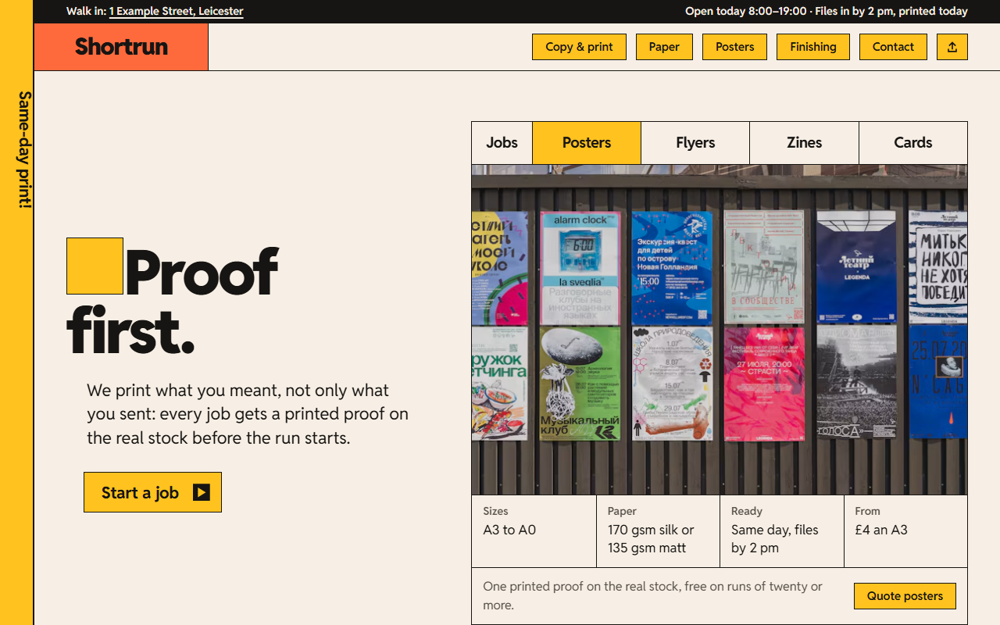
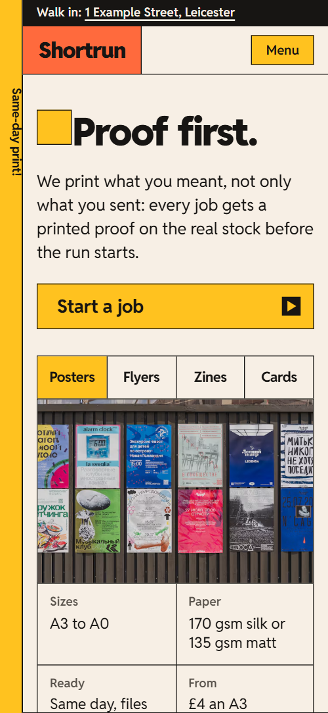
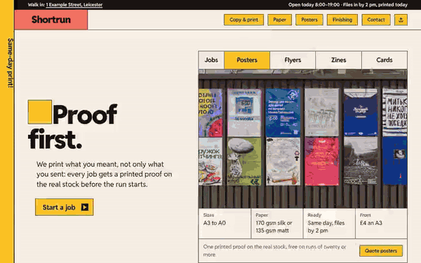

# Free HTML print shop website template with scroll animations and no libraries

Print shop website template: one free HTML file for a copy and print shop that takes walk-in and file-based jobs, with a counter queue, a paper table, a poster-size demo, a file checklist and a quote form. It looks like a layout app in paper white and five bright accents; the scroll motion runs on CSS with no libraries.

[](LICENSE)  

**[Live demo](https://8bsite.github.io/print-shop-website-template/)** · **[Use this template](https://github.com/new?template_name=print-shop-website-template&template_owner=8bsite)** · **[Download ZIP](https://github.com/8bsite/print-shop-website-template/archive/refs/heads/main.zip)** · **[Template page on 8b.com](https://8b.com/templates/shortrun/)**

<a href="https://8bsite.github.io/print-shop-website-template/"></a> <a href="https://8bsite.github.io/print-shop-website-template/"></a>

<p align="center"><a href="https://8bsite.github.io/print-shop-website-template/"></a><br><sub>Scroll animation</sub></p>

## Use it with Claude Code, Cursor or Codex

Download the four files into your project folder (`curl.exe` in Windows PowerShell):

```bash
curl -LO https://raw.githubusercontent.com/8bsite/print-shop-website-template/main/index.html
curl -LO https://raw.githubusercontent.com/8bsite/print-shop-website-template/main/AGENTS.md
curl -LO https://raw.githubusercontent.com/8bsite/print-shop-website-template/main/LICENSE
curl -LO https://raw.githubusercontent.com/8bsite/print-shop-website-template/main/CREDITS.md
```

Then fill in the angle brackets and give your agent this prompt:

```text
Read AGENTS.md, then edit index.html. Make this the site for <my shop: name, town, address, what I print, job types with sizes, paper and turnaround, prices, hours, same-day cutoff, delivery terms>. Replace first the name, address, prices and contacts. Keep the tab, photo and panel names and the seven size items. Motion is CSS scroll-driven animation plus the inline kit: keep the gate script, the data-8b-motion attributes and the classes AGENTS.md lists; add no animation library. Never invent prices, hours or contacts; ask me.
```

Vibe coding goes fastest when the agent starts from the shop's real facts: what you print, the price per job, paper stocks, opening hours, the same-day cutoff, delivery terms and file rules. As a print shop website template for Claude Code, Cursor or Codex, it needs those replaced first, then the six counter rows, the paper table and the six recent jobs. Keep the section ids, the data-8b-section, data-8b-motion and data-8b-part attributes and the selectors AGENTS.md lists. The demo's prices, hours and jobs are invented.

No agent? Click **[Use this template](https://github.com/new?template_name=print-shop-website-template&template_owner=8bsite)**, edit `index.html` on GitHub and turn on **Settings > Pages**.

## Sections and motion

- **Navigation**: a vertical Same-day print! label, a strip with address and status, the wordmark, five square button links and a send-files icon. The header slides away on scroll down past 140px and returns on scroll up; on narrow screens a Menu button opens a full-screen link overlay.
- **Proof first.**: first screen: the h1 Proof first. with a lead and button, and four job tabs that swap a photo and a spec list. On load the heading block rises in and a paper layer and three ink layers wipe off the proof photo in turn; the four tabs swap the photo and spec list on click or arrow keys, in every browser.
- **Walk in. Walk out with it.**: a print queue of six jobs whose bars fill in turn and whose Ready badges stamp down. Scrubbed as the queue crosses the screen: each row's bar fills in turn and its Ready badge stamps in.
- **Pick your paper.**: photo of coloured card edges beside a table of six paper stocks with weight badges. On arrival the photo opens from a crop, the heading gets a highlight sweep and the six weight badges stamp in.
- **Big is our small size.**: a held stage where a poster wall is dragged out by selection handles from A6 to A0 while a marker steps along the size row. The stage holds for about two screens of scrolling: the poster wall grows from a small sheet to full size through seven sizes, selection handles follow its corners and a yellow marker steps from A6 to A0.
- **Off the press this week.**: six recent jobs listed like dockets, each with a thumbnail, spec, time and a status stamp. The heading gets a highlight sweep, the thumbnails open from a crop and the status badges stamp in.
- **Fold it, stitch it, bind it, trim it.**: four finishing panels that unfold from a tight zig-zag into one flat strip. On wide screens the section holds for about one and a half screens while four panels unfold sideways from a zig-zag into a flat strip, alternate ones starting darker; on narrow screens they unfold vertically as they pass.
- **Paper with a past.**: a pledge about recycled paper with three fact tiles and a photo. The heading gets a highlight sweep, the three tiles stamp in and the photo opens from a crop.
- **Send it right, get it right.**: a four-point file checklist beside a sample sheet that gets its bleed, trim marks, safe area and colour bar as the checks tick. On wide screens the section holds for about a screen and a third: the four ticks draw one by one, each followed by the next mark on the sample sheet: bleed line, trim marks, safe area, colour bar; on narrow screens the list and the sheet scrub separately.
- **Asked at the counter.**: six questions and answers (native details). The heading gets a highlight sweep; each question's plus box turns on opening.
- **Come in, or send it over.**: a shop-front photo that is re-cropped by drag handles, address, hours, phone, email and a quote form. The shop-front photo starts cropped tight and zoomed, and its selection handles drag the crop out to the whole photo as the section scrolls in.
- **Footer**: wordmark with a line about the shop, visit and talk columns, page links and a base line.

## Design

 page ground, the header bar, card and table surfaces, form fields, text on the ink sections  
 text, every 1.5px border, the strip above the header, the finishing section and the footer  
 yellow: buttons, icon buttons, the margin stripe, selection handles, the active tab, the size marker, the FAQ plus box, two heading highlights, the column heads in the footer  
 coral: the wordmark blocks in the header and footer, the jobs heading highlight, the bleed line on the sample sheet, link hover fill, one badge  
 violet: the paper section ground, the safe-area line on the sample sheet, two counter icons, one weight badge  
 pale blue: the file checklist section ground, the FAQ heading highlight, one counter icon, photo placeholders  
 lime: the recycled section ground, the Ready and Collected badges, tab and FAQ row hover, one counter icon  
 muted text: column heads, small notes, spec labels, FAQ answers

**Reddit Sans**: the only typeface, one variable file for weights 400 to 900: headings at 900 with tight tracking, titles and the main buttons at 700, labels and the small buttons at 600, body at 400 (Google Fonts). A 44px left margin carries a yellow stripe and an ink hairline, with a vertical Same-day print! label hanging in it under the header. Every block is a box with a 1.5px ink border and square corners: the queue, the paper table, the quote form, the FAQ list. Most sections are two-column splits, a heading and lead against a table, photo or form. Tables and rows restack on phones.

## Questions

**Does it work outside the UK?**  
Yes, after a text pass. The layout suits any shop, but the demo is a Leicester shop: prices in pounds, VAT, A-series paper sizes, a postcode and a UK phone number. Replace them, and relabel the size row if you print other formats, keeping seven items.

**Does this version need GSAP, Lenis or any other library?**  
No. The scroll scenes are CSS scroll-driven animations with a short inline script; visitors see the same page from 27 KB of code gzipped against 72 KB. In Firefox today and with reduced motion it shows the finished layout, with no smooth wheel: the poster wall at full size, the panels flat and every check ticked. The tabs still switch.

**Does the quote form send anything?**  
No. It usually opens the visitor's email program with the entered text, addressed to the demo address, so it fails for visitors with no mail app. There is no file upload field. Point the form at Formspree or Netlify Forms, or at your own endpoint.

## Is it the right base?

This is the light build: the same look and scroll behaviour, with no animation library and no script from a CDN. Measured here, it downloads about 27 KB of code gzipped in one file; the GSAP version needs about 72 KB and three extra requests. Among print shop website templates, a small press that sells prints online with a price calculator fits [a template built around one](https://8b.com/templates/dotdrum/) better. The quote form only opens the visitor's mail app.

## Before you publish

- Replace what is marked `data-8b-placeholder` (social preview image, favicon, email, phone, form) and the invented demo facts; [AGENTS.md](AGENTS.md) lists them.
- The form sends nothing yet: connect it to Formspree or Netlify Forms, or remove it.

## Tech

No JavaScript libraries: CSS scroll-driven animations and a small inline motion script with its own smooth wheel scrolling, 115 KB, no build step. Chrome and Edge 108+, Safari 16+, Firefox 110+ (it uses container query units, cascade layers, small/dynamic viewport units). Without scroll-driven animations (Firefox today) the scroll motion and the smooth wheel are off and each section shows its finished layout (a load-in or a loop may still play); with "reduce motion" on, the page is complete and nothing moves on its own (hover effects stay).

A GSAP build of the same page is [`index.gsap.html`](index.gsap.html): GSAP 3.13.0, ScrollTrigger, Lenis 1.3.11 from jsDelivr, 100 KB; its scroll motion also plays in Firefox. Use one of the two files.

## License

MIT, see [LICENSE](LICENSE). Photos, fonts and libraries keep their own licences: [CREDITS.md](CREDITS.md). More free templates: [8b.com/templates](https://8b.com/templates/) · [github.com/8bsite](https://github.com/8bsite).
