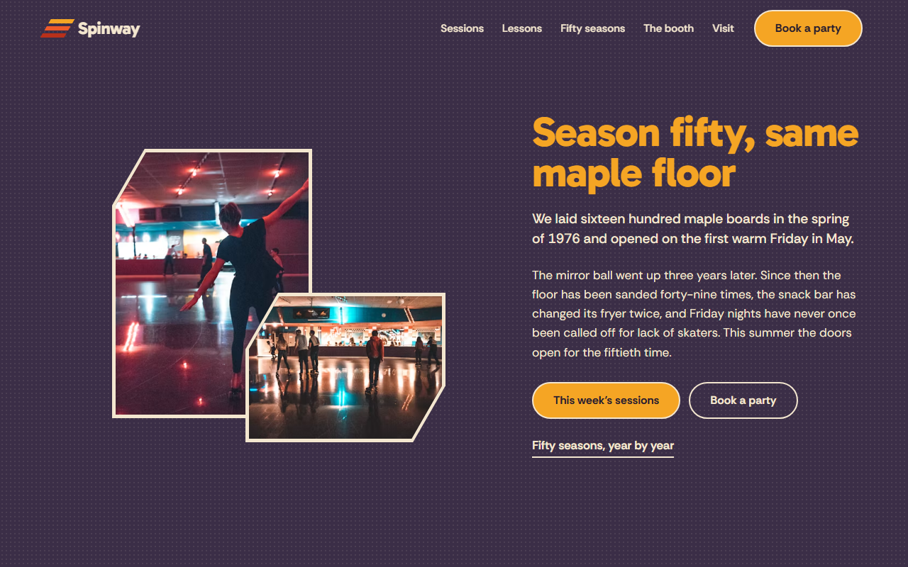
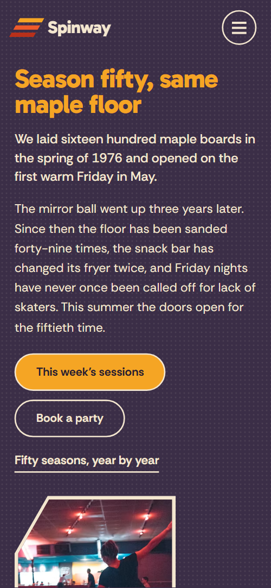
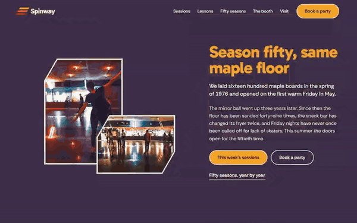

# Free HTML roller rink website template with GSAP scroll animations

Roller rink website template: one free HTML file for a skating venue with a weekly session list, eight-week lessons, rental sizes, party packages and a record booth. It reads like a 1976 poster, with teal, aubergine and ink grounds and cream type under yellow, orange and red stripes. AGENTS.md is included, so Claude Code, Cursor or Codex can adapt it.

[](LICENSE)  

**[Live demo](https://8bsite.github.io/roller-rink-website-template/)** · **[Use this template](https://github.com/new?template_name=roller-rink-website-template&template_owner=8bsite)** · **[Download ZIP](https://github.com/8bsite/roller-rink-website-template/archive/refs/heads/main.zip)** · **[Template page on 8b.com](https://8b.com/templates/spinway/)**

<a href="https://8bsite.github.io/roller-rink-website-template/"></a> <a href="https://8bsite.github.io/roller-rink-website-template/"></a>

<p align="center"><a href="https://8bsite.github.io/roller-rink-website-template/"></a><br><sub>Scroll animation</sub></p>

## Use it with Claude Code, Cursor or Codex

Download the four files into your project folder (`curl.exe` in Windows PowerShell):

```bash
curl -LO https://raw.githubusercontent.com/8bsite/roller-rink-website-template/main/index.html
curl -LO https://raw.githubusercontent.com/8bsite/roller-rink-website-template/main/AGENTS.md
curl -LO https://raw.githubusercontent.com/8bsite/roller-rink-website-template/main/LICENSE
curl -LO https://raw.githubusercontent.com/8bsite/roller-rink-website-template/main/CREDITS.md
```

Then fill in the angle brackets and give your agent this prompt:

```text
Read AGENTS.md, then edit index.html. Make this the site for <my venue: name, address, year opened, weekly sessions with days, times and prices, lesson fee and start date, rental sizes, shop prices, party packages and deposit, hours, closures, phone, email>. Replace first the name, sessions, prices and history years. Keep the section ids, the four lesson steps with their --ls-n numbers, the classes AGENTS.md lists and the footer wordmark len set to the new name length. Ask me for missing facts and never invent prices, hours or contacts.
```

For vibe coding with Claude Code, Cursor or Codex, hand the agent the real session days, times and prices, the lesson fee and start date, rental sizes, shop prices, party packages, deposit, history, address and hours. The demo invents all of them, including the DJ and the 1976 opening. The agent should replace the name everywhere and set the footer wordmark's --len to its character count. The ids and the classes AGENTS.md lists must stay.

No agent? Click **[Use this template](https://github.com/new?template_name=roller-rink-website-template&template_owner=8bsite)**, edit `index.html` on GitHub and turn on **Settings > Pages**.

## Sections and motion

- **Navigation**: top bar: stripe mark and wordmark, five section links, Book a party button; hides on scroll down; full-screen phone menu.
- **Season fifty, same maple floor**: first screen: two cut-corner photos beside the headline, a short story of the floor, two buttons and a link. On load the two photos rise in from the lower left and the headline, text, buttons and link settle upward one after another, in CSS keyframes with nothing tied to scroll.
- **Five sessions a week**: five weekly sessions as colour rows with day, name, note, time and price; ticket note and button. While you scroll, the list starts tilted and shrunk, straightens, and each row slides into place and fades in its description, pinned for about one extra screen of scrolling on desktop.
- **Sixteen hundred boards of hard maple**: a photo of worn skates beside a heading about the maple floor, a stripe band and three facts. The photo drifts inside its frame on scroll, the stripe band draws across and the three facts slide in diagonally.
- **Learn to skate in eight Wednesdays**: course heading with a photo, then four steps rising like a staircase with week ranges and a join button. The four steps climb into a staircase as you scroll, sliding sideways instead on phones.
- **Two hundred and forty pairs on the wall**: rental heading, wall photo, four wheel-colour size rows, a heap-of-skates photo and a pro shop price list. The two photos drift on scroll and the four wheel-colour rows slide in diagonally.
- **Fifty seasons on the same floor**: a horizontal track of eight years with a short story and a photo each, under a stripe band. The section pins and the row of eight years slides sideways as you scroll.
- **Your party, our floor**: party heading with a photo, three slanted package panels with lists and prices, deposit note and button. The photo drifts and the three package panels slide in diagonally, one after another.
- **Records from the booth**: booth story with a photo and a record request form, beside four record sleeves flipping like a crate. The section pins and the sleeves flip forward and fade one by one, like flicking through a crate, until the last crate stays.
- **Before your first lap**: questions and answers in native details elements beside a heading with a stripe band. The stripe band draws and each question slides in diagonally.
- **Find the rink**: address, phone and email, session hours, box office note, beside a drawn street map with a route to the rink. The map zooms and untwists into place while the route to the rink draws itself.
- **Footer**: large wordmark with a stripe band, footer links, social links, copyright with the Design: 8B credit. The stripe band under the wordmark draws across once.

## Design

 teal ground of the lessons and booth sections, the Saturday session row and the teal wheel in the rental rows  
 aubergine ground of the first screen, phone menu, rental and contact sections  
 cream text, photo frames, rules, outlines and the cream bars between stripes  
 yellow ground of the floor and questions sections, primary buttons, the first session row and the footer wordmark  
 orange ground of the seasons section, button hover, the second session row and the map route  
 red in the stripes, the red wheel, the third lesson step and the largest party panel  
 ink page ground for sessions, parties and footer, and dark text on the yellow and orange sections

**Gabarito**: rounded heavy headings, session days, step and panel titles and the footer wordmark, weights 700 to 800. **Rethink Sans**: body text, buttons, uppercase labels, form fields and badges, weights 400 to 700 (Google Fonts). Section grounds alternate as you scroll: aubergine, ink, yellow, teal, aubergine, orange, ink, teal, yellow, aubergine. Photos sit in frames with two cut corners. Session rows are full-width colour bars, the lesson steps rise like a staircase, the party packages are three slanted panels, and the seasons run as a row of eight years. A diagonal slant repeats in badges, stripes and entrances. The map is drawn in SVG, with the rink as a rounded oval of nested rings.

## Questions

**Is this a free roller skating website template?**  
Yes. It is one HTML file under the MIT licence, free for your own rink or a client's. The photos are from Unsplash and listed in CREDITS.md, and the two fonts are open licence. Replace the invented prices, hours and history before you publish.

**Does the record request form send anything?**  
No. As shipped, a script checks that the field is not empty and shows a thank-you line on the page, and nothing leaves the browser. Connect Formspree or Netlify Forms, or point it at your own endpoint, or delete the form and its script.

**Can I get a site like this without editing code?**  
Yes, with [8B's AI website builder](https://8b.com/templates/8b/). You describe the rink in a sentence and it designs a new site, which is its own design and not this template. Designing and restyling are free; publishing with hosting, HTML export and AI edits in chat are on Pro at $9 a month billed yearly. It also runs inside Claude and ChatGPT.

## Is it the right base?

Pick this base for a venue with a regular timetable and a history worth telling. A [trampoline venue](https://8b.com/templates/hopla/) that sells timed jumps can keep the structure but will want its own look, and a bowling alley website can drop the wheel-colour rental rows. The weak spot is the single page: the record request form sends nothing until connected, and without code, the 8B builder is the other route.

## Before you publish

- Replace what is marked `data-8b-placeholder` (social preview image, favicon, email, form, phone, social) and the invented demo facts; [AGENTS.md](AGENTS.md) lists them.
- The form sends nothing yet: connect it to Formspree or Netlify Forms, or remove it.

## Tech

GSAP 3.13.0, ScrollTrigger, Lenis 1.3.27 from jsDelivr, 85 KB, no build step. Chrome and Edge 111+, Safari 16.2+, Firefox 113+ (it uses color-mix(), cascade layers, small/dynamic viewport units). With "reduce motion" on, the page is complete and still.

## License

MIT, see [LICENSE](LICENSE). Photos, fonts and libraries keep their own licences: [CREDITS.md](CREDITS.md). More free templates: [8b.com/templates](https://8b.com/templates/) · [github.com/8bsite](https://github.com/8bsite).
