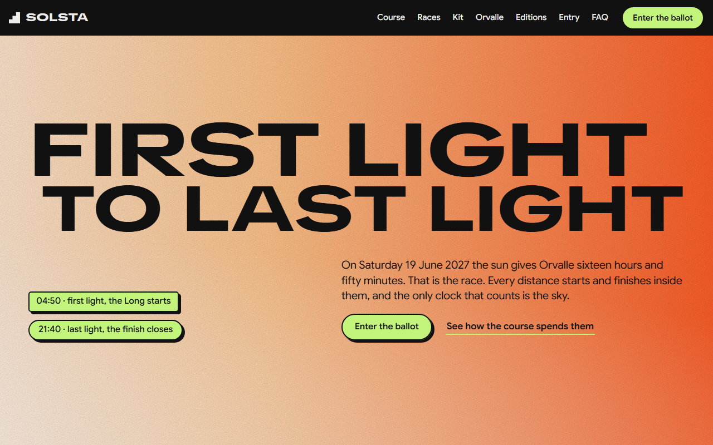
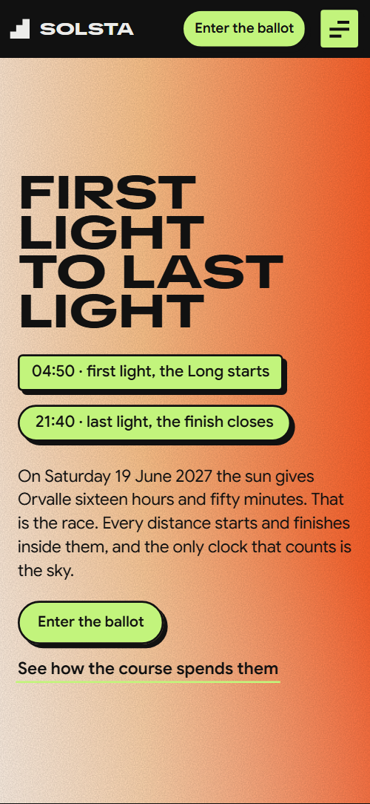
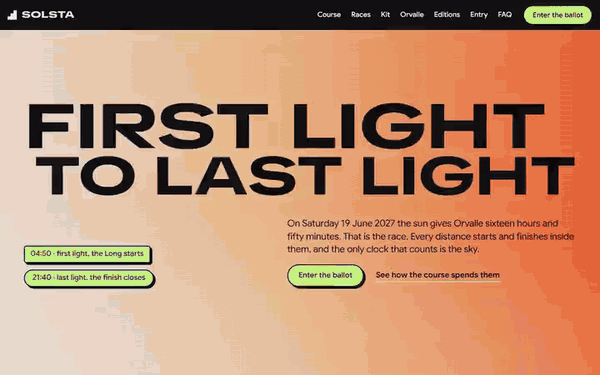

# Free HTML running race website template with GSAP scroll animations

This running race website template is one free HTML file for a yearly mountain trail race or ultra. It has a course set out as a sideways row of five parts, three race categories, a kit list, ten past editions with their weather, an entry ballot with fees and a race office form. AGENTS.md lets an AI agent adapt it.

[](LICENSE)  

**[Live demo](https://8bsite.github.io/running-race-website-template/)** · **[Use this template](https://github.com/new?template_name=running-race-website-template&template_owner=8bsite)** · **[Download ZIP](https://github.com/8bsite/running-race-website-template/archive/refs/heads/main.zip)** · **[Template page on 8b.com](https://8b.com/templates/solsta/)**

<a href="https://8bsite.github.io/running-race-website-template/"></a> <a href="https://8bsite.github.io/running-race-website-template/"></a>

<p align="center"><a href="https://8bsite.github.io/running-race-website-template/"></a><br><sub>Scroll animation</sub></p>

## Use it with Claude Code, Cursor or Codex

Download the four files into your project folder (`curl.exe` in Windows PowerShell):

```bash
curl -LO https://raw.githubusercontent.com/8bsite/running-race-website-template/main/index.html
curl -LO https://raw.githubusercontent.com/8bsite/running-race-website-template/main/AGENTS.md
curl -LO https://raw.githubusercontent.com/8bsite/running-race-website-template/main/LICENSE
curl -LO https://raw.githubusercontent.com/8bsite/running-race-website-template/main/CREDITS.md
```

Then fill in the angle brackets and give your agent this prompt:

```text
Read AGENTS.md, then edit index.html. Make it the site for <my race: name, place, date, first and last light, distances with climb, altitudes and places, ballot dates, fees, cut-offs, kit list, past results, volunteer rules, legal name and contacts>. Replace the race name, dates, distances, altitudes and fees first. Keep the section ids, the data-8b-section, data-8b-motion and data-8b-part attributes, each course tile's altitude value and each editions row's data-sky value, and update every --len. Ask me for missing facts and never invent cut-offs, safety rules, results, fees or contacts.
```

Start with the race name, date, first and last light and the three race cards, then the five course tiles, the fee table and the ten past editions. Claude Code, Cursor or Codex can do this in one pass, and vibe coding works if you hand over the facts. Keep the section ids, the data-8b-section, data-8b-motion and data-8b-part attributes, the altitude value on each course tile and every --len, which stores a heading's character count.

No agent? Click **[Use this template](https://github.com/new?template_name=running-race-website-template&template_owner=8bsite)**, edit `index.html` on GitHub and turn on **Settings > Pages**.

## Sections and motion

- **Navigation**: black top bar: round mark and wordmark, seven section links, an Enter the ballot button; below 1081 px a menu button opens a full-screen overlay. The top bar slides up out of view when you scroll down and returns on scroll up; this slide keeps running with reduced motion.
- **First light to last light**: first screen on a sky tile: two-line headline, first-light and last-light times, a paragraph about the sixteen hours of daylight, a button and a link. On load the two headline lines slide in from opposite sides, the text row lifts into place and the sky gradient drifts in a slow loop.
- **58 km over the Kessel ridge**: the course as a sideways row of five part tiles that climb with the altitude, an intro column with a GPX link. Pinned: the row of five tiles slides sideways and each tile sits higher the higher its altitude, so the row climbs to the ridge and drops back, with orange light crossing each photo.
- **Three races, one day**: three race cards on sky tiles coloured by start hour: Long, Half, Vertical. The three race cards start stacked and slightly turned under the first and spread into their row as you scroll in.
- **212 people on the mountain**: volunteers: heading with a link, four portraits with name tags and a quote. The heading rises out of its clip, orange light crosses each portrait and the name tags land like stickers.
- **What you carry**: mandatory kit: a held photo of a runner with a weight badge beside a ten-item checklist. The held photo pulls back from a tight close-up while the ten boxes tick one by one as their items pass the middle of the screen.
- **The finish closes at last light. The long table opens.**: the finish village: heading, paragraph, one night photo cut into six tiles, a paragraph and three tags. Six small rounded tiles with gaps grow into one seamless night photo while an orange light moves across it.
- **Ten longest days**: a held sky tile beside a table of ten past editions that shows each edition's weather as you read. The tile held beside the table changes its sky, weather word and year to match the row nearest the middle of the screen.
- **Getting a place**: entry board: ballot dates with a reminder button, a fees table for three races, three tags and a note about the finisher stone. The heading rises out of its clip and the three tags land like stickers.
- **One day**: two huge words that widen, two photos and a card about the trail-work day with three steps. The two words "One day" widen from the narrowest to the widest setting of the display font as you scroll, and orange light crosses both photos.
- **Before you apply**: eight questions as native details elements beside a heading and a link to the office. The heading lifts in and the Ask the office badge lands like a sticker; the questions open as native details elements.
- **The race office**: the race office on a sky tile that turns from dusk to night: address, email, phone, hours and a form. The tile's sky goes from dusk to night as you reach the end, and the orange glow sinks behind the cards.
- **Footer**: footer: giant wordmark, a line about the race, three link columns and a legal line. The See you at first light sticker lands when the footer arrives.

## Design

 page ground, text on lime buttons and badges, borders and the hard shadows  
 body text on the black ground, the light cards (entry board, trail day card, race office cards) and part of the fog, storm and not-run skies  
 orange: the light that crosses photos, the button sweep, the heat sky and the glow behind the contact cards  
 lime: buttons, badges, link underlines, course part numbers, kit boxes, focus outline and hover colour  
 violet: the ends of the sky gradient and the snow, wind and storm skies  
 pink in the sky gradient and the wind and storm skies  
 mint: base of the sky tiles and the clear and snow skies  
 peach in the sky gradient and the clear and heat skies  
 grey for labels, course facts, table heads, hairlines and the quote credit  
 white in the sky gradient and skies, and the form field background  
 deep violet of the night that closes over the contact tile  
 dark card surfaces: course cards, question boxes, the quote card, photo backing, the current table row and table hairlines

**TikTok Sans**: display face, weights 700 to 800 with a width axis from 75% to 150%: headlines, race names, the wordmark, kit items and questions, table years, the race names in the fee table and small uppercase numbers. **Google Sans**: text face, weights 400 to 700, for body copy, buttons, badges, form fields and table cells, fees included (Google Fonts). Black ground with rounded sky tiles: panels filled with a slow gradient whose colours come from an hour value, from pale mint and lilac to orange and violet. Large uppercase display type in a stretched face sits on them. Lime buttons, badges and stickers carry thick dark borders and a hard offset shadow, as if stuck on. Every photo is greyscale. Sections alternate between full-width tiles, a sideways row, a three-card grid and a table beside a held tile.

## Questions

**Where does the race office form send its messages?**  
Nowhere reliable yet. The form posts to a mailto address as plain text, so it only opens the visitor's mail program and does nothing on a device without one. Connect Formspree or Netlify Forms, or delete the form and keep the email and phone.

**What happens on a phone, with reduced motion or with scripts off?**  
On a phone the race cards stack in one column and the menu button opens a full-screen overlay. With reduced motion on, the scroll scenes and smooth scrolling stop and the course becomes a plain grid, while button hovers and the bar's slide still run. Without JavaScript the menu cannot open; the questions still open.

**Can I get a site like this without editing code?**  
Yes, with [8B's AI website builder](https://8b.com/templates/8b/). You describe the race in a sentence and its engine designs a new site, not this template. Designing and restyling are free; publishing with hosting and SSL, full HTML export and AI edits in chat are on Pro at $9 a month billed yearly. It runs inside Claude and ChatGPT too.

## Is it the right base?

Choose it for a yearly event with several distances, a ballot and volunteers. A running club, coaching service or training app needs another shape, and the [app landing page](https://8b.com/templates/kurvo/) template is closer to that. Live tracking, results search and registration are not here: the entry buttons only jump to the entry section until you point them at your sign-up. Owners who do not code can try 8B instead.

## Before you publish

- Replace what is marked `data-8b-placeholder` (social preview image, favicon, email, phone, form, social) and the invented demo facts; [AGENTS.md](AGENTS.md) lists them.
- The form sends nothing yet: connect it to Formspree or Netlify Forms, or remove it.

## Tech

GSAP 3.13.0, ScrollTrigger, Lenis 1.3.27 from jsDelivr, 111 KB, no build step. Chrome and Edge 111+, Safari 16.2+, Firefox 113+ (it uses color-mix(), container query units, cascade layers, small/dynamic viewport units). With "reduce motion" on, the page is complete and still.

## License

MIT, see [LICENSE](LICENSE). Photos, fonts and libraries keep their own licences: [CREDITS.md](CREDITS.md). More free templates: [8b.com/templates](https://8b.com/templates/) · [github.com/8bsite](https://github.com/8bsite).
