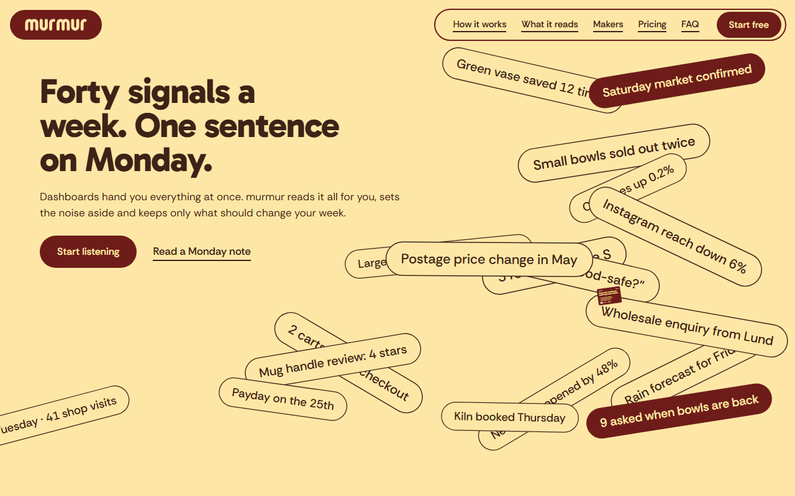
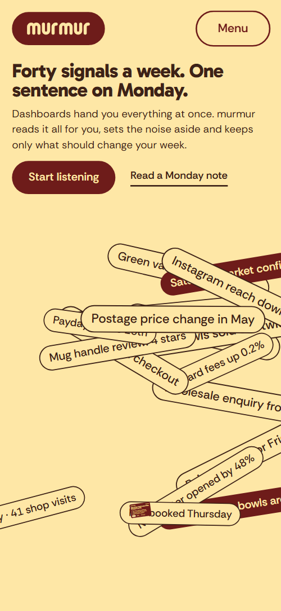
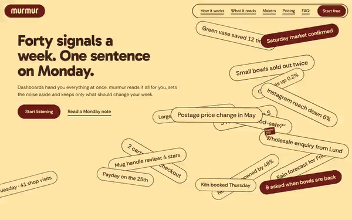

# Free HTML saas landing page template with GSAP scroll animations

SaaS landing page template: one free HTML file for an app that sends small shops a single weekly message. It has a phone mockup, five coloured data-source columns, two priced plans and a contact form, in maroon, butter and gold with round-ended buttons. AGENTS.md is included, so Claude Code, Cursor or Codex can adapt it.

[](LICENSE)  

**[Live demo](https://8bsite.github.io/saas-landing-page-template/)** · **[Use this template](https://github.com/new?template_name=saas-landing-page-template&template_owner=8bsite)** · **[Download ZIP](https://github.com/8bsite/saas-landing-page-template/archive/refs/heads/main.zip)** · **[Template page on 8b.com](https://8b.com/templates/murmur/)**

<a href="https://8bsite.github.io/saas-landing-page-template/"></a> <a href="https://8bsite.github.io/saas-landing-page-template/"></a>

<p align="center"><a href="https://8bsite.github.io/saas-landing-page-template/"></a><br><sub>Scroll animation</sub></p>

## Use it with Claude Code, Cursor or Codex

Download the four files into your project folder (`curl.exe` in Windows PowerShell):

```bash
curl -LO https://raw.githubusercontent.com/8bsite/saas-landing-page-template/main/index.html
curl -LO https://raw.githubusercontent.com/8bsite/saas-landing-page-template/main/AGENTS.md
curl -LO https://raw.githubusercontent.com/8bsite/saas-landing-page-template/main/LICENSE
curl -LO https://raw.githubusercontent.com/8bsite/saas-landing-page-template/main/CREDITS.md
```

Then fill in the angle brackets and give your agent this prompt:

```text
Read AGENTS.md, then edit index.html. Make this the site for <my app: what it does and for whom, what it sends, the data sources it connects to, two plans with prices, privacy promises, customers I can quote, support email>. Replace the wordmark, copy, prices, quotes, photos and contacts first. Keep the section ids, the classes AGENTS.md lists, five source columns and eight field tiles, and set each --len to the character count of its line. Ask me for missing facts and never invent prices, customers, quotes, figures or contacts.
```

Hand index.html and AGENTS.md to Claude Code, Cursor or Codex and vibe code the rest. Replace the product, prices, plan limits, privacy promises, customer quotes and sample signals first; the demo invents all of them. The agent should ask the owner for real figures and customer names. Keep the section ids, the classes AGENTS.md lists, the five source columns and the eight field tiles, and update each --len after changing a display line.

No agent? Click **[Use this template](https://github.com/new?template_name=saas-landing-page-template&template_owner=8bsite)**, edit `index.html` on GitHub and turn on **Settings > Pages**.

## Sections and motion

- **Navigation**: fixed top bar: drawn wordmark, five section links, Start free button; hides on scroll down; phone menu overlay. The navigation bar hides on scroll down and returns on scroll up, and under 960 px the Menu button opens a full-screen overlay.
- **Forty signals a week. One sentence on Monday.**: first screen: heading, lead, two calls to action, a field of 18 signal chips and the Monday note card. Pinned for 300svh: the 18 signal chips glide from a rotated scatter into a tidy list, three of them turn maroon and the Monday note card grows from a dot.
- **Five things it listens to.**: five coloured columns, one per data source, each with a line of text and a sample "Heard this week" line. Pinned: a small strip of five bars unfolds into the five full columns, then the Messages column carries on into the next section.
- **One sentence. Three reasons. One tap.**: maroon panel with a sticky phone showing the weekly note, beside a heading and three explained parts. On wide screens the maroon panel sweeps in from the Messages column with the phone inside, and each of the three parts lights its block on the phone with a gold outline as you scroll.
- **Kept by forty-one small studios.**: five arch portraits of customers with a place and a quote each, on a held horizontal track. Pinned: the row of five portraits slides sideways, and the card at the middle of the screen lifts so a wave travels along the row.
- **Field notes.**: a gutterless moodboard of 8 tiles: 5 photos and 3 coloured note tiles. Pinned: the moodboard opens zoomed in on one note tile and zooms out until the whole grid is in view.
- **No dashboards. No streaks. No charts at midnight. One sentence on Monday.**: four large lines, three struck out, and two short paragraphs. The four lines slide in from alternating sides, and a bar strikes through each of the first three.
- **Wherever Monday finds you.**: four coloured tiles showing the same note on a lock screen, an inbox, a text message and a printed card. Each of the four tiles opens from a narrow round-ended tube to full shape on arrival, and the heading words rise.
- **Four Mondays free. Then one small price.**: two plans side by side: Studio and Collective, with price, list and button. The two plans rise from below as tall arches, the second a beat later, and square off as they lock into one panel.
- **Questions, answered plainly.**: six questions in native details elements beside a heading, an email line and an arch photo. The heading words rise and the portrait opens from a tube; the questions are plain details elements.
- **Say something. We answer by the next Monday.**: large email address in two halves, phone, studio address and hours, and a form. The two halves of the large email address slide in from opposite edges until they meet.
- **Footer**: footer: lead line, two link columns, copyright with the Design: 8B credit, back-to-top link and a large drawn wordmark. The six strokes of the large wordmark bob up and down in a wave, paused while the footer is off screen.

## Design

 maroon: page ground, buttons, the note panel behind the phone, manifesto and contact backgrounds, the first-screen note card  
 butter: first screen, moodboard and FAQ backgrounds, text on dark slabs, the signal chips, form fields  
 dark brown: body text, the Stock column, makers, surfaces and footer backgrounds, the hover fill of maroon buttons, borders  
 rust: the Visits column, one moodboard note, the printed-card tile  
 gold: the Sales column, one moodboard note, the text-message tile, the hover fill of butter buttons and FAQ rows, the active outline on the phone  
 near-black: sources and pricing backgrounds, the phone body

**Gabarito**: headings, plan prices, source names, phone sentence and the large email address, in weights 700 and 800. **Rethink Sans**: body text, buttons, chips, labels and form fields, in weights 400 to 600 (Google Fonts). Full-width colour slabs alternate down the page: a butter first screen, five columns in five colours, a maroon panel with a sticky phone, a dark brown row of makers, a butter moodboard, a maroon manifesto, dark brown delivery tiles, near-black pricing and a butter FAQ. Section headings are heavy Gabarito up to 66px. Chips and buttons are full pills, cards take 28px corners, columns and plans stay square, and the product is shown in HTML and CSS mockups, not screenshots.

## Questions

**Do the sign-up buttons and the contact form work?**  
Not yet. Start free and Start listening jump to the pricing section, and the plan buttons jump to the contact form. The form checks name and email, shows a thank-you line and sends nothing. Point the buttons at your checkout and connect Formspree or Netlify Forms, or delete the form.

**Can I get a site like this without editing code?**  
Not this exact file, but you can describe your product to [8B's AI website builder](https://8b.com/templates/8b/) and its engine designs a new site, with its own design. Designing and restyling are free. Publishing with hosting, full HTML export and AI edits in chat are on Pro at $9 a month billed yearly, and it also runs inside Claude and ChatGPT.

**What happens on a phone, with reduced motion or without scripts?**  
On a phone the five source columns stack and their Heard this week lines are hidden. With reduced motion on, the pinned scenes become plain stacked sections and the page reads in full. Without JavaScript the Menu button cannot open its overlay, and the bar links are hidden under 960 px.

## Is it the right base?

As a SaaS website template it suits a product with a short story and two plans. For another take on an app page, see the [app-focused](https://8b.com/templates/linea/) template. A product that needs docs, a blog, a login or several pages needs more than one page. The weak spot is the logo: it is drawn paths, so a new name needs new paths. If you do not want to edit code, 8B's builder designs a new site from a sentence.

## Before you publish

- Replace what is marked `data-8b-placeholder` (social preview image, favicon, email, phone, form) and the invented demo facts; [AGENTS.md](AGENTS.md) lists them.
- The form sends nothing yet: connect it to Formspree or Netlify Forms, or remove it.

## Tech

GSAP 3.13.0, ScrollTrigger, SplitText, Lenis 1.3.27 from jsDelivr, 107 KB, no build step. Chrome and Edge 108+, Safari 15.4+, Firefox 101+ (it uses cascade layers, small/dynamic viewport units). With "reduce motion" on, the page is complete and still.

## License

MIT, see [LICENSE](LICENSE). Photos, fonts and libraries keep their own licences: [CREDITS.md](CREDITS.md). More free templates: [8b.com/templates](https://8b.com/templates/) · [github.com/8bsite](https://github.com/8bsite).
