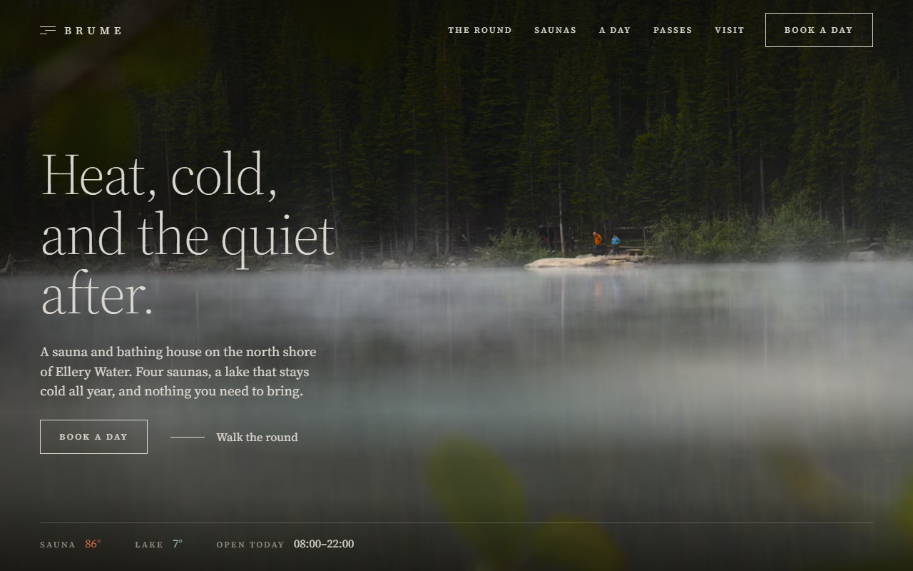
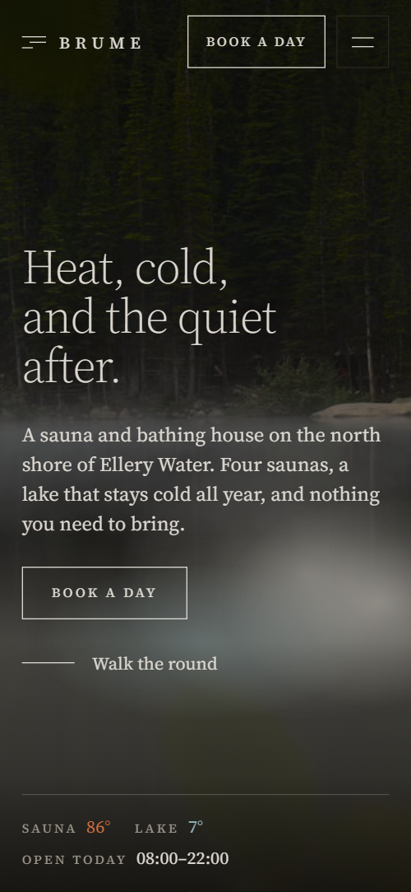
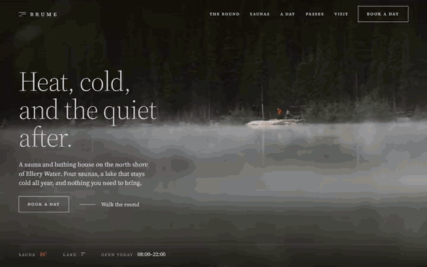

# Free HTML sauna website template with scroll animations and no libraries

Sauna website template: one free HTML file for a bathhouse or lakeside day spa, with a three-step round, four rooms with temperatures, three timed passes and a request form. The look is near-black with copper and lake blue in a light serif, and fog rises over the first photo, in CSS with no libraries. AGENTS.md guides Claude Code or Codex.

[](LICENSE)  

**[Live demo](https://8bsite.github.io/sauna-website-template/)** · **[Use this template](https://github.com/new?template_name=sauna-website-template&template_owner=8bsite)** · **[Download ZIP](https://github.com/8bsite/sauna-website-template/archive/refs/heads/main.zip)** · **[Template page on 8b.com](https://8b.com/templates/brume/)**

<a href="https://8bsite.github.io/sauna-website-template/"></a> <a href="https://8bsite.github.io/sauna-website-template/"></a>

<p align="center"><a href="https://8bsite.github.io/sauna-website-template/"></a><br><sub>Scroll animation</sub></p>

## Use it with Claude Code, Cursor or Codex

Download the four files into your project folder (`curl.exe` in Windows PowerShell):

```bash
curl -LO https://raw.githubusercontent.com/8bsite/sauna-website-template/main/index.html
curl -LO https://raw.githubusercontent.com/8bsite/sauna-website-template/main/AGENTS.md
curl -LO https://raw.githubusercontent.com/8bsite/sauna-website-template/main/LICENSE
curl -LO https://raw.githubusercontent.com/8bsite/sauna-website-template/main/CREDITS.md
```

Then fill in the angle brackets and give your agent this prompt:

```text
Read AGENTS.md, then edit index.html. Make this the site for <my bathhouse: name, place, water, rooms with temperatures and seats, passes with hours and prices, menu, opening days, rules, contacts>. Replace the name, readings, passes and room facts. Motion is CSS scroll-driven animation plus the inline kit: keep the gate script, section ids, the classes AGENTS.md lists, pass hours between 8 and 22, each temperature value with its line end; set each --len; add no animation library. Never invent prices, hours, health advice or contacts; ask me.
```

Used as a sauna website template for Claude Code, Cursor or Codex, vibe coding goes fastest when you give the agent the facts only the venue has: room temperatures and seats, pass hours and prices, menu, opening days, rules and address. The demo invents all of them, along with the lake and the village. The agent should swap the name in every letter case, rewrite the five statement lines and reset each --len. Pass hours must stay inside the 08 to 22 axis.

No agent? Click **[Use this template](https://github.com/new?template_name=sauna-website-template&template_owner=8bsite)**, edit `index.html` on GitHub and turn on **Settings > Pages**.

## Sections and motion

- **Navigation**: fixed bar with a three-bar mark and wordmark, five section links, a Book a day button and a menu button with an overlay. The bar turns solid after 80px of scroll, slides away when you scroll down past 160px and returns when you scroll up; under 1024px wide a menu button opens a full-screen overlay.
- **Heat, cold, and the quiet after.**: two screens: a lake under fog with the headline, intro, two actions and live-looking readings; then a warm rest room, a three-line heading and three floating photos. On load the lake photo settles from a slight zoom, three fog patches drift sideways in a loop and the headline rises in. On scroll the lake photo holds still while the text leaves, a fog veil climbs over it and a rest-room photo comes up from the dark, then the three small photos rise at different speeds.
- **One round, three temperatures**: three steps of one round (heat, cold, rest) beside a held photo frame that opens into each in turn. A frame of three photos in thirds stays beside the steps: the heat photo widens over the others under a copper tint, wipes away to the cold photo under a blue tint, which wipes away to the rest photo, and the thirds return.
- **Four rooms, coldest to hottest**: four rooms coldest to hottest as rows, each with a temperature, a line that runs out to it, text, facts and a photo. Each row's temperature line draws out to its value as the row arrives, and the section ground shifts from blue-black to brown-black across the four rooms.
- **Water on the stones. A breath of heat rolls off the ceiling and the room goes quiet.**: a five-line statement over a dark photo; a glow rises through it and the lines swell in weight. A copper glow rises through the five lines, and from the bottom line up each swells from weight 300 to 560 and turns copper before settling back.
- **The fifth room has no walls**: a wide photo of the boardwalk into fog beside a heading, a paragraph and four facts. The wide photo slides down 10% of its height inside its frame as it scrolls into view, and the paragraph and four facts fade up in turn.
- **A day at Brume, mist to lanterns**: six hours of the day over a held lake photo that goes from morning mist to night; the hour at the middle of the screen lights up. Pinned: the held morning-mist photo cross-fades to a night cabin as the six hours pass, with a blue dawn tint fading out and a copper dusk tint fading in and out; the hour near the middle of the screen turns copper.
- **The long table by the stove**: a menu of five dishes with prices drawn between hairlines, beside three photos. The five menu rules draw across when they arrive, the intro line fades up and the three photos slide down into their frames.
- **A house built for the weather**: a photo of the bathhouse cut into vertical boards that slide into line, beside two paragraphs and a link. The photo is cut into ten vertical boards, six under 700px wide; alternate boards slide in from opposite directions and meet in line, and the two paragraphs fade up.
- **Choose your hours**: three timed passes on an 08-22 time axis with a marker that sweeps across and lights the pass it is inside. A copper marker sweeps across the 08 to 22 axis as you scroll, and each pass whose hours contain the marker lights its band and name in copper.
- **Before your first round**: six questions in native details elements beside a heading. The six questions fade up one after another when the list arrives, and each plus turns into a minus as its answer opens.
- **Forty minutes from the city**: how to get there and contact details beside a day-request form, closed by a large name that condenses out of mist. The closing name is split into letters that start spread apart and faint, blurred on wide screens with a mouse, and gather into the word as you scroll.
- **Footer**: a Book a day line, four columns (links, address, hours, contact), and a base line with readings, the copyright and a Top link. The rule beside the Book a day line draws across when it arrives.

## Design

 page ground, the menu overlay, the solid header, text on a filled button when hovered  
 body and heading text, button borders and hover fills, focus outlines, fog patches  
 section rails, field labels, captions, small notes, form field underlines  
 hairlines between steps, dishes, questions and passes; borders of the form panel and menu button  
 copper for heat: hot readings and temperatures, step meta, line ends, the lit hour, open pass bands, the pass marker, the statement glow  
 lake blue for cold: cold readings and temperatures, the start of the temperature lines, the cold and dawn tints, one fog patch  
 the request form panel, photo placeholders and the dropdown option backgrounds  
 cold end of the sauna section's ground, a blue-black  
 hot end of the sauna section's ground, a brown-black

**Source Serif 4**: the only typeface, variable weights 300 to 600: light headings, regular body text, and medium uppercase tracked labels, buttons and rails (Google Fonts). A narrow rail on the left carries a vertical uppercase label for most sections and stays in view while the section scrolls; content sits to its right. Headings are stacked in two or three lines with the second indented. Full-bleed scenes alternate with ruled lists: four sauna rows, five dishes, three passes and six questions, divided by hairlines. Corners are square throughout, and the photos are dark and warm.

## Questions

**How do I turn the request form into real bookings?**  
As shipped it sends nothing. It needs a date, a name and an email, then shows a thank-you line and clears itself. Connect Formspree or Netlify Forms with the steps in AGENTS.md, or link the Book buttons to your booking system. Edit the thank-you line too: it promises confirmation by email within a few hours.

**Can I get a site like this without editing code?**  
Yes, with [8B's AI website builder](https://8b.com/). You describe the site in a sentence and its engine designs a new one, not this template. Designing and restyling are free. Publishing with hosting and SSL, full HTML export and AI edits in chat are on Pro at $9 a month billed yearly. It also runs inside Claude and ChatGPT.

**What happens with reduced motion, in Firefox or with scripts off?**  
Without CSS scroll-driven animations (Firefox today) or with reduced motion, each section shows its finished layout: the round as three photos side by side, the morning lake behind the hours, the name whole. Firefox still plays the opening fog. Without JavaScript the menu fails, the temperature lines stay empty and every pass band fills the axis.

## Is it the right base?

As a sauna website template it fits one venue with water nearby, a few rooms of different character and entry sold by the hour. A coach selling a course or a studio with a teacher fits the [studio and course](https://8b.com/templates/senti/) template better. This light build has no animation library: about 27 KB gzipped against 75 KB and four extra requests for the GSAP version. Booking is the thin part: the form is a request, with no calendar of free slots.

## Before you publish

- Replace what is marked `data-8b-placeholder` (social preview image, favicon, phone, email, form, social) and the invented demo facts; [AGENTS.md](AGENTS.md) lists them.
- The form sends nothing yet: connect it to Formspree or Netlify Forms, or remove it.

## Tech

No JavaScript libraries: CSS scroll-driven animations and a small inline motion script with its own smooth wheel scrolling, 107 KB, no build step. Chrome and Edge 111+, Safari 16.2+, Firefox 113+ (it uses color-mix(), cascade layers). Without scroll-driven animations (Firefox today) the scroll motion and the smooth wheel are off and each section shows its finished layout (a load-in or a loop may still play); with "reduce motion" on, the page is complete and nothing moves on its own (hover effects stay).

A GSAP build of the same page is [`index.gsap.html`](index.gsap.html): GSAP 3.13.0, ScrollTrigger, SplitText, Lenis 1.3.27 from jsDelivr, 92 KB; its scroll motion also plays in Firefox. Use one of the two files.

## License

MIT, see [LICENSE](LICENSE). Photos, fonts and libraries keep their own licences: [CREDITS.md](CREDITS.md). More free templates: [8b.com/templates](https://8b.com/templates/) · [github.com/8bsite](https://github.com/8bsite).
