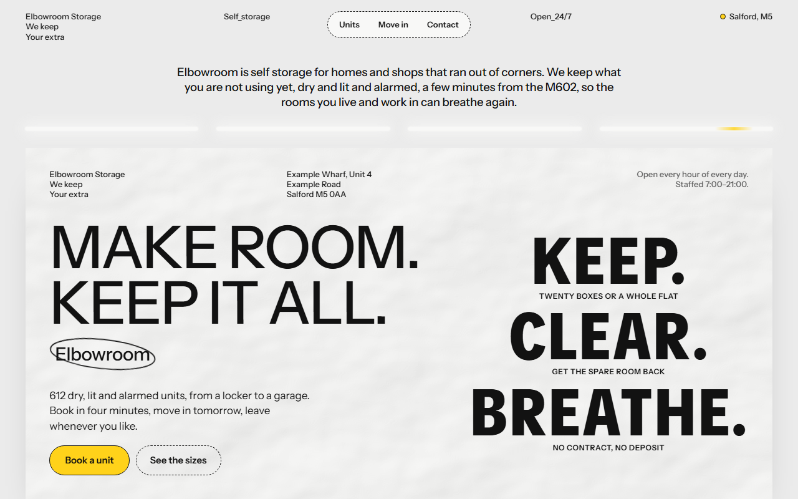
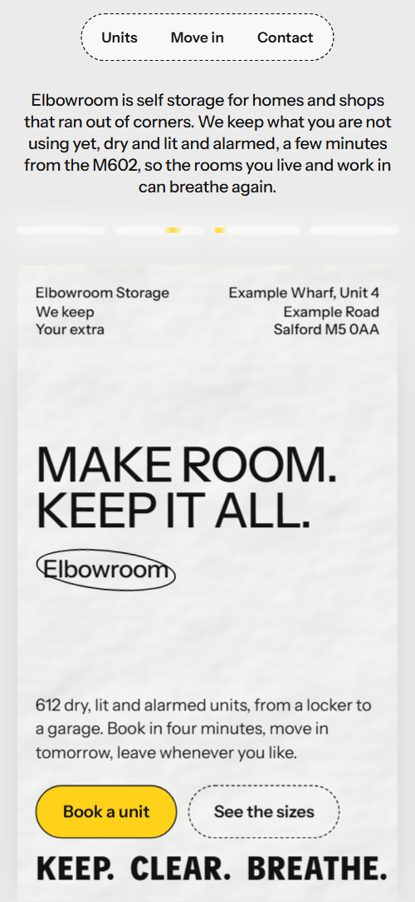
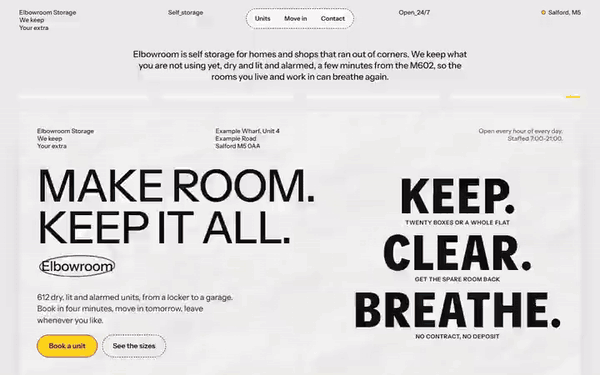

# Free HTML self storage website template with scroll animations and no libraries

Self storage website template: a free HTML file for a facility that rents lockers, rooms and garages by the week. It has four priced unit sizes, a building specification, a four step move-in and a reservation form, on grey paper posters with one signal yellow. Its scroll motion needs no JavaScript library, and AGENTS.md guides Claude Code, Cursor or Codex.

[](LICENSE)  

**[Live demo](https://8bsite.github.io/self-storage-website-template/)** · **[Use this template](https://github.com/new?template_name=self-storage-website-template&template_owner=8bsite)** · **[Download ZIP](https://github.com/8bsite/self-storage-website-template/archive/refs/heads/main.zip)** · **[Template page on 8b.com](https://8b.com/templates/elbowroom/)**

<a href="https://8bsite.github.io/self-storage-website-template/"></a> <a href="https://8bsite.github.io/self-storage-website-template/"></a>

<p align="center"><a href="https://8bsite.github.io/self-storage-website-template/"></a><br><sub>Scroll animation</sub></p>

## Use it with Claude Code, Cursor or Codex

Download the four files into your project folder (`curl.exe` in Windows PowerShell):

```bash
curl -LO https://raw.githubusercontent.com/8bsite/self-storage-website-template/main/index.html
curl -LO https://raw.githubusercontent.com/8bsite/self-storage-website-template/main/AGENTS.md
curl -LO https://raw.githubusercontent.com/8bsite/self-storage-website-template/main/LICENSE
curl -LO https://raw.githubusercontent.com/8bsite/self-storage-website-template/main/CREDITS.md
```

Then fill in the angle brackets and give your agent this prompt:

```text
Read AGENTS.md, then edit index.html. Make this the site for <my storage facility: name, town, unit sizes with area and weekly prices, number of units, access and desk hours, security, insurance terms, notice period, extra services, address, phone, email, company number>. Motion is CSS scroll-driven animation plus the inline motion kit: keep the gate script, the data-8b attributes AGENTS.md lists, the four unit faces and the four move-in sheets; add no library. Never invent prices, terms, insurance limits, reviews or contacts; ask me.
```

As a self storage website template for Claude Code, Cursor or Codex it starts with facts only the operator holds: unit sizes, weekly prices, the number of units, desk hours, insurance terms and the address. The demo invents them all, with a Salford address and a company number. If you vibe code the site, change the size names in the unit faces and in the form's select, and update --len on any display text you reword.

No agent? Click **[Use this template](https://github.com/new?template_name=self-storage-website-template&template_owner=8bsite)**, edit `index.html` on GitHub and turn on **Settings > Pages**.

## Sections and motion

- **Navigation**: top bar of small captions: a brand caption, Self_storage, a pill with three links, Open_24/7 and the district. Once you scroll past 90 px the four captions round the pill slide up and fade out one after another, and they return near the top and at the very bottom.
- **Make room. Keep it all.**: two screens: a paper poster with the headline, an oval word, address, actions and three keep/clear/breathe lines, then a second poster with a justified manifesto. On load the intro rises, the light bars flicker on and the poster is pasted in; on scroll the first poster tips back over its bottom edge while the second swings down from its top edge, and the manifesto lines slide in from alternate sides.
- **Three promises, written into the agreement you sign**: pinned sideways track of three promises with giant pale words, a pill-shaped photo and a corridor photo. The section pins and the three promise panels travel sideways, with each giant word sliding in, each note straightening and the pill photo widening.
- **The room you get back**: an empty room photo with a text column on each side. The empty room photo opens from a narrow slit to full width while the two text columns are pushed outward.
- **Four sizes, one key**: four unit sizes as faces of a block that turns and then opens flat into a row (a column on phones). The section pins for about two and a half screens while the four unit faces turn round a block, then open out flat into a row.
- **Kept dry, lit and watched**: a building specification label: six rows of conditions and a corridor photo. The heading and each of the six rows tip up into place with a short stagger, and the corridor photo is revealed from the top down.
- **Moving in takes one morning**: four tilted step sheets that start as one pile and are dealt onto the wall. The wall pins while the four step sheets start as a tilted pile and are dealt one by one into their places.
- **Behind 612 doors**: five door numbers in ovals, each with a photo and a line about what is kept behind it. Each door number's oval draws itself and each photo is revealed from the top down, with a short stagger.
- **Everything besides the room**: a dark panel with a drum of nine extra services that spins and unrolls into a list over a corridor photo. The section pins while the nine services spin past on a drum and unroll into a flat list, and the dark panel closes to a slit as you leave.
- **Questions people ask at the desk**: six questions as native &lt;details&gt; beside a heading with a phone link. The heading, the line under it and each question tip up into place with a stagger.
- **Come and stand in a unit**: a giant halftone COME BY, then address, phone, email and a reservation form. The dots of the giant Come by lettering grow from faint dust into printed letters while the tilted letters settle into one line.
- **Footer**: footer on the grey ground: a large wordmark over address, hours, four links and the company line.

## Design

 page ground, a cool light grey  
 text, button and form outlines, the dashed nav pill, the dark extras panel and the dots of the Come by lettering  
 poster and sheet paper, the nav pill, form fields and text on the dark panel  
 secondary text: the hours note, promise numbers and the line under the unit sizes  
 the giant pale words behind the three promises  
 the only saturated colour: the main button, price highlights, the manifesto's last word, the specification heading band, the location dot and link hovers  
 hairlines between the services on the dark extras panel

**Instrument Sans**: body text, captions, buttons and fields at weights 400 to 600, plus sentence case section headings and the uppercase headline, manifesto lines and service words at weight 500. **TikTok Sans**: unit names, step names, promise ghost words, door numbers and the footer wordmark, heavy 900 weight in condensed capitals. **Playpen Sans**: handwritten notes beside the copy, at 19px (Google Fonts). Paper posters pasted onto a light grey ground carry the page: a first poster on a twelve column grid with address captions, a second poster with a ten line justified manifesto, four unit faces, a specification label with six rows, four tilted step sheets and five door numbers. Section headings are sentence case at medium weight, the headline and manifesto medium capitals; unit names, steps and door numbers are heavy condensed capitals. Handwritten notes sit beside the copy.

## Questions

**Does the Hold it for a week form reserve a unit?**  
No. The form checks the name and the phone or email field, shows a thank-you line and sends nothing. Connect Formspree or Netlify Forms with the steps in AGENTS.md, or point the Book a unit button at your own booking page. There is no availability map or payment.

**What do I change first for my own facility?**  
Start with the four unit names, areas and weekly prices, the number 612 and the opening and desk hours. Then the address, phone, email, company number, insurance and notice terms. The demo invents all of them, so ask the owner for each and never guess.

**Does it need GSAP, and what shows in Firefox or with reduced motion?**  
No library: the effects are CSS animations, mostly scroll-driven, and a short inline script, 28 KB gzipped against 73 KB for the GSAP build. In Firefox the opening still plays its load-in, but the posters, tracks, block and drum are plain layouts and the nav captions stay put. With reduced motion the load-in stops too.

## Is it the right base?

It fits a facility with a short price list and a form, not a live unit map. The reservation form sends nothing, so a site that needs real time availability or card payment needs a booking system behind it. A business that prices by size, such as a [size-based price board](https://8b.com/templates/two-buckets/) for a car wash, lays its sizes out differently. Without code, 8B's AI website builder designs a new site instead.

## Before you publish

- Replace what is marked `data-8b-placeholder` (social preview image, favicon, phone, email, form) and the invented demo facts; [AGENTS.md](AGENTS.md) lists them.
- The form sends nothing yet: connect it to Formspree or Netlify Forms, or remove it.

## Tech

No JavaScript libraries: CSS scroll-driven animations and a small inline motion script with its own smooth wheel scrolling, 107 KB, no build step. Chrome and Edge 111+, Safari 16.2+, Firefox 113+ (it uses color-mix(), container query units, cascade layers, small/dynamic viewport units). Without scroll-driven animations (Firefox today) the scroll motion and the smooth wheel are off and each section shows its finished layout (a load-in or a loop may still play); with "reduce motion" on, the page is complete and nothing moves on its own (hover effects stay).

A GSAP build of the same page is [`index.gsap.html`](index.gsap.html): GSAP 3.13.0, ScrollTrigger, Lenis 1.3.4 from jsDelivr, 98 KB; its scroll motion also plays in Firefox. Use one of the two files.

## License

MIT, see [LICENSE](LICENSE). Photos, fonts and libraries keep their own licences: [CREDITS.md](CREDITS.md). More free templates: [8b.com/templates](https://8b.com/templates/) · [github.com/8bsite](https://github.com/8bsite).
