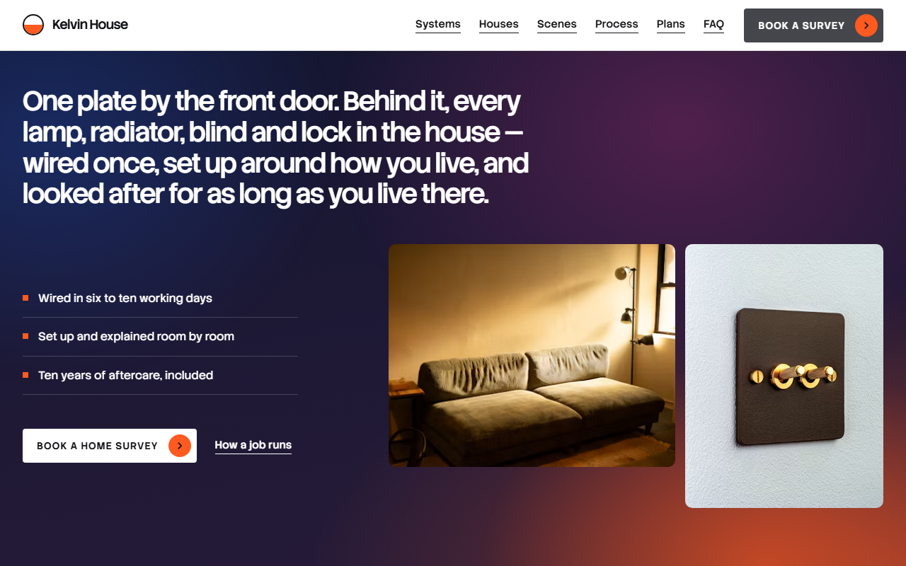
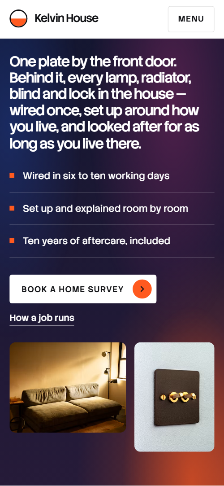
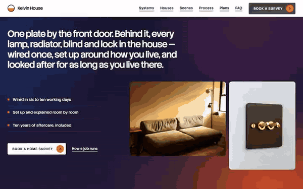

# Free HTML smart home website template with scroll animations and no libraries

Smart home website template: one free HTML file for an installer who designs, wires and looks after homes, with five systems, four recent houses, four timed scenes, three priced plans and a survey form. Dusk-dark bands with orange accents break up white sections. Its scroll scenes run on CSS with no libraries; AGENTS.md guides Claude Code, Cursor or Codex.

[](LICENSE)  

**[Live demo](https://8bsite.github.io/smart-home-website-template/)** · **[Use this template](https://github.com/new?template_name=smart-home-website-template&template_owner=8bsite)** · **[Download ZIP](https://github.com/8bsite/smart-home-website-template/archive/refs/heads/main.zip)** · **[Template page on 8b.com](https://8b.com/templates/kelvin-house/)**

<a href="https://8bsite.github.io/smart-home-website-template/"></a> <a href="https://8bsite.github.io/smart-home-website-template/"></a>

<p align="center"><a href="https://8bsite.github.io/smart-home-website-template/"></a><br><sub>Scroll animation</sub></p>

## Use it with Claude Code, Cursor or Codex

Download the four files into your project folder (`curl.exe` in Windows PowerShell):

```bash
curl -LO https://raw.githubusercontent.com/8bsite/smart-home-website-template/main/index.html
curl -LO https://raw.githubusercontent.com/8bsite/smart-home-website-template/main/AGENTS.md
curl -LO https://raw.githubusercontent.com/8bsite/smart-home-website-template/main/LICENSE
curl -LO https://raw.githubusercontent.com/8bsite/smart-home-website-template/main/CREDITS.md
```

Then fill in the angle brackets and give your agent this prompt:

```text
Read AGENTS.md, then edit index.html. Make this the site for <my installation firm: name, area, systems fitted, plans with prices, time on site, aftercare terms, finished-job count, past houses, customers who agreed to be quoted, who answers the phone, hours, address>. Motion is CSS scroll-driven animation plus the inline motion kit: keep the gate script, the ids, classes and data-8b attributes AGENTS.md lists and four house cards; add no animation library. Set the wordmark's --len to its character count. Never invent prices, promises, reviews or contacts; ask me.
```

Vibe coding goes fastest when the agent in Claude Code, Cursor or Codex receives the facts only the firm has: prices, time on site, aftercare terms, how many homes it has finished, its area, hours and who answers the phone. The demo invents all of them, including the four houses and the five customers. Replace the wordmark and its --len together, and leave the ids, the data-8b-section, data-8b-motion and data-8b-part attributes and the listed classes alone.

No agent? Click **[Use this template](https://github.com/new?template_name=smart-home-website-template&template_owner=8bsite)**, edit `index.html` on GitHub and turn on **Settings > Pages**.

## Sections and motion

- **Navigation**: top bar with the brand, six section links, a Book a survey button and a Menu button; full-screen menu with links, phone and email. The bar slides out of sight after a short scroll down and returns on scroll up, and button fills sweep in from the arrow on hover; both keep running with reduced motion.
- **Kelvin House, smart-home installers in Leeds and West Yorkshire. One plate by the front door. Behind it, every lamp, radiator, blind and lock in the house — wired once, set up around how you live, and looked after for as long as you live there.**: dark panel with the h1 as one long statement, three facts, a booking button and two photos. Smooth wheel scrolling throughout; on load the statement, facts, buttons and photos rise in turn, and soft glow blobs drift on the dusk background in slow loops until the section leaves the screen.
- **Five systems, one plate**: five tall columns, one per system, each with a photo, name, one sentence and tags. From 1024 px wide the stage pins for about 3.6 screen heights while one column opens beside a larger copy of its photo and the others narrow with their names standing upright; below that each photo opens from a strip as it rises.
- **Recent houses**: four recent installs as wide photo cards that stack on a sticky top. The four house cards stick below the top bar one over another, and as the next one slides over, the covered card shrinks, darkens and has its reeded glass close over the photo.
- **One plate, four scenes**: dark section with one living-room photo and four timed scenes; an orange marker walks the list while colour layers regrade the room. The stage pins for about 3 screen heights while an orange marker steps down the four times, the active time slot stays bright, and four colour layers regrade the one photo from cool morning through grey and amber to night.
- **How a job runs**: four steps as cards with photos that descend like a staircase. Each step starts at the position of the one before it and slides into its place on the diagonal as its row rises.
- **After the van leaves, the house stays on our list.**: aftercare statement with a button and photo beside a six-entry log on a rail. A square marker rides down the rail while the rail fills, each entry fades in from faint to full strength as the marker reaches it, and the statement's words fade in one by one with the scroll.
- **Ways to start**: three plans in tabs, each with features, a price card and a photo. Tabs switch by click or arrow keys without animation, and the reeded glass over each photo slides back to cover half of it as it scrolls into view.
- **Living with it**: dark band with five households as portrait cards on a horizontal track. The stage pins and the five cards slide left as one row, with each portrait's glass clearing and its quote lifting as the card nears the middle of the screen.
- **Questions**: six questions in native &lt;details&gt; beside a photo and a call button.
- **Let’s walk your house**: rounded panel with a porch photo and details beside a survey request form. As the panel arrives, the dusk inside it fades to daylight, the glow blobs slide into place and the heading settles from 1.32 times its size.
- **Footer**: three link cards, copyright with the Design: 8B credit, a photo and the full-width wordmark. The giant wordmark rises into view, and the reeded glass over the photo next to it slides back to half its width.

## Design

 page ground, navigation bar, cards and fields, and text on the dark sections  
 body text, full-screen menu ground, the tab strip outline and the selected tab, the arrow inside the orange lamp circles and the fill that grows down the aftercare rail  
 pale grey ground of the houses and aftercare sections, photo placeholders and the form's thank-you line  
 secondary text, tag badges and placeholders, and the grey layer that drains colour from the scenes photo  
 orange: the fill that sweeps across buttons and tabs on hover, the lamp circles, fact squares, the marker beside the times and the aftercare rail marker  
 hairlines, card and field borders and the aftercare rail track  
 fill of the dark square-cornered buttons  
 teal start of the daylight gradient in the contact panel  
 blue end of that daylight gradient, a night glow in the opening and the cool morning layer on the scenes photo  
 pink glow in the contact daylight, the haze behind system names and part of the morning layer  
 amber glow for the evening and night layers on the scenes photo and in the contact daylight  
 deep indigo ground of the scenes and stories sections and of the opening night, and the shade that falls over covered house cards  
 plum glow in the opening night, the contact night and the evening layer on the scenes photo

**Stack Sans Headline**: headings, the plan prices and the giant footer wordmark, at weights 500 and 600 with tight spacing. **Stack Sans Text**: body text, labels, tags, form fields and the uppercase button labels, at weights 400 to 600 (Google Fonts). White and pale grey sections alternate with three dark ones: the opening, the scenes and the stories. Most sections start with a heading, a hairline under it and a short paragraph beside it. Five tall system columns share one row, house cards stack like a deck, the process steps descend a diagonal and the aftercare log hangs on a vertical rail. The contact form sits in a rounded panel, and a giant wordmark closes the page.

## Questions

**Where does the survey request form send its data?**  
Nowhere yet. The script checks the fields, clears the form and shows a thank-you line that promises a call within one working day. Connect Formspree or Netlify Forms as AGENTS.md describes, or delete the form and its script, and make the promise match how fast you really ring back.

**Does it need GSAP, and what shows in Firefox or with reduced motion?**  
No library: the pinned scenes run on CSS scroll-driven animations and a short inline script, 31 KB gzipped against 75 KB. In Firefox today the page shows its finished layout, with only the opening's glow blobs drifting; with reduced motion nothing moves but the nav hiding and hover fills. Keep four house cards: CSS stacks exactly four.

**Can an electrician use it as an electrician website template?**  
Partly. For website design for electricians who fit lighting, heating or security controls and sell fixed plans, the structure, [plans and contact on a single scroll](https://8b.com/templates/one-page/), fits. The text and prices need rewriting, and an electrician website design built around fault-finding must add an emergency block and night line. UK prices and places are demo content.

## Is it the right base?

Pick it for a firm that sells fixed-price plans and long aftercare in a calm, premium tone. This light build keeps the look and motion with no animation library or CDN script: about 31 KB of code gzipped, where the GSAP version needs 75 KB and three extra requests. A firm living on emergency call-outs will find the [plumbing and heating firm](https://8b.com/templates/ferrule/) template closer. The weak spot is booking: every booking button jumps to one form that sends nothing yet.

## Before you publish

- Replace what is marked `data-8b-placeholder` (social preview image, favicon, phone, email, form) and the invented demo facts; [AGENTS.md](AGENTS.md) lists them.
- The form sends nothing yet: connect it to Formspree or Netlify Forms, or remove it.

## Tech

No JavaScript libraries: CSS scroll-driven animations and a small inline motion script with its own smooth wheel scrolling, 124 KB, no build step. Chrome and Edge 111+, Safari 16.2+, Firefox 113+ (it uses color-mix(), container query units, cascade layers, small/dynamic viewport units). Without scroll-driven animations (Firefox today) the scroll motion and the smooth wheel are off and each section shows its finished layout (a load-in or a loop may still play); with "reduce motion" on, the page is complete and nothing moves on its own (hover effects stay).

A GSAP build of the same page is [`index.gsap.html`](index.gsap.html): GSAP 3.13.0, ScrollTrigger, Lenis 1.3.4 from jsDelivr, 113 KB; its scroll motion also plays in Firefox. Use one of the two files.

## License

MIT, see [LICENSE](LICENSE). Photos, fonts and libraries keep their own licences: [CREDITS.md](CREDITS.md). More free templates: [8b.com/templates](https://8b.com/templates/) · [github.com/8bsite](https://github.com/8bsite).
