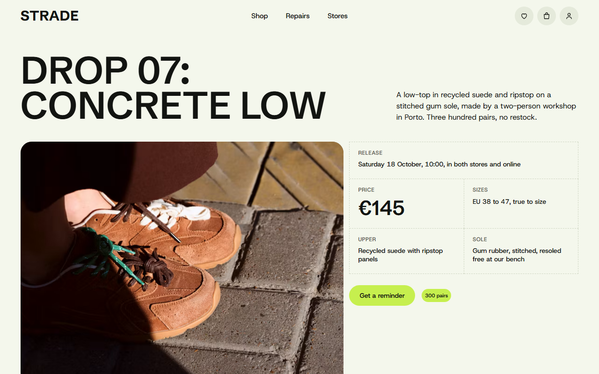
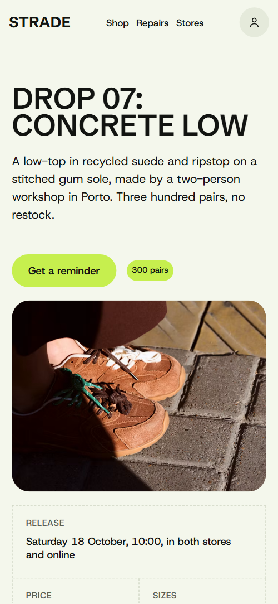
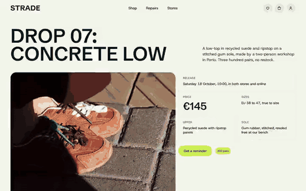

# Free HTML sneaker store website template with scroll animations and no libraries

Sneaker store website template: one free HTML file for an independent streetwear shop with a single product drop, a priced lookbook, a repair service, two stores and a Saturday run club. Pale green ground, near-black type and one lime accent. Its scroll motion runs on CSS with no JavaScript libraries, so Claude Code, Cursor or Codex reads one light file.

[](LICENSE)  

**[Live demo](https://8bsite.github.io/sneaker-store-website-template/)** · **[Use this template](https://github.com/new?template_name=sneaker-store-website-template&template_owner=8bsite)** · **[Download ZIP](https://github.com/8bsite/sneaker-store-website-template/archive/refs/heads/main.zip)** · **[Template page on 8b.com](https://8b.com/templates/strade/)**

<a href="https://8bsite.github.io/sneaker-store-website-template/"></a> <a href="https://8bsite.github.io/sneaker-store-website-template/"></a>

<p align="center"><a href="https://8bsite.github.io/sneaker-store-website-template/"></a><br><sub>Scroll animation</sub></p>

## Use it with Claude Code, Cursor or Codex

Download the four files into your project folder (`curl.exe` in Windows PowerShell):

```bash
curl -LO https://raw.githubusercontent.com/8bsite/sneaker-store-website-template/main/index.html
curl -LO https://raw.githubusercontent.com/8bsite/sneaker-store-website-template/main/AGENTS.md
curl -LO https://raw.githubusercontent.com/8bsite/sneaker-store-website-template/main/LICENSE
curl -LO https://raw.githubusercontent.com/8bsite/sneaker-store-website-template/main/CREDITS.md
```

Then fill in the angle brackets and give your agent this prompt:

```text
Read AGENTS.md, then edit index.html. Make this the site for <my shop: name, city, the current drop with name, price, pair count, sizes and release date, look prices, repair terms, two store addresses and hours, run club time, shipping and returns, contacts>. Replace the euro prices, Porto and Rotterdam details and VAT line first. Motion is CSS scroll-driven animation plus the inline motion kit: keep the gate script, ids, data-8b-section, data-8b-motion, data-8b-items and the selectors AGENTS.md lists; add no animation library. Never invent prices, hours or addresses; ask me.
```

Give the agent the drop facts first: name, price, pair count, sizes, materials, release date and shop link, then both store addresses, hours and repair terms. It replaces the demo euro prices, Porto workshop, Rotterdam stores and VAT line, and points the reminder, bag, repair and run buttons at real pages. As a sneaker store website template for Claude Code or Cursor it works when the agent asks for missing prices and hours instead of inventing them, even when [an agent builds the whole shop](https://8b.com/templates/vibe-coding/).

No agent? Click **[Use this template](https://github.com/new?template_name=sneaker-store-website-template&template_owner=8bsite)**, edit `index.html` on GitHub and turn on **Settings > Pages**.

## Sections and motion

- **Navigation**: fixed top bar: wordmark, three links (Shop, Repairs, Stores) and three icon links. The navigation bar slides up out of view when you scroll down and returns when you scroll up; this keeps working with reduced motion.
- **Drop 07: Concrete Low**: first screen: headline of the product drop, a paragraph, a photo, a spec list and a reminder button. On load the photo is cut into tiles that start scattered and turned and lock together into the picture, while the headline slides in by line and the badge pops.
- **Five ways to wear October**: five outfits with photo, name and three priced pieces, shown as a sideways rail. The section holds in place while the row of looks travels sideways as you scroll, and each photo drifts slightly inside its frame.
- **Worn on the city before it is sold**: heading, paragraph, a tall photo and a wear-test table of five pieces. The heading slides in by line and the tall photo opens from a centre column as it arrives.
- **Repairs for life**: heading, paragraph and button, then three step cards with photos. Tied to the scroll, the three step cards start piled on the middle card (the first on phones), each turned a little, and spread into their row.
- **Two stores, one repair bench**: two store cards with photo, address, opening hours table and a directions link. The heading slides in, each store photo opens from a centre column and each badge pops in.
- **Saturday run club**: run club panel: heading, paragraph, button, a night photo and three pace lanes. Tied to the scroll, each pace line enters from the right and settles at the left, the fast group travelling furthest.
- **Before you ask**: five questions and answers in native &lt;details&gt; elements. The heading slides in by line; each question is a native details element, so it opens without scripts.
- **Say hello**: large "Say hello" wordmark, a paragraph with email and phone, and a message form. Tied to the scroll, the letters of the Say hello wordmark start spread across the width and turned, then close into the two words.
- **Footer**: logo, six links, the two store addresses and a small print line.

## Design

 page background and the top bar  
 text, button hover fill, the run club panel and the footer background  
 the accent: button fill, badges, run club paces, open FAQ plus  
 icon circles, image frame backing, the closed FAQ plus  
 dashed rules and form field borders  
 repair cards, form fields, text on the dark panels  
 run club paragraph and group labels, footer address and small print  
 dashed rules inside the run club panel and the footer  
 spec labels, wear-test column heads, hours labels, contact labels

**Schibsted Grotesk**: uppercase display type: headings, look and store names, repair step titles, FAQ questions, the price, the large contact wordmark and the logo, in semibold and bold. **Host Grotesk**: body text in regular weight, buttons and table text in medium to semibold, and small uppercase labels (Google Fonts). A 12-column grid on desktop. Most sections set a big uppercase heading against a block of text on the far side, and dashed rules separate spec cells, look prices, store rows and FAQ items. The lookbook is a row of 3:4 portrait cards with a priced list under each. The run club and the footer are rounded near-black panels on the pale ground. Photos sit in rounded frames. Below 900 px most sections stack to one column.

## Questions

**Can this sneaker website template take orders online?**  
No, not by itself. The bag, saved looks and members icons only scroll to a section, and the file has no cart, wishlist or login. Point them at your cart or checkout page and a member or wishlist page, or remove the icons. The template presents the drop and does not take payment.

**Where does the contact form send its messages?**  
Nowhere yet. The form needs a name, an email and a message, then shows a thank-you line and clears the fields without sending anything. Connect Formspree or Netlify Forms before publishing, or delete the form and its script. Without JavaScript it posts to the page itself, which also sends nothing.

**Does it work in every browser and with reduced motion?**  
Yes. Without CSS scroll-driven animations (Firefox today) or with reduced motion on, the page shows its finished static layout: the drop photo whole, the looks as a grid of cards, the repair cards in their row, the wordmark in place, with ordinary scrolling. The navigation bar still hides as you scroll down, and hover effects remain.

## Is it the right base?

As a streetwear brand website template it suits a shop with one hero release, a workshop story and a community event. This is the light build: the same look and behaviour with no script from a CDN, about 19 KB of code gzipped in one file against 66 KB and three extra requests for the GSAP version. A label selling many drops from a calendar is closer to the [limited-drop label](https://8b.com/templates/scrawl/) template. There is no cart, login or phone menu.

## Before you publish

- Replace what is marked `data-8b-placeholder` (social preview image, favicon, map, email, phone, form) and the invented demo facts; [AGENTS.md](AGENTS.md) lists them.
- The form sends nothing yet: connect it to Formspree or Netlify Forms, or remove it.

## Tech

No JavaScript libraries: CSS scroll-driven animations and a small inline motion script with its own smooth wheel scrolling, 66 KB, no build step. Chrome and Edge 108+, Safari 15.4+, Firefox 121+ (it uses :has(), cascade layers, small/dynamic viewport units). Without scroll-driven animations (Firefox today) the scroll motion and the smooth wheel are off and each section shows its finished layout (a load-in or a loop may still play); with "reduce motion" on, the page is complete and nothing moves on its own (hover effects stay).

A GSAP build of the same page is [`index.gsap.html`](index.gsap.html): GSAP 3.13.0, ScrollTrigger, Lenis 1.3.27 from jsDelivr, 64 KB; its scroll motion also plays in Firefox. Use one of the two files.

## License

MIT, see [LICENSE](LICENSE). Photos, fonts and libraries keep their own licences: [CREDITS.md](CREDITS.md). More free templates: [8b.com/templates](https://8b.com/templates/) · [github.com/8bsite](https://github.com/8bsite).
