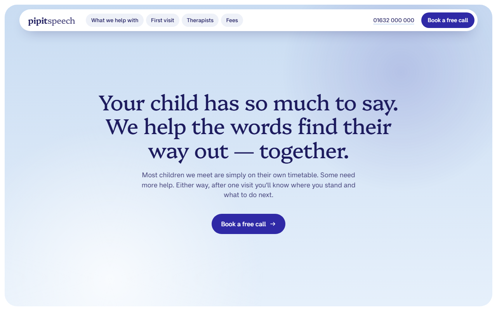
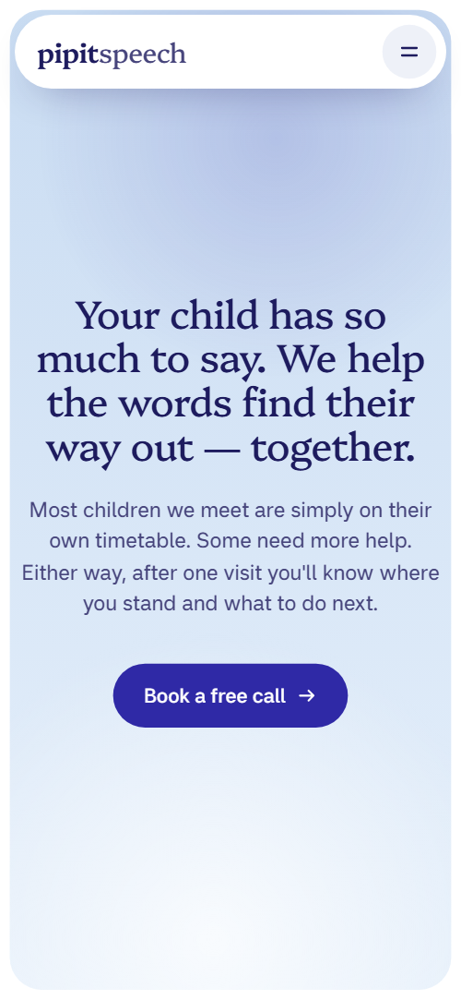
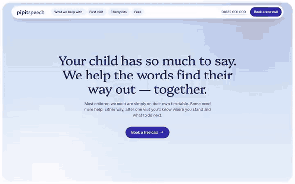

# Free HTML speech therapist website template with GSAP scroll animations

Speech therapist website template: one free HTML file for a children's speech and language practice, with five areas of help, a four-step first visit, a parent and therapist message thread, four therapist cards, fees and a call request form. The look is soft sky blue, indigo and cream. AGENTS.md lets Claude Code, Cursor or Codex adapt it.

[](LICENSE)  

**[Live demo](https://8bsite.github.io/speech-therapist-website-template/)** · **[Use this template](https://github.com/new?template_name=speech-therapist-website-template&template_owner=8bsite)** · **[Download ZIP](https://github.com/8bsite/speech-therapist-website-template/archive/refs/heads/main.zip)** · **[Template page on 8b.com](https://8b.com/templates/pipit/)**

<a href="https://8bsite.github.io/speech-therapist-website-template/"></a> <a href="https://8bsite.github.io/speech-therapist-website-template/"></a>

<p align="center"><a href="https://8bsite.github.io/speech-therapist-website-template/"></a><br><sub>Scroll animation</sub></p>

## Use it with Claude Code, Cursor or Codex

Download the four files into your project folder (`curl.exe` in Windows PowerShell):

```bash
curl -LO https://raw.githubusercontent.com/8bsite/speech-therapist-website-template/main/index.html
curl -LO https://raw.githubusercontent.com/8bsite/speech-therapist-website-template/main/AGENTS.md
curl -LO https://raw.githubusercontent.com/8bsite/speech-therapist-website-template/main/LICENSE
curl -LO https://raw.githubusercontent.com/8bsite/speech-therapist-website-template/main/CREDITS.md
```

Then fill in the angle brackets and give your agent this prompt:

```text
Read AGENTS.md, then edit index.html. Make this the site for <my practice: name, town, what we treat and at what ages, therapists with registrations and working days, how a first visit runs, where we meet, fees, hours, how parents book a call>. Replace first the wordmark in the nav and the footer, the therapists, registrations, fees, quotes and Exeter details. Keep the ids, the classes AGENTS.md lists and four word spans in the first-visit heading. Ask me for any missing fact and never invent registrations, fees, quotes or contacts.
```

Give the agent the facts only your practice has: registrations, therapist names and working days, the ages each help card serves, fees, step timings, service areas and hours. The demo invents all of them, including the Exeter address and the HCPC claim. Replace the two-part wordmark first, in the nav and the footer. Vibe coding with Claude Code, Cursor or Codex works well when the agent asks for these facts instead of filling gaps.

No agent? Click **[Use this template](https://github.com/new?template_name=speech-therapist-website-template&template_owner=8bsite)**, edit `index.html` on GitHub and turn on **Settings > Pages**.

## Sections and motion

- **Navigation**: two-part wordmark, four links, phone, a Book a free call button and a menu overlay. The bar slides out of view after a short scroll down and returns after a short scroll up; this keeps running with reduced motion.
- **Your child has so much to say. We help the words find their way out — together.**: a sky-blue panel with the h1, a short lead and a Book a free call button. On load the heading, lead and button rise 22 pixels into place one after another, while two soft round glows drift in the sky in a CSS loop that pauses off screen.
- **What we help with**: five cards of what the practice helps with, each showing a child's word today and soon. Each card travels in from below, tilted, and straightens as it scrolls up, then the old word is struck through and the target word rises in.
- **We talk, play, plan and practise.**: a held stage: four step cards stack up one over another while the heading words light in turn. Pinned for about three screens of scrolling: each step card rises over the one before, which shrinks slightly, and the matching heading word is highlighted.
- **Play is the method, not the reward.**: four play photos with a caption each. Each photo opens from a small stadium-shaped window to full size while the image settles, and the heading, lead and captions rise, once on scroll.
- **Ten minutes a day, and someone to ask.**: a held stage: a message thread between a parent and a therapist that plays out message by message. On screens 900 pixels or wider it is pinned for two screens and the messages after the first pop in one by one while the list lifts to keep the newest in view; on phones each pops in as it scrolls into view.
- **Who you'll see — every time**: four therapist cards with roles, working days and a photo. The heading rises, each portrait opens from a small window and the weekday chips pop in, once on scroll.
- **Where we meet**: a held stage: four places to meet open one after another in a single photo window. Pinned for about three screens: each place's photo opens from a small pill into its full shape while the previous text fades, and an index of the four names lights the current one.
- **Families, in their own words**: three columns of parent quotes and photos moving at different speeds. On screens 600 pixels or wider the three columns start 220, 60 and 320 pixels lower and rise to their places; on phones each note and photo slides in from alternating sides.
- **Fees, plainly**: a price list of five items and four questions on one panel. The heading and lead rise once; the four questions are native details elements that open without JavaScript.
- **Book a free call**: a sky panel that opens from a stadium window, with details and a call request form. The sky panel grows from a small stadium-shaped window to the full rounded panel as you scroll, while the details and the form rise into place.
- **Footer**: wordmark with a line, address, contact, page links and the legal line. The four footer columns rise once on scroll.

## Design

 page background, nav bar, cards, form fields, button labels, the footer text and the therapist's message text  
 body text and headings, and the footer background  
 buttons, the therapist's message bubbles, the avatar, tick icons, the lit heading word, the current place in the index, focus rings and the favicon  
 top of the sky gradients (opening, menu overlay, contact panel), the button hover fill, form field borders and link underlines  
 bottom of those gradients, the first-visit panel, the parent's message bubbles, the footer base text and the tint under each therapist card  
 the cream background of three of the six family quote cards  
 message-thread and fees panels, photo placeholders, icon buttons, weekday chips and help-card borders  
 secondary text: leads, captions, age ranges, the speech half of the wordmark and the struck-through old words

**Platypi**: serif for the wordmark, section headings, the child's words on the help cards, the large menu links and the avatar letter. **Miranda Sans**: sans for body text, card titles, buttons, labels, badges and form fields, in regular and medium weights (Google Fonts). A floating pill nav sits over soft panels with 32 pixel corners: the sky panel of the opening, then the first-visit, message-thread, places, fee and contact panels. Help is a six column bento of five cards, two of them with photos. Photos sit in stadium, arch, circle and ellipse windows, and the four therapist portraits rise from the card base as arches. Three tall pinned sections alternate with ordinary ones. Headings are serif, body text sans.

## Questions

**Is this a free speech therapy website template I can use for a clinic?**  
Yes. It is one index.html under the MIT license, so a practice or a freelancer can use it for clients at no cost. GSAP, ScrollTrigger, SplitText and Lenis load from jsDelivr, the fonts are Google Fonts files, and there is no build step. Photos are Unsplash images listed in CREDITS.md.

**Can I get a site like this without editing code?**  
Yes, with [8B's AI website builder](https://8b.com/templates/8b/). You describe the practice in a sentence and its engine designs a new site, not this template. Designing and restyling are free; publishing with hosting and SSL, full HTML export and AI edits in chat are on Pro at $9 a month billed yearly. It also runs inside Claude and ChatGPT.

**Where does the Request a call form send its messages?**  
Nowhere yet. A script checks that the name and the phone or email field are filled, shows a thank-you line and resets the form without sending anything. Connect Formspree or Netlify Forms with the steps in AGENTS.md, or delete the form. Also edit the thank-you line, which promises a call within one working day.

## Is it the right base?

Choose this when the practice is small, family facing and sells by phone: named therapists, a priced list, a message thread and one form. A larger clinic with a blog, a patient login or a booking calendar needs more pages. A [vet practice](https://8b.com/templates/burrow/) that books visits through a form has its own template. The weak spot is edges: the form field borders and the card outlines are very pale against white. If nobody on your team edits HTML, the 8B builder is the no-code route.

## Before you publish

- Replace what is marked `data-8b-placeholder` (social preview image, favicon, phone, email, form) and the invented demo facts; [AGENTS.md](AGENTS.md) lists them.
- The form sends nothing yet: connect it to Formspree or Netlify Forms, or remove it.

## Tech

GSAP 3.13.0, ScrollTrigger, SplitText, Lenis 1.3.4 from jsDelivr, 104 KB, no build step. Chrome and Edge 111+, Safari 16.2+, Firefox 113+ (it uses color-mix(), cascade layers, small/dynamic viewport units). With "reduce motion" on, the page is complete and still.

## License

MIT, see [LICENSE](LICENSE). Photos, fonts and libraries keep their own licences: [CREDITS.md](CREDITS.md). More free templates: [8b.com/templates](https://8b.com/templates/) · [github.com/8bsite](https://github.com/8bsite).
