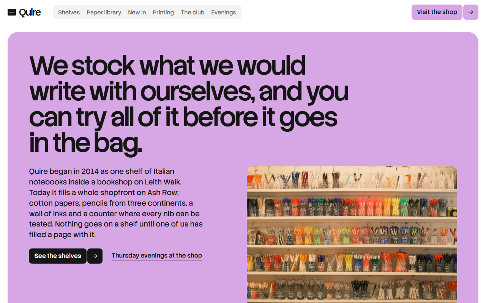
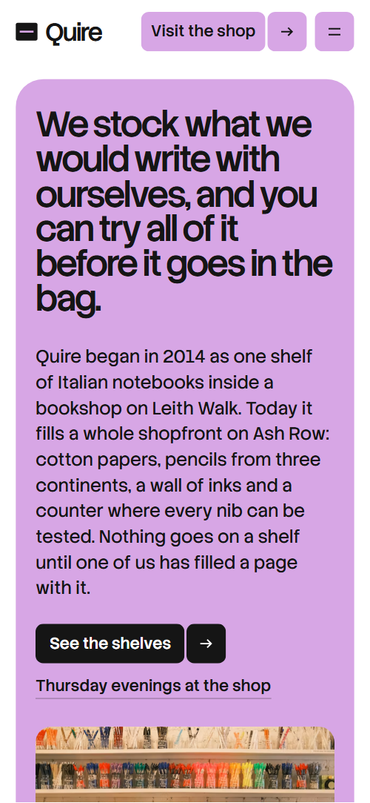
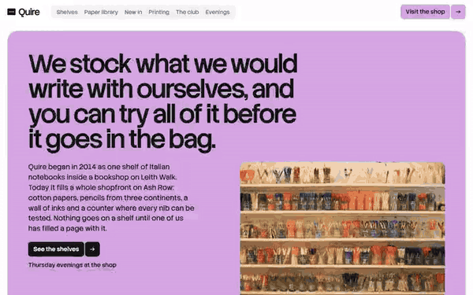

# Free HTML stationery shop website template with scroll animations and no libraries

Stationery shop website template: one free HTML file for an independent stationer, with five shelves, a paper library in tabs, new arrivals, makers, letterpress printing, a monthly subscription and Thursday workshops. White pages, ink-black panels, one lilac accent, and scroll motion in CSS with no libraries. AGENTS.md lets Claude Code, Cursor or Codex adapt it.

[](LICENSE)  

**[Live demo](https://8bsite.github.io/stationery-shop-website-template/)** · **[Use this template](https://github.com/new?template_name=stationery-shop-website-template&template_owner=8bsite)** · **[Download ZIP](https://github.com/8bsite/stationery-shop-website-template/archive/refs/heads/main.zip)** · **[Template page on 8b.com](https://8b.com/templates/quire/)**

<a href="https://8bsite.github.io/stationery-shop-website-template/"></a> <a href="https://8bsite.github.io/stationery-shop-website-template/"></a>

<p align="center"><a href="https://8bsite.github.io/stationery-shop-website-template/"></a><br><sub>Scroll animation</sub></p>

## Use it with Claude Code, Cursor or Codex

Download the four files into your project folder (`curl.exe` in Windows PowerShell):

```bash
curl -LO https://raw.githubusercontent.com/8bsite/stationery-shop-website-template/main/index.html
curl -LO https://raw.githubusercontent.com/8bsite/stationery-shop-website-template/main/AGENTS.md
curl -LO https://raw.githubusercontent.com/8bsite/stationery-shop-website-template/main/LICENSE
curl -LO https://raw.githubusercontent.com/8bsite/stationery-shop-website-template/main/CREDITS.md
```

Then fill in the angle brackets and give your agent this prompt:

```text
Read AGENTS.md, then edit index.html. Make this the site for <my shop: name, address, hours, shelves, papers with prices, new arrivals, makers, made-to-order printing, subscription tiers, workshop dates, how people reserve>. Replace the Ash Row address, hours, prices and dates first. Keep the gate script in the head, the section ids, the data-8b-* attributes, the classes AGENTS.md lists, five shelf rows with five photos, three evening cards, four paper tabs and each --len; add no animation library. Ask me for missing facts; never invent prices or dates.
```

[Vibe coding this with Claude Code](https://8b.com/templates/for-claude-code/), Cursor or Codex starts with facts only the shop has: address, hours, papers and prices, makers, print runs, subscription tiers and workshop dates. The agent should replace the Ash Row address first and set each --len to the new line's character count, then rewrite the shelves, the four paper tabs and the Thursday cards. It keeps the section ids and the AGENTS.md classes, and never invents prices or dates.

No agent? Click **[Use this template](https://github.com/new?template_name=stationery-shop-website-template&template_owner=8bsite)**, edit `index.html` on GitHub and turn on **Settings > Pages**.

## Sections and motion

- **Navigation**: top bar: wordmark, six section links, a Visit the shop button and a menu button; a full-screen menu on phones. The bar slides away after 24 px of downward scrolling past 160 px and returns on the way up; this keeps working with reduced motion.
- **We stock what we would write with ourselves, and you can try all of it before it goes in the bag.**: one statement as the h1, a short story paragraph with two links, and a wide photo of a wall of pens and pencils. On load the lilac panel, the statement and the story rise in with a short stagger, and the photo drifts down into place inside its frame as the panel scrolls up.
- **Five shelves, chosen by hand.**: five shelves as a list beside a sticky plate of photos that wipe to the shelf in view (demo: Paper &amp; card, Pens &amp; ink, Notebooks, Post &amp; sealing, Paint &amp; drawing). The plate beside the list is sticky in CSS. As each of rows two to five rises into the screen its photo wipes up over the previous one, settling from 120% to 100%; a row's title darkens while it crosses 60% of the screen, and a rule draws above each row.
- **The paper library. Touch before you buy.**: a panel with four paper tabs (demo: Cotton rag, Kraft &amp; recycled, Marbled, Washi), a stack of four photos and a detail panel with sizes, best for and price. Clicking a tab or using the arrow, Home and End keys swaps the detail panel and cross-fades the photo, and the heading's second half writes in word by word as you scroll.
- **New on the shelves.**: a sticky heading and button beside four new-arrival cards with photo, name, price, maker and date (demo: notebook £24, pencil set £14, seal kit £32, watercolour tin £38). Each card enters shifted 150 px and tilted 9 degrees from alternating sides and straightens by mid-screen while its photo zooms out; on phones the shift and tilt scale to 40%.
- **Ten of our thirty-one makers, most of them small.**: a grid of ten maker tiles with name, city and craft (demo: Hollin Bindery, Orba, Merrow &amp; Lane, Studio Kesh, Tidewell Mill and five more). Each maker's name fills in word by word as its tile scrolls into view.
- **Printed to order, in the back room.**: a horizontal row held on screen: an intro with a button, then four steps with photos (demo: choose stock and set type, proof, print by hand, wrap and collect). Held on screen: a sticky stage keeps the row in view while the intro and four steps slide sideways for as long as the row overflows, each photo shifting back against the movement.
- **The Monthly Quire. Paper by post.**: a panel with three subscription tiers, each with a price, a line, a list and a button (demo: Pocket £12, Desk £24 marked Most chosen, Studio £45). The three tiers start folded forward from their top edge and unfold one after another; at 900 px and narrower each unfolds on its own.
- **Thursday evenings at the shop.**: three workshop cards with photo, date, title, text, price and a Book a place link (demo: an italic hand, a Coptic notebook, a watercolour field journal). The second and third cards start 130 and 260 px lower, a staircase that closes into a row by mid-screen while the photos shift against their frames; on phones the steps are shallower.
- **Questions at the counter.**: six questions and answers as native &lt;details&gt; rows with a sticky heading and phone and email links. A rule draws under each question on arrival, and the plus turns into a minus when a row opens.
- **27 Ash Row, Edinburgh.**: the address as a large two-line heading, a photo, opening hours, address, phone and email, and a message form. The motion kit adds a lilac copy of the address heading, offset behind it; as you scroll in, the two lines slide in from opposite sides and the copy settles into register and fades.
- **Footer**: panel with a large wordmark, a tagline, three link columns (Shop, Services, Visit) and the copyright line with the Design: 8B credit. A rule draws across the top of each of the four columns.

## Design

 page background, text on the ink panels and on hovered buttons, the selected paper tab  
 text, the ink panels (paper library, subscription, footer), button fill on hover, the Desk button  
 secondary text: leads, notes, makers' places, answers, shelf titles before they become current  
 grey surfaces: nav pill, paper tab list, evening cards, enquiry form, alternate maker tiles, printing step cards, question icons  
 the only accent: opening panel, button fills, the Most chosen mark, the Desk tier, the thank-you line, the address copy, focus rings on ink panels  
 tier cards inside the subscription panel and the paper photo frame  
 hairlines above shelf rows, card footers, question rows and maker tile borders  
 muted text on the ink panels: leads, spec labels, tier descriptions, footer labels

**Stack Sans Headline**: weight 500 with tight negative tracking: the opening statement, section headings, prices, tab names, the wordmark and the menu links. **Stack Sans Text**: weight 400 for body text and 500 for buttons, form labels and small labels, which are uppercase with 0.06em tracking (Google Fonts). A white page whose section heads sit on a 12-column grid: heading left, small grey lead right. The opening is one rounded lilac panel holding the statement, a story paragraph and a wide photo. Ink-black rounded panels hold the paper library and the subscription tiers, and the footer repeats the ink panel. The shelves, new arrivals and questions pair a sticky column with a scrolling list. Corners are 8, 16 or 28 px, with hairline rules and no shadows.

## Questions

**Is this a free stationery template I can print?**  
No. It is a website, not printable letterhead or notebook pages. It is free to use, though: one index.html, [shelves to workshops on one page](https://8b.com/templates/one-page/), under the MIT licence with no build step, so it works as a stationery template free download for a shop site.

**Can it work as a stationery ecommerce website template?**  
Only as a showcase so far. There is no cart, checkout or payment script: the hold, print order, subscription and booking buttons all point to the contact form. Replace each with your shop, checkout or booking link, one per tier and per workshop.

**Where does the Ask the shop form send its messages?**  
Nowhere yet. The form checks the name, email and message, clears itself and shows a thank-you line, but sends nothing. Connect Formspree or Netlify Forms with the steps in AGENTS.md, or delete the form and keep the email link. Edit the thank-you line, which promises a reply within one working day.

## Is it the right base?

It suits a shop that mixes browsing, a monthly parcel and teaching evenings; a showroom selling large objects fits the [lighting showroom](https://8b.com/templates/glim/) template better. This light build keeps the same look and scroll behaviour with no script from a CDN: about 26 KB of code gzipped in one file, against about 74 KB and four more requests for the GSAP version. The weak spot is selling: no cart, and the order and booking buttons lead to the contact form until you link your own.

## Before you publish

- Replace what is marked `data-8b-placeholder` (social preview image, favicon, phone, email, form) and the invented demo facts; [AGENTS.md](AGENTS.md) lists them.
- The form sends nothing yet: connect it to Formspree or Netlify Forms, or remove it.

## Tech

No JavaScript libraries: CSS scroll-driven animations and a small inline motion script with its own smooth wheel scrolling, 107 KB, no build step. Chrome and Edge 111+, Safari 16.2+, Firefox 113+ (it uses color-mix(), cascade layers, small/dynamic viewport units). Without scroll-driven animations (Firefox today) the scroll motion and the smooth wheel are off and each section shows its finished layout (a load-in or a loop may still play); with "reduce motion" on, the page is complete and nothing moves on its own (hover effects stay).

A GSAP build of the same page is [`index.gsap.html`](index.gsap.html): GSAP 3.13.0, ScrollTrigger, SplitText, Lenis 1.3.4 from jsDelivr, 93 KB; its scroll motion also plays in Firefox. Use one of the two files.

## License

MIT, see [LICENSE](LICENSE). Photos, fonts and libraries keep their own licences: [CREDITS.md](CREDITS.md). More free templates: [8b.com/templates](https://8b.com/templates/) · [github.com/8bsite](https://github.com/8bsite).
