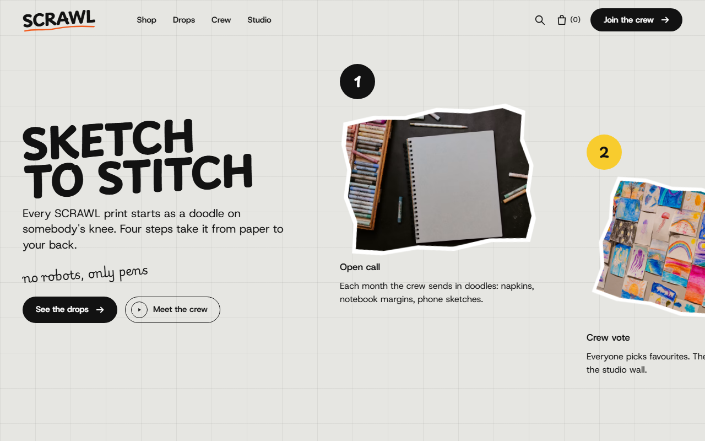
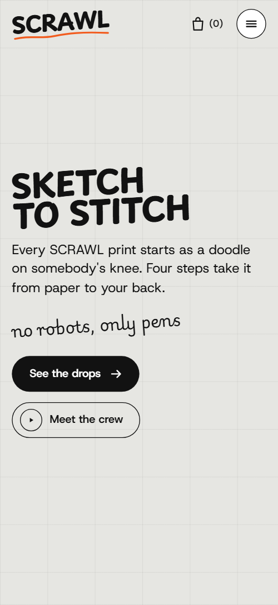
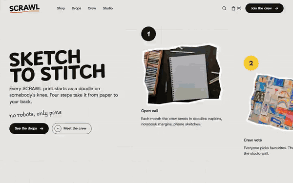

# Free HTML streetwear brand website template with GSAP scroll animations

Streetwear brand website template: one free HTML file for a clothing label that sells limited drops and credits the artists behind them. It scrolls from a pinned sideways process strip through a crew wall, a hoodie close-up and a drop calendar to a contact poster, all in marker doodles on paper. AGENTS.md is included for Claude Code, Cursor and Codex.

[](LICENSE)  

**[Live demo](https://8bsite.github.io/streetwear-brand-website-template/)** · **[Use this template](https://github.com/new?template_name=streetwear-brand-website-template&template_owner=8bsite)** · **[Download ZIP](https://github.com/8bsite/streetwear-brand-website-template/archive/refs/heads/main.zip)** · **[Template page on 8b.com](https://8b.com/templates/scrawl/)**

<a href="https://8bsite.github.io/streetwear-brand-website-template/"></a> <a href="https://8bsite.github.io/streetwear-brand-website-template/"></a>

<p align="center"><a href="https://8bsite.github.io/streetwear-brand-website-template/"></a><br><sub>Scroll animation</sub></p>

## Use it with Claude Code, Cursor or Codex

Download the four files into your project folder (`curl.exe` in Windows PowerShell):

```bash
curl -LO https://raw.githubusercontent.com/8bsite/streetwear-brand-website-template/main/index.html
curl -LO https://raw.githubusercontent.com/8bsite/streetwear-brand-website-template/main/AGENTS.md
curl -LO https://raw.githubusercontent.com/8bsite/streetwear-brand-website-template/main/LICENSE
curl -LO https://raw.githubusercontent.com/8bsite/streetwear-brand-website-template/main/CREDITS.md
```

Then fill in the angle brackets and give your agent this prompt:

```text
Read AGENTS.md, then edit index.html. Make this the site for <my clothing or merch label: what I make, how prints are chosen and credited, my artists, release days, next drops, shipping and returns, studio and contacts>. Replace the brand name, the five drops, the crew captions, the hoodie details and the contacts. Keep the section ids, the classes AGENTS.md lists, four steps and four hoodie details with their pins, and set the contact heading's len to its character count. Ask for missing facts; never invent dates, artists or contacts.
```

Vibe coding this clothing website template with Claude Code, Cursor or Codex goes fastest when you give the agent the label's own facts: what you make, how prints are picked, artist names, release days, shipping and returns, address, hours and contacts. The demo invents all of it, including the drop dates, the fund and the doodle pay. Keep the four-step strip and the four hoodie details with their pins as they are, and update the contact heading's length value when its words change.

No agent? Click **[Use this template](https://github.com/new?template_name=streetwear-brand-website-template&template_owner=8bsite)**, edit `index.html` on GitHub and turn on **Settings > Pages**.

## Sections and motion

- **Navigation**: top bar: wordmark, four links, search and bag icons, Join the crew button; phone menu sheet. The bar hides while you scroll down and returns on scroll up, and on phones a button slides in a full-screen menu sheet.
- **Sketch to stitch**: first screen: the headline "Sketch to stitch" with intro and two buttons, then a pinned sideways strip of four photo steps. The stage pins and the strip slides sideways through four steps while a dashed marker line draws along it and each photo straightens as it reaches the middle.
- **The crew draws it**: heading, intro and button above a collage of six sticker portraits with taped name and print captions. Six stickers start piled in the middle at odd angles and are dealt out to their places as the wall scrolls into view; the marker underline under the heading draws itself once when it comes into view.
- **Made heavy**: a hoodie photo with four numbered details: hood, cords, shoulder, pocket. The stage pins for three screens of scroll while the photo zooms and pans to each numbered detail in turn, a ring draws around it and its list item lights up.
- **The brighter fund**: a charity splash: heading, line, nominate link, two sticker photos and a note. Each photo lands over-scaled and settles once, and the paper note swings to its resting tilt as it crosses the screen.
- **Drop calendar**: five dated drops in a list, the next one highlighted, each with a name, mood badge, piece count and a Remind me link. A yellow highlighter sweeps from row to row down the list as you scroll through it.
- **Ask us anything**: heading splash with an email link beside five native details questions. The heading splash lands with a slap and its marker arrow draws; the five questions are native details elements and open without JavaScript.
- **Say hi**: a giant "Say hi" over five taped strips (address, hours, email, phone, doodle address) and a shop photo. On scroll the cropped Say hi heading shrinks to size while the taped strips swing in from both sides and the shop photo slides up and straightens.
- **Footer**: wordmark, tagline, five links, three social links, copyright with the Design: 8B credit.

## Design

 paper page ground and the translucent nav bar once scrolled  
 text, buttons, outlines, rules and the grid lines  
 cobalt: phone menu sheet, the questions splash, step four number, focus outlines  
 yellow: button hover fill, the next drop row and its highlighter, the active hoodie item, step two number, hover blob behind nav icons  
 orange: marker underlines, hoodie pins and rings, fund splash, step three number  
 taped strips, text on near-black buttons and on cobalt, the question cards  
 hoodie photo frame ground and the paper note in the fund section  
 secondary text: drop details, answers, contact labels, copyright line  
 defined in the variables but not used by any rule in the shipped page

**Playpen Sans**: display face: heavy uppercase headings and the wordmark, bold uppercase small headings and step numbers. **Host Grotesk**: body text, labels, buttons, badges and drop details, in regular to semibold weights. **Playwrite US Modern**: handwritten script used once, for the small tilted line under the first headline (Google Fonts). Off-white paper with a faint 64 px grid drawn over it. Most photos are tilted stickers with ragged edges, the hoodie photo sits in a rounded frame, and details sit on white taped strips. The first screen puts the headline and two buttons beside the start of a four-step strip. The crew wall is a collage on desktop and a grid on phones. The drop calendar is five ruled rows, the next one in yellow.

## Questions

**Can I build a clothing website with a shop and checkout from it?**  
Not as shipped. The Bag (0) in the nav is fixed text, and the search icon only jumps to the hoodie section. Point both at your store and cart URLs, and send the Shop link to your shop. The page is a brand site: no product pages, no size picker, no payment.

**Where does the Send a doodle button go, and is there a form?**  
It jumps to the contact section, which has no form: five taped strips hold the address, hours, two email addresses and a phone number. Point the button at your submission form or a mailto. To take artwork on the page, add a form service such as Formspree or Netlify Forms.

**Can I get a site like this without editing code?**  
Not this exact template, but yes for a site. [8B's AI website builder](https://8b.com/templates/8b/) designs a new site from a sentence, in its own design, and designing and restyling are free. Pro at $9 a month billed yearly adds publishing with hosting and SSL, full HTML export and AI edits in chat. It also runs inside Claude and ChatGPT.

## Is it the right base?

It fits a label that drops limited runs. As a fashion website template it has no product pages, sizes picker or checkout: the bag shows a fixed (0), so a full online shop needs more. A studio that prints for clients may prefer the [print shop](https://8b.com/templates/dotdrum/) template. The strip pins for about a screen and a half of scroll and the hoodie tour for three: long on a short phone. Owners who would rather not edit code can design a different site in 8B's builder.

## Before you publish

- Replace what is marked `data-8b-placeholder` (social preview image, favicon, email, phone, social) and the invented demo facts; [AGENTS.md](AGENTS.md) lists them.

## Tech

GSAP 3.13.0, ScrollTrigger, Lenis 1.3.27 from jsDelivr, 82 KB, no build step. Chrome and Edge 111+, Safari 16.2+, Firefox 113+ (it uses color-mix(), cascade layers, small/dynamic viewport units). With "reduce motion" on, the page is complete and still.

## License

MIT, see [LICENSE](LICENSE). Photos, fonts and libraries keep their own licences: [CREDITS.md](CREDITS.md). More free templates: [8b.com/templates](https://8b.com/templates/) · [github.com/8bsite](https://github.com/8bsite).
