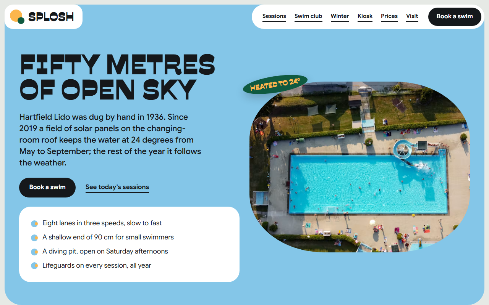
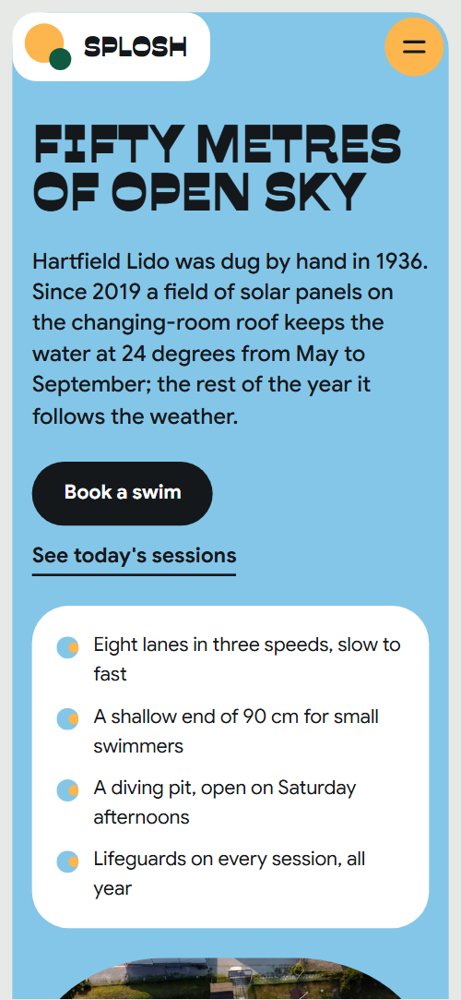
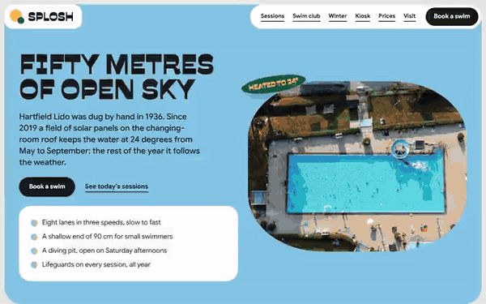

# Free HTML swimming pool website template with GSAP scroll animations

Swimming pool website template: one free HTML file for an outdoor pool, lido or swim club with timed sessions, swim lessons, a kiosk menu and ticket prices. Saturated rounded tiles sit on a pale grey ground, with round photo windows and tilted price stickers. It is a single file that Claude Code, Cursor or Codex can adapt.

[](LICENSE)  

**[Live demo](https://8bsite.github.io/swimming-pool-website-template/)** · **[Use this template](https://github.com/new?template_name=swimming-pool-website-template&template_owner=8bsite)** · **[Download ZIP](https://github.com/8bsite/swimming-pool-website-template/archive/refs/heads/main.zip)** · **[Template page on 8b.com](https://8b.com/templates/splosh/)**

<a href="https://8bsite.github.io/swimming-pool-website-template/"></a> <a href="https://8bsite.github.io/swimming-pool-website-template/"></a>

<p align="center"><a href="https://8bsite.github.io/swimming-pool-website-template/"></a><br><sub>Scroll animation</sub></p>

## Use it with Claude Code, Cursor or Codex

Download the four files into your project folder (`curl.exe` in Windows PowerShell):

```bash
curl -LO https://raw.githubusercontent.com/8bsite/swimming-pool-website-template/main/index.html
curl -LO https://raw.githubusercontent.com/8bsite/swimming-pool-website-template/main/AGENTS.md
curl -LO https://raw.githubusercontent.com/8bsite/swimming-pool-website-template/main/LICENSE
curl -LO https://raw.githubusercontent.com/8bsite/swimming-pool-website-template/main/CREDITS.md
```

Then fill in the angle brackets and give your agent this prompt:

```text
Read AGENTS.md, then edit index.html. Make this the site for <my pool: name, address, session times and prices, lesson levels with fees, ticket and pass prices, kiosk menu, event dates, opening hours, charity number>. Replace first the pool name, demo history, prices and photos. Keep the section ids, the classes AGENTS.md lists and the four photos in the kiosk chain; set --len on the big word and footer wordmark to the new character count. Ask for any missing fact; never invent prices, hours, dates, safety rules or contacts.
```

Give Claude Code, Cursor or Codex the facts only the pool has: the session timetable, ticket and pass prices, lesson ages and fees, kiosk menu, event dates, opening hours and the charity or company number. The demo invents all of them, including the history. Replace the name, then update --len on the big word and the footer wordmark. The deck section's real heading sits in a hidden span, so change both. The agent should ask about safety rules and leave [the scroll-driven motion](https://8b.com/templates/animated/) as built.

No agent? Click **[Use this template](https://github.com/new?template_name=swimming-pool-website-template&template_owner=8bsite)**, edit `index.html` on GitHub and turn on **Settings > Pages**.

## Sections and motion

- **Navigation**: fixed bar: logo tile, white pill with six links, Book a swim button; hides on scroll down; phone menu overlay. The fixed bar hides when you scroll down and returns when you scroll up; on phones a menu button opens a full-screen overlay.
- **Fifty metres of open sky**: one blue screen: headline "Fifty metres of open sky", a paragraph, two buttons, four facts and an aerial photo with a 24 degree sticker. On load the heading lines, text, buttons, list and photo pop up in a short stagger, and the heated sticker lands like a stamp.
- **A day in the water**: "A day in the water": five lanes, one per session, each with time, name, line and price, and a round swimmer photo on its lane. On screens at least 1000 by 680 px the section pins for about one and a tenth screens while each lane's round photo swims across it and a colour fill follows; smaller screens run each lane as it passes.
- **Swim club**: "Swim club": four level tiles of rising height with a round photo each, a handwritten note with an arrow and a trial lesson button. As you scroll, the four steps rise from below one after another, each round photo hops in an arc to its step and the handwritten arrow draws itself.
- **The water doesn't close for winter**: "The water doesn't close for winter": green ground, a swimmer photo, a sauna photo, a short list of seasons and prices and a join button. The heading and paragraph rise, the sticker stamps in and a small spark draws its three strokes.
- **Lounge on the lawn**: "Lounge on the lawn": the giant word LOUNGE with a round deckchair photo, then three tiles with photos. The section pins for one screen while a round photo travels through the word Lounge, lifting and tilting the letters it passes, and comes to rest after the last letter.
- **The kiosk**: "The kiosk": a hot chocolate feature tile with a price sticker, a chain of four round photos and a six-line price list. Four round photos start piled on the hot chocolate photo and roll out into an overlapping chain; the price sticker stamps in and a spark draws beside the photo.
- **Since 1936**: "( Since 1936 )": a short history in a paragraph and four dated lines beside two archive photos. The heading, first line and both archive photos rise, and a spark draws beside the photos.
- **The lights go on underwater**: "The lights go on underwater": dusk ground, a glowing pool photo and three dated event tiles. The section ground runs from pool blue through deep green to night ink as it arrives, the type turns white and the photo brightens from near dark.
- **Pay as you swim, or swim all summer**: "Pay as you swim, or swim all summer": four ticket tiles with price stickers and a Book a swim button. The heading and paragraph rise, and each of the four price stickers stamps in.
- **Through the green gate**: "Through the green gate": a board of tiles (address, photo, getting here, opening hours, phone and email) and a message form. The tiles arrive scattered and tilted around the board's centre and gather into the board as it comes into view.
- **Good to know**: "Good to know": six questions as native details elements beside a heading and the phone number. The heading and the line under it rise on arrival.
- **Footer**: pool-blue footer: the wordmark with a disc for the O, brand line, eight links, address and phone, charity line with the Design: 8B credit.

## Design

 page ground, the price pills on the session lanes and the dividers between questions  
 white tiles, the nav pill and logo tile, form fields, lane tracks and the rings around round photos  
 text, the black buttons, the events section ground, the menu overlay and the footer rule  
 pool blue: the first-screen panel, the footer panel, blue tiles and the Ducklings step  
 sunny yellow: tiles, the button hover fill, the nav logo disc, the question toggles and the winter sticker  
 orange tiles, the lane tone behind the family session, the link underline on hover and the spark beside the history photos  
 deep green: the winter panel, the tilted price stickers with yellow type and the small nav logo disc  
 secondary grey text: lane descriptions, the kiosk note, the price footnote and the answers to questions

**Savate**: weight 900 in capitals: section headings, card titles, the big Lounge word, the footer wordmark and the stickers. **Google Sans**: body text, buttons, times, prices and form labels, in weights 400 to 700. **Playpen Sans**: weight 600, used once, for the handwritten note beside the trial lesson button (Google Fonts). A pale grey ground carries tiles with 30px corners in white, pool blue, yellow, orange and deep green. The first screen is one large blue panel on a 12-column grid: heading, text, buttons and a four-point list beside an aerial photo. Later sections use two-column heads, five horizontal lane bands, club steps that rise in height, a ticket row with every second ticket pushed down and a tile board with a form.

## Questions

**Is this a free swimming pool website template I can use for a club?**  
Yes. It is one index.html under the MIT license, so a lido, a swim club or a freelancer can use it at no cost. GSAP, ScrollTrigger and Lenis load from jsDelivr, there is no build step, photos are Unsplash images and the fonts are under the Open Font License. CREDITS.md lists them.

**Do the Book a swim buttons and the message form work?**  
Not yet. Book a swim only scrolls to the prices or visit section, and the form checks its fields, shows a thank-you line and sends nothing. Point the buttons at your booking page and connect Formspree or Netlify Forms, or delete the form. Also edit the thank-you line, which promises an answer within two days.

**Can I get a site like this without editing code?**  
Yes, in a different way. [8B's AI website builder](https://8b.com/) designs a new site from a sentence describing the pool, and it will not be this template. Designing and restyling are free. Publishing with hosting and SSL, full HTML export and AI edits in chat need Pro at $9 a month billed yearly. It also runs inside Claude and ChatGPT.

## Is it the right base?

This is the right base for one venue that sells time slots and a few tickets at its own gate. A [training club](https://8b.com/templates/arcline/) with coaches and membership plans suits a template built around a weekly schedule. The weak spots: Book a swim buttons only jump to another section of the page, there is no live availability, and the site is one long scroll. Without code, 8B's builder is the other route.

## Before you publish

- Replace what is marked `data-8b-placeholder` (social preview image, favicon, phone, email, form) and the invented demo facts; [AGENTS.md](AGENTS.md) lists them.
- The form sends nothing yet: connect it to Formspree or Netlify Forms, or remove it.

## Tech

GSAP 3.13.0, ScrollTrigger, Lenis 1.3.4 from jsDelivr, 116 KB, no build step. Chrome and Edge 111+, Safari 16.2+, Firefox 113+ (it uses color-mix(), container query units, cascade layers, small/dynamic viewport units). With "reduce motion" on, the page is complete and still.

## License

MIT, see [LICENSE](LICENSE). Photos, fonts and libraries keep their own licences: [CREDITS.md](CREDITS.md). More free templates: [8b.com/templates](https://8b.com/templates/) · [github.com/8bsite](https://github.com/8bsite).
