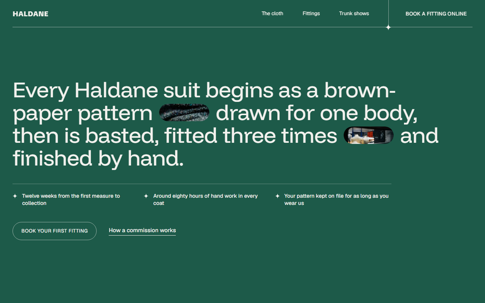
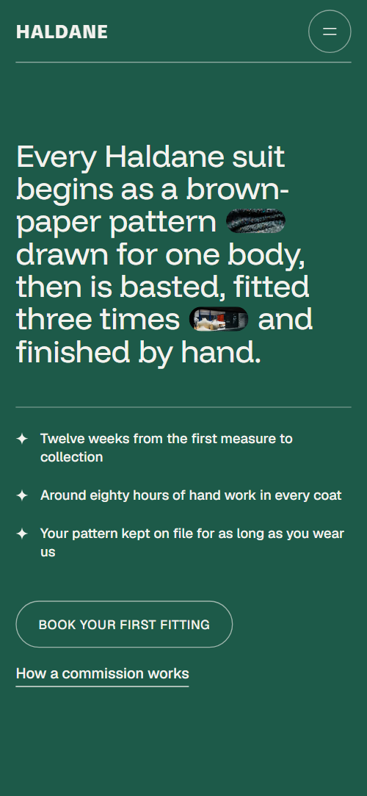
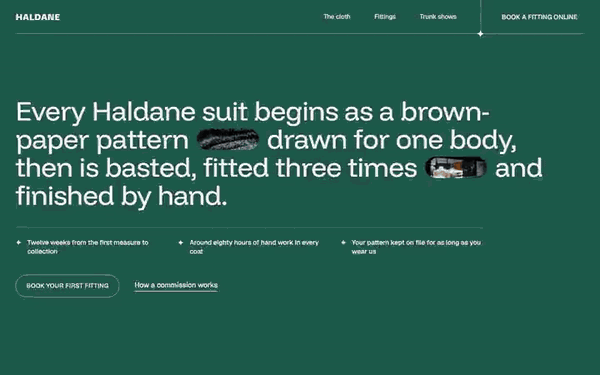

# Free HTML tailor website template with scroll animations and no libraries

Tailor website template: one free HTML page for a bespoke tailor or made-to-order clothier, with a cloth library, three fittings, a price list, trunk shows in five cities and a fitting request form. The ground is near-black with bottle green and gold, display type extra-wide. Scroll motion is CSS, no JavaScript library; an AI agent can adapt the file.

[](LICENSE)  

**[Live demo](https://8bsite.github.io/tailor-website-template/)** · **[Use this template](https://github.com/new?template_name=tailor-website-template&template_owner=8bsite)** · **[Download ZIP](https://github.com/8bsite/tailor-website-template/archive/refs/heads/main.zip)** · **[Template page on 8b.com](https://8b.com/templates/haldane/)**

<a href="https://8bsite.github.io/tailor-website-template/"></a> <a href="https://8bsite.github.io/tailor-website-template/"></a>

<p align="center"><a href="https://8bsite.github.io/tailor-website-template/"></a><br><sub>Scroll animation</sub></p>

## Use it with Claude Code, Cursor or Codex

Download the four files into your project folder (`curl.exe` in Windows PowerShell):

```bash
curl -LO https://raw.githubusercontent.com/8bsite/tailor-website-template/main/index.html
curl -LO https://raw.githubusercontent.com/8bsite/tailor-website-template/main/AGENTS.md
curl -LO https://raw.githubusercontent.com/8bsite/tailor-website-template/main/LICENSE
curl -LO https://raw.githubusercontent.com/8bsite/tailor-website-template/main/CREDITS.md
```

Then fill in the angle brackets and give your agent this prompt:

```text
Read AGENTS.md, then edit index.html. Make this the site for <my workroom: name, city, garments and prices, fittings and weeks, deposit, cloth mills, cutters, trunk show dates, hours, address, legal name>. Replace first the brand name, prices, cities, dates, people and the footer line. Keep the section ids, the gate script in the head, the data-8b attributes and the classes AGENTS.md lists, set each --len to the new character count, and add no animation library. Never invent prices, dates, hours or contacts; ask me.
```

If you vibe code the site in Claude Code, Cursor or Codex, it goes quickest when the agent gets the facts only the workroom has: prices with weeks and fittings, the deposit, cloth mills and weights, cutters and roles, trunk show dates, hours and legal name. The agent then replaces the brand name everywhere, including the text ring on the gold stamp, and sets --len on the four trait words, the Come in headline and the footer wordmark. The finished file can go live [on a free github.io address](https://8b.com/templates/github/).

No agent? Click **[Use this template](https://github.com/new?template_name=tailor-website-template&template_owner=8bsite)**, edit `index.html` on GitHub and turn on **Settings > Pages**.

## Sections and motion

- **Navigation**: wordmark, three links and a booking button; a Menu button opens a full-screen overlay with six links, the booking button, address and phone. The header bar hides once you scroll down past 160 px and returns on any scroll up, in every browser; under 860 px a menu button opens a full-screen overlay.
- **Every Haldane suit begins as a brown-paper pattern drawn for one body, then is basted, fitted three times and finished by hand.**: one large statement as the h1 with two small photo pills inside it, three facts and two links. On load the two photo pills inside the headline open from a slit, one after the other.
- **Four hundred cloths. One of them is yours.**: six cloth swatches arrive scattered like stickers, straighten into a row and open into tall pill bolts. Held for about 1.1 screens (CSS sticky): six swatches fly in tilted and scattered, straighten into one row and open from rounded squares into tall pills.
- **Three fittings, twelve weeks**: four steps as extra-wide words joined by dashes; the track travels sideways while the section is held, photos open as they arrive. Held for about three to four screens (CSS sticky): the four steps form one sideways track, each dash draws out of its word, each photo opens from a slit, and a progress line fills and lights four sparkles; a small inline script measures the track, so the scroll length follows its width.
- **Three pairs of hands in every coat**: three portrait stickers with name, role and one line each. A hairline with a sparkle draws, then each portrait rises from below, fades in and settles onto its tilt as it arrives.
- **The Haldane cut**: four traits of the house cut in extra-wide type that stretches as it rises, beside one portrait. Each trait word stretches sideways from the width of the display face's narrowest setting to its full width as it rises through the lower half of the screen while its sparkle turns, and the portrait drifts down inside its frame.
- **Commissions**: price list of five garments in hairline rows, with weeks and fittings. A hairline with a sparkle draws above each of the five rows, and the heading rises.
- **We travel with the cloth**: five trunk-show cities with dates; a gold stamp rolls down beside the list and stamps each city. A gold stamp rolls down beside the list as you scroll, and each city row's outline and sparkle turn from grey to gold as the stamp passes it.
- **Your pattern stays with us**: a photo cut into five bands that slide into register, with a paragraph and three terms. The photo is rebuilt from five horizontal bands that start offset to the left and right and slide into register near mid-screen.
- **Questions before a first fitting**: five questions and answers (native &lt;details&gt;) with an email link. A hairline draws above the list; opening a question turns its plus into a minus and its sparkle gold.
- **Come in**: "Come in" headline closing onto a dash, workroom address, hours, phone, email, a photo and a fitting request form. Come and in slide in from opposite edges onto the dash while it shrinks from a long stroke to its resting length.
- **Footer**: hairline with sparkles, workroom, page links, contact links, the wordmark across the width, copyright and the Design: 8B credit. The hairline draws and its two sparkles pop in.

## Design

 page ground, header bar fill once you scroll, text on the gold stamp, hover fill of the opening button  
 main text, hairline dashes under the steps, outlines of buttons, the dash in the contact headline  
 ground of the full-height opening panel, hover fill of most buttons, the green glow under portrait stickers  
 gold: focus outlines, step labels, trunk show outlines and sparkles, the stamp, lit progress sparkles, ring around a sticker on hover  
 secondary text: notes, cloth mills, form labels, FAQ answers  
 hairlines, price row dividers, the unfilled progress line and its unlit sparkles  
 ground behind photos while they load, and the background of the form's select list

**TikTok Sans**: weight 800 only, with a width axis from 75% to 150%: the extra-wide uppercase step and trait words, the Come in headline and the footer wordmark; the header wordmark uses it at normal width. **Funnel Display**: regular weight: the opening sentence, section headings, menu links, commission names, prices, city names and FAQ questions. **Geist**: weights 400 to 600: body text, notes, uppercase labels, buttons and form fields (Google Fonts). A full-height green panel opens the page; its headline is one long sentence with two small photo pills inside it. Most sections then pair a heading on the left with a short paragraph on the right, above wide content: six tall swatches in a row, a sideways track of four steps, three tilted portrait stickers, four trait words beside one tall photo, hairline price rows and five pill-shaped city rows.

## Questions

**Can it work for a ladies' tailor, a shirtmaker or a shoemaker?**  
Yes, after a text pass. The five commission rows, the four fitting steps, the four trait words and the cloth swatches are plain text and photos, so rewrite them for women's suits, shirts or shoes. The demo FAQ already has a question about making for women; keep it or replace it.

**Where does the fitting request form send its messages?**  
Nowhere yet. It requires a name and an email, then shows a thank-you line and clears the fields without sending anything. Connect Formspree or Netlify Forms with the steps in AGENTS.md, or delete the form and keep the email link. Also edit the line that promises a reply within one working day.

**Can I get a site like this without editing code?**  
Yes, with [8B's AI website builder](https://8b.com/). You describe the site in a sentence and its engine designs a new site, its own design, not this template. Designing is free; publishing with hosting and SSL, full HTML export and AI edits in chat are on Pro at $9 a month billed yearly. It also runs inside Claude and ChatGPT.

## Is it the right base?

Pick this for a craft sold by appointment, with a long process, set prices and trunk shows. A goldsmith sells pieces rather than commissions, and the [goldsmith](https://8b.com/templates/oriel/) template is closer to that. Ready-made clothes need a cart, which this lacks, and the form sends nothing. This build keeps the look and motion with no script from a CDN: 30 KB of code gzipped against 75 KB and four more requests for the GSAP version. No code? 8B also has an AI website builder.

## Before you publish

- Replace what is marked `data-8b-placeholder` (social preview image, favicon, phone, email, form, social) and the invented demo facts; [AGENTS.md](AGENTS.md) lists them.
- The form sends nothing yet: connect it to Formspree or Netlify Forms, or remove it.

## Tech

No JavaScript libraries: CSS scroll-driven animations and a small inline motion script with its own smooth wheel scrolling, 118 KB, no build step. Chrome and Edge 111+, Safari 16.2+, Firefox 113+ (it uses color-mix(), container query units, cascade layers, small/dynamic viewport units). Without scroll-driven animations (Firefox today) the scroll motion and the smooth wheel are off and each section shows its finished layout (a load-in or a loop may still play); with "reduce motion" on, the page is complete and nothing moves on its own (hover effects stay).

A GSAP build of the same page is [`index.gsap.html`](index.gsap.html): GSAP 3.13.0, ScrollTrigger, SplitText, Lenis 1.3.27 from jsDelivr, 99 KB; its scroll motion also plays in Firefox. Use one of the two files.

## License

MIT, see [LICENSE](LICENSE). Photos, fonts and libraries keep their own licences: [CREDITS.md](CREDITS.md). More free templates: [8b.com/templates](https://8b.com/templates/) · [github.com/8bsite](https://github.com/8bsite).
