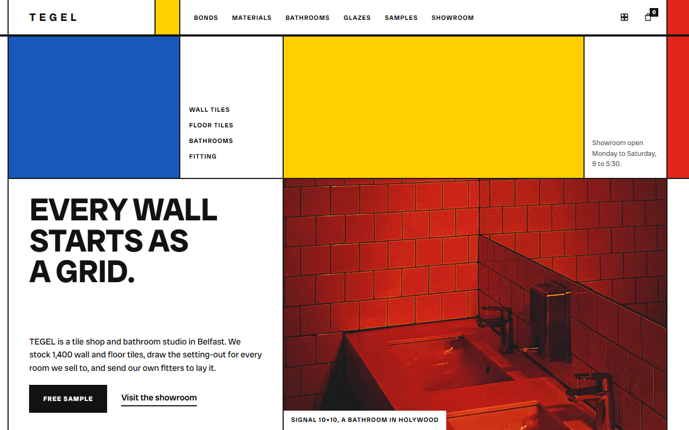
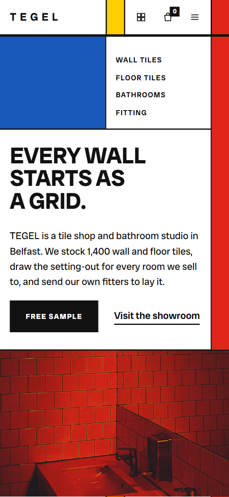
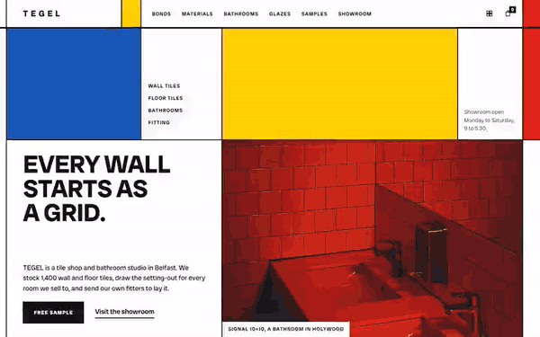

# Free HTML tile store website template with GSAP scroll animations

Tile store website template: one free HTML file for a tile shop or bathroom studio with a showroom, free samples and its own fitters. It has a bond demonstration, a materials table with prices, a sample form and five house glazes, in a white grid ruled in black with colour blocks. AGENTS.md lets Claude Code, Cursor or Codex adapt it.

[](LICENSE)  

**[Live demo](https://8bsite.github.io/tile-store-website-template/)** · **[Use this template](https://github.com/new?template_name=tile-store-website-template&template_owner=8bsite)** · **[Download ZIP](https://github.com/8bsite/tile-store-website-template/archive/refs/heads/main.zip)** · **[Template page on 8b.com](https://8b.com/templates/tegel/)**

<a href="https://8bsite.github.io/tile-store-website-template/"></a> <a href="https://8bsite.github.io/tile-store-website-template/"></a>

<p align="center"><a href="https://8bsite.github.io/tile-store-website-template/"></a><br><sub>Scroll animation</sub></p>

## Use it with Claude Code, Cursor or Codex

Download the four files into your project folder (`curl.exe` in Windows PowerShell):

```bash
curl -LO https://raw.githubusercontent.com/8bsite/tile-store-website-template/main/index.html
curl -LO https://raw.githubusercontent.com/8bsite/tile-store-website-template/main/AGENTS.md
curl -LO https://raw.githubusercontent.com/8bsite/tile-store-website-template/main/LICENSE
curl -LO https://raw.githubusercontent.com/8bsite/tile-store-website-template/main/CREDITS.md
```

Then fill in the angle brackets and give your agent this prompt:

```text
Read AGENTS.md, then edit index.html. Make this the site for <my tile shop or bathroom studio: name, town, showroom address and hours, materials with prices per square metre, finished jobs, sample terms, fitters and guarantee, delivery and returns, legal name and company number>. Replace first the shop name, the Belfast details, the materials and prices, the four rooms and the fitters. Keep the section ids, the classes AGENTS.md lists, exactly four room photos and equal bond rows. Ask me for missing facts; never invent prices, guarantees, reviews or contacts.
```

Vibe coding this tile store website template for Claude Code or Cursor goes fastest when you hand the agent the facts only the shop has: materials and prices per square metre, finished jobs, sample terms, glazes, fitters, guarantee, delivery, returns and legal name. The demo invents all of them. Replace the Belfast details first, and leave the section ids and the classes AGENTS.md lists alone. Check the technical tips in the questions, such as the R10 slip rating, against your own trade. [The vibe coding guide](https://8b.com/templates/vibe-coding/) compares other agents.

No agent? Click **[Use this template](https://github.com/new?template_name=tile-store-website-template&template_owner=8bsite)**, edit `index.html` on GitHub and turn on **Settings > Pages**.

## Sections and motion

- **Navigation**: wordmark with a yellow block, six links, sample box and basket icons, and a menu button on phones. The navigation bar slides away when you scroll down, returns on scroll up and underlines the link of the section in view.
- **Every wall starts as a grid.**: one screen of ruled cells: department links, opening hours, a three-line h1, a paragraph and buttons, and a red tiled bathroom photo, between blocks of blue, yellow and red. On load the blue, yellow and red fields wipe in from the left one after another, the photo opens from a cut and the text rises; there is no scroll scene here.
- **One tile, three walls**: a wall of ruled cells that shifts row by row from stack bond to half bond to third bond while the section is held. Pinned for about two screens of scrolling: the four rows of the cell wall slide sideways from stack bond to half bond to third bond and the matching bond in the list lights up.
- **What a tile is made of**: a table of six tile materials with where each can go and a price per square metre. The heading and the seven table rows start offset left and right in turn and settle as they rise, while a red field wipes in.
- **Four rooms, one grid**: four finished bathrooms in a four-cell stage that recomposes so each takes the large cell in turn, with a yellow marker on its caption. Pinned for about three screens: four photos sit in clipped cells whose borders move so each room takes the large cell in turn, with a yellow marker beside its name.
- **Five samples, free**: a free-sample form: twelve tile chips (up to five), name, email and postcode, beside a shelf photo. The twelve sample chips open one after another from their upper-left corners and a blue field wipes in from above.
- **Five house glazes**: five house glaze bays that travel sideways on one held screen, each colour field rising as the bay crosses the middle. Pinned while the row of five bays travels sideways, for as far as the row overflows the screen (about one screen on a laptop, less on a wide monitor), and each bay's colour field rises as the bay comes in from the right.
- **Laid by our own fitters**: three fitter cards with photo, name and speciality, a guarantee on a yellow field. The three fitter cards open in turn from their upper-left corners and the yellow guarantee field wipes in from the right.
- **From a floor plan to a finished wall**: five numbered steps of a job; a blue marker travels along the rule and the step it reaches turns yellow. A blue marker moves along the rail above the five steps, or down the left edge on a phone, and each step it passes turns its number black, the current one turning yellow.
- **Before you order**: six questions and answers (native &lt;details&gt;) beside a yellow card with the phone number. The heading and the six questions slide in offset and settle, and the yellow phone card wipes in from the bottom.
- **Come and stand on them**: "Come and stand on them" with a showroom photo, address with directions, hours, phone and email on a grid with yellow and red fields. As the section arrives the showroom photo widens from a small window to the full cell while a red block slides down and a yellow one slides across.
- **Footer**: wordmark with a short description, three link columns (shop, studio, visit), a red field, and the legal line with the Design: 8B credit. The three link columns settle from an offset and a red field wipes in from above.

## Design

 page ground and the fill of every cell between the rules, button text on black, text of checked sample chips and lit step numbers  
 text, the rules between cells, primary buttons, checked sample chips, lit step numbers, the black wall cell and the Ink glaze field  
 yellow: the blocks in the navigation bar, opening and contact, button hover wipe, current-section underline, active bond and room markers, the current step, guarantee and phone cards, the Saffron glaze  
 blue: the block in the opening and the strip beside the samples form, the moving step marker, focus outlines on buttons and fields, the Cobalt glaze  
 red: end of the navigation bar, blocks in the opening, materials, contact and footer, the Signal glaze and wall cells  
 grey: the table header row, the Chalk glaze field, one wall cell and the ground behind the glaze photos  
 captions and descriptions in small text, and the No cells in the materials table

**Radio Canada Big**: the only typeface: weights 400 to 700; heavy uppercase headings, semibold tracked labels at 12 pixels, regular 16 pixel body text and a widely spaced wordmark (Google Fonts). Every section is a CSS grid whose two pixel gaps show a near-black ground, so the page reads as ruled cells. Narrow empty cells run down the left and right edges, and blocks of blue, yellow and red fill cells beside the text and photos. Headings are heavy uppercase in a tight line. Below 900 pixels the grids fall to one or two columns, the left strip goes and a thin right column carries the colour blocks.

## Questions

**Does it work as a bathroom showroom website template without an online shop?**  
Yes. It is one page with no product pages, search or checkout, built around a sample request and a visit to the showroom. The basket icon in the navigation bar is decoration: it jumps to the start of the page and its count stays at 0. Link it to your shop or delete it.

**Where does the sample form send its requests?**  
Nowhere yet. It needs at least one chip, a name, an email and a postcode, allows at most five chips, then shows a thank-you line and clears the fields. To receive requests, connect Formspree or Netlify Forms with the steps in AGENTS.md, or remove the form and its script.

**Where is the tile store website design prompt, and how do I use it?**  
Below the short prompt sits a longer tile store website design prompt for any AI tool. With the template, put index.html and AGENTS.md in an empty folder with the curl lines in AGENTS.md, and tell the agent to read AGENTS.md first. Give it the files, not the page address. Cursor reads AGENTS.md too, as [its folder setup](https://8b.com/templates/for-cursor/) shows.

## Is it the right base?

Choose this base when the business sells through showroom visits, free samples and fitting, not through a basket. A designer who sells colour advice will find the [interior colour studio](https://8b.com/templates/pervenche/) template closer. A shop with hundreds of lines needs product pages and a real cart, which this one-page file lacks. One weak spot: the opening screen gives Saturday hours that differ from the contact section, so make them agree.

## Before you publish

- Replace what is marked `data-8b-placeholder` (social preview image, favicon, form, phone, map, email, social) and the invented demo facts; [AGENTS.md](AGENTS.md) lists them.
- The form sends nothing yet: connect it to Formspree or Netlify Forms, or remove it.

## Tech

GSAP 3.13.0, ScrollTrigger, Lenis 1.3.4 from jsDelivr, 99 KB, no build step. Chrome and Edge 108+, Safari 15.4+, Firefox 101+ (it uses cascade layers, small/dynamic viewport units). With "reduce motion" on, the page is complete and still.

## License

MIT, see [LICENSE](LICENSE). Photos, fonts and libraries keep their own licences: [CREDITS.md](CREDITS.md). More free templates: [8b.com/templates](https://8b.com/templates/) · [github.com/8bsite](https://github.com/8bsite).
