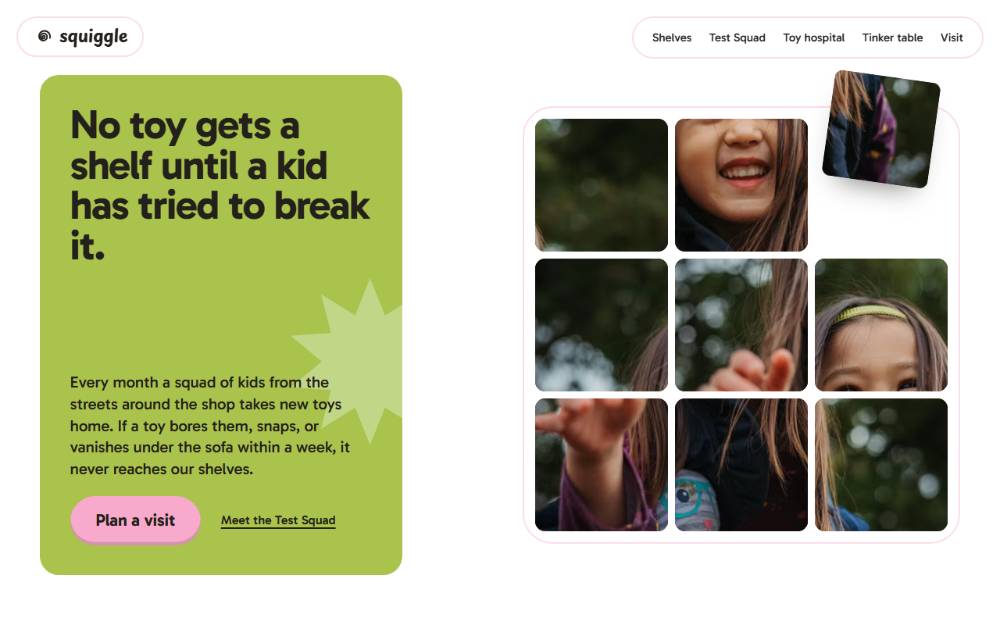
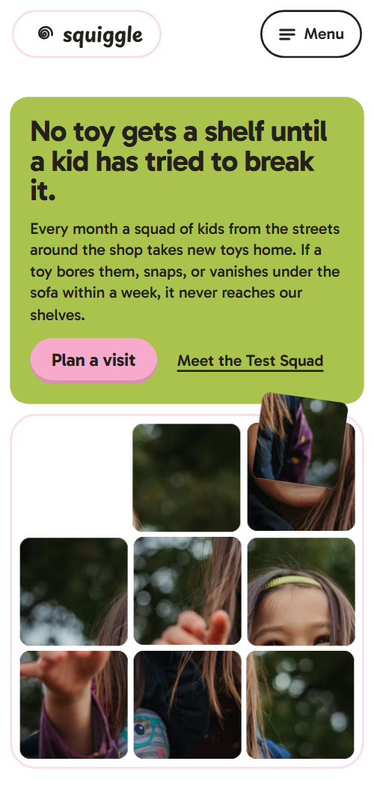
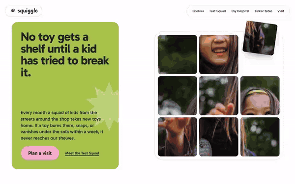

# Free HTML toy store website template with GSAP scroll animations

This toy store website template is one free HTML file for an independent toy shop that also runs repairs, Saturday workshops, a swap box and birthday lists. Candy yellow, pink, lime and cobalt sit on white, with notched cards and a photo puzzle that solves itself on scroll. AGENTS.md is included, so Claude Code, Cursor or Codex can adapt it.

[](LICENSE)  

**[Live demo](https://8bsite.github.io/toy-store-website-template/)** · **[Use this template](https://github.com/new?template_name=toy-store-website-template&template_owner=8bsite)** · **[Download ZIP](https://github.com/8bsite/toy-store-website-template/archive/refs/heads/main.zip)** · **[Template page on 8b.com](https://8b.com/templates/squiggle/)**

<a href="https://8bsite.github.io/toy-store-website-template/"></a> <a href="https://8bsite.github.io/toy-store-website-template/"></a>

<p align="center"><a href="https://8bsite.github.io/toy-store-website-template/"></a><br><sub>Scroll animation</sub></p>

## Use it with Claude Code, Cursor or Codex

Download the four files into your project folder (`curl.exe` in Windows PowerShell):

```bash
curl -LO https://raw.githubusercontent.com/8bsite/toy-store-website-template/main/index.html
curl -LO https://raw.githubusercontent.com/8bsite/toy-store-website-template/main/AGENTS.md
curl -LO https://raw.githubusercontent.com/8bsite/toy-store-website-template/main/LICENSE
curl -LO https://raw.githubusercontent.com/8bsite/toy-store-website-template/main/CREDITS.md
```

Then fill in the angle brackets and give your agent this prompt:

```text
Read AGENTS.md, then edit index.html. Make this the site for <my toy shop: what we sell, town and address, hours, repair prices, workshop dates with the year, swap rules, gift-list service, phone, email, legal name>. Replace first the shop name, promise, shelves, prices, dates, hours and photos. Keep the section ids, the classes AGENTS.md lists, nine puzzle tiles in a 3 by 3 grid and the footer wordmark's len set to the new name's length. Ask me for missing facts; never invent prices, dates, tester names, hours or contacts.
```

Vibe coding goes fastest when you give the agent the shop's own facts: what you sell, repair prices, workshop dates with the year, swap rules, hours, address, phone and email. Replace those first, then the 23 photos. The demo's five testers are stock pictures of children, so swap in real ones only with the parents' permission. The workshop dates carry no year, and their weekdays fit 2024, not 2026.

No agent? Click **[Use this template](https://github.com/new?template_name=toy-store-website-template&template_owner=8bsite)**, edit `index.html` on GitHub and turn on **Settings > Pages**.

## Sections and motion

- **Navigation**: wavy logo and wordmark top-left; five section links on wide screens, a Menu button and full-screen overlay on phones. The bar slides up out of sight when you scroll down and comes back when you scroll up, also with reduced motion.
- **No toy gets a shelf until a kid has tried to break it.**: one held screen: the shop's promise, a lead and two links beside a 3 by 3 photo puzzle that solves itself as you scroll. The text card and the board rise on load; as you scroll the screen is held for about 170svh while the scrambled board slides back in 12 moves (10 on phones) and the ninth tile drops into the last hole.
- **Shelved by the question, not the age**: six shelf blocks, each a question kids ask, with a category pill, a line of examples and a square toy photo. Pinned: the six shelf blocks travel left as you scroll, and each photo leans with the scroll speed and swings upright when it slows.
- **Meet the Test Squad**: five trading cards of child testers, each with an age tab, photo, role and a handwritten verdict. The five cards start as one fanned stack in the middle of the row and are dealt out one after another to their places as it scrolls in.
- **The toy hospital**: the toy repair counter: a coloured card with five tilted price tags beside two photos. The heading slides in, the five price tags drop in tilted and bounce once, and the starburst turns with the scroll.
- **The Saturday tinker table**: four free Saturday workshops strung on a blue ribbon, with a ball that rolls down it. An orange ball follows the ribbon as you scroll, and each workshop keeps a green tab and a smaller, tilted photo until the ball reaches it.
- **The swap box**: trade-in credit: heading, three rule pills and a ribbon beside a photo of old toys with a magnifying lens. A round lens travels over the photo to each note in turn with the scroll, the second and third notes fade in as it arrives, and the ribbon draws itself.
- **Birthday lists that actually work**: birthday lists in three steps on a candy card with two photos and a burst sticker. A large burst covers the card at first, then turns and shrinks into the corner while the sticker words pop onto it.
- **1 Example Street**: shopfront photo behind four colour shutters, address, directions button and opening hours. Four colour shutters cover the shopfront photo and retract one after another, starting with the bottom band, as the section scrolls in.
- **Questions grown-ups ask**: five questions and answers in native details elements. The heading and the lead slide in, and the plus icon turns on hover and when a question opens.
- **Come and play**: shop address, phone, email and hours note beside an enquiry form (placeholders). The four contact pills start scattered at angles and settle into a tidy list as the card scrolls in.
- **Footer**: full-width wordmark with a wavy ribbon, five links and the copyright with the Design: 8B credit. The wavy ribbon under the wordmark draws itself with the scroll.

## Design

 page background, form fields, the number discs in the gift steps, text on cobalt  
 text on every light ground, field borders and the outline of the Menu button  
 hours card, contact card, one ground of the tester and workshop cards, the plus discs in the questions, first shutter  
 default pill button, gifts card and address card, some badges and card grounds, open question border, second shutter, lens ring  
 opening text card, some badges and card grounds, third shutter, tabs of workshops the ball has not reached  
 cobalt buttons (Start a list, Get directions, Send it), the cobalt badges (Puzzles, Wind-up repairs, Open), the ribbons, fourth shutter, focus ring  
 orange badges, the age and date tabs, the ball that rolls down the workshop ribbon  
 repair card, one ground of the tester and workshop cards, photo placeholders, outlines of the logo pill, the link bar and closed questions, footer rule, open question fill

**Gabarito**: body text, headings, buttons and labels: bold 700 for headings, 500 for leads, 600 for small labels and pills, 400 for body. **Playpen Sans**: the logo, the footer wordmark (700), the testers' quoted verdicts and the repair note (500) (Google Fonts). Flat candy-coloured cards with rounded corners sit on white inside a column up to 1320 px wide. Cards in the testers and workshop rows have one top-right corner cut as a notch that holds a coloured tab with an age or a date. Small pills for categories, prices and rules sit tilted. The opening is a text card beside a framed 3 by 3 photo board. Wavy cobalt ribbons run through the swap box, workshops and footer.

## Questions

**Does the contact form send enquiries?**  
No. The form posts to # and no script handles it, so it sends nothing and shows no thank-you line. Connect Formspree or Netlify Forms, or delete the form and keep the phone and email links. Name, email and message are required fields.

**Can I get a site like this without editing code?**  
Not this exact file. [8B's AI website builder](https://8b.com/templates/8b/) designs a new site from a one-sentence description, in its own design. Designing and restyling are free. Publishing with hosting and SSL, HTML export and AI edits in chat are on Pro at $9 a month billed yearly. It also runs inside Claude and ChatGPT.

**What happens with reduced motion or without JavaScript?**  
With reduced motion the entrance and scroll animations and smooth scrolling are off: the puzzle shows solved and the shelves sit in a grid. The nav bar still hides on scroll and hover effects still run. Without JavaScript the phone Menu button cannot open and the workshop ribbon is missing; the questions still open.

## Is it the right base?

Choose it for a shop that sells toys and also offers services around them. It is not a toys ecommerce website template: there is no cart, checkout or product list, and the form sends nothing until you connect it. Among toy store themes it is a plain HTML file, not a WordPress or Shopify theme. A shop selling flowers fits the [florist](https://8b.com/templates/moth-marigold/) template better.

## Before you publish

- Replace what is marked `data-8b-placeholder` (social preview image, favicon, map, phone, email, form) and the invented demo facts; [AGENTS.md](AGENTS.md) lists them.
- The form sends nothing yet: connect it to Formspree or Netlify Forms, or remove it.

## Tech

GSAP 3.13.0, ScrollTrigger, MotionPathPlugin, Lenis 1.3.4 from jsDelivr, 107 KB, no build step. Chrome and Edge 111+, Safari 16.2+, Firefox 113+ (it uses color-mix(), container query units, cascade layers, small/dynamic viewport units). With "reduce motion" on, the page is complete and still.

## License

MIT, see [LICENSE](LICENSE). Photos, fonts and libraries keep their own licences: [CREDITS.md](CREDITS.md). More free templates: [8b.com/templates](https://8b.com/templates/) · [github.com/8bsite](https://github.com/8bsite).
