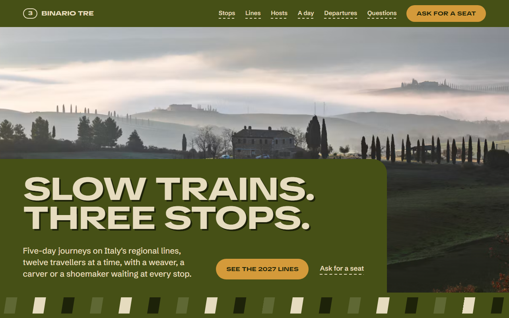
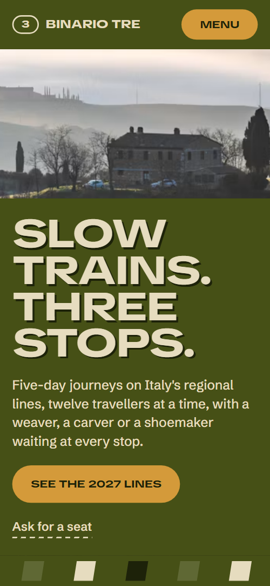
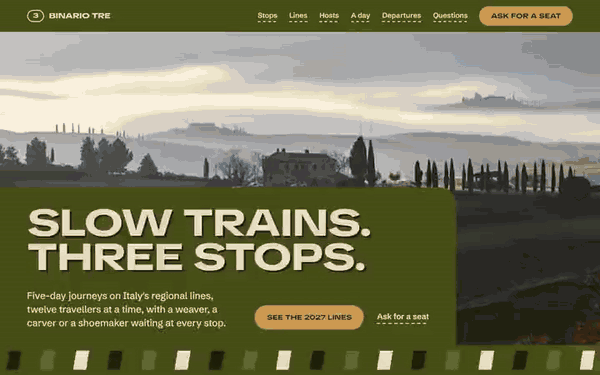

# Free HTML travel agency website template with scroll animations and no libraries

Travel agency website template: a one-page site for a small group tour operator that sells dated rail journeys, with a three-stop route, four priced lines, a departures table with seats left, a FAQ and an enquiry form, in olive and cream with an amber accent. Its scroll motion runs on CSS, with no JavaScript library.

[](LICENSE)  

**[Live demo](https://8bsite.github.io/travel-agency-website-template/)** · **[Use this template](https://github.com/new?template_name=travel-agency-website-template&template_owner=8bsite)** · **[Download ZIP](https://github.com/8bsite/travel-agency-website-template/archive/refs/heads/main.zip)** · **[Template page on 8b.com](https://8b.com/templates/binario-tre/)**

<a href="https://8bsite.github.io/travel-agency-website-template/"></a> <a href="https://8bsite.github.io/travel-agency-website-template/"></a>

<p align="center"><a href="https://8bsite.github.io/travel-agency-website-template/"></a><br><sub>Scroll animation</sub></p>

## Use it with Claude Code, Cursor or Codex

Download the four files into your project folder (`curl.exe` in Windows PowerShell):

```bash
curl -LO https://raw.githubusercontent.com/8bsite/travel-agency-website-template/main/index.html
curl -LO https://raw.githubusercontent.com/8bsite/travel-agency-website-template/main/AGENTS.md
curl -LO https://raw.githubusercontent.com/8bsite/travel-agency-website-template/main/LICENSE
curl -LO https://raw.githubusercontent.com/8bsite/travel-agency-website-template/main/CREDITS.md
```

Then fill in the angle brackets and give your agent this prompt:

```text
Read AGENTS.md, then edit index.html. This is a one-page site for <your tour or travel business: the journeys, stops and local hosts, price per person and what is included, departure dates with seats left, group size, office and how to book>. Replace the company, journeys, hosts, departures, prices and contacts first, then the photos. Keep every id, the gate script, the data-8b-section, data-8b-motion and data-8b-items attributes and four tickets; change both --len values with the words. Add no animation library. Never invent prices, dates, licences or contacts; ask me.
```

As a travel agency website template for Claude Code, Cursor or Codex, it hands over index.html and AGENTS.md. The [Codex setup for these templates](https://8b.com/templates/for-codex/) explains how the CLI picks up AGENTS.md. In a vibe coding session, start with the company, the four lines, the three hosts, the seven departures, prices and the office details, then the photos and alt text. The agent must keep the ids, the data-8b-section, data-8b-motion and data-8b-part attributes and the selectors AGENTS.md lists, and ask for dates, seats, terms and the licence line.

No agent? Click **[Use this template](https://github.com/new?template_name=travel-agency-website-template&template_owner=8bsite)**, edit `index.html` on GitHub and turn on **Settings > Pages**.

## Sections and motion

- **Navigation**: fixed bar: numbered badge and name, six links, Ask for a seat button and a menu button; a menu panel with seven links; hides on scroll down. The bar slides up out of sight after about 24 px of downward scrolling and returns on scroll up or keyboard focus; this keeps running with reduced motion.
- **Slow trains. Three stops.**: two screens: a full-bleed landscape under a two-line title, intro and buttons, then a carriage screen with a window photo and three facts. On load (CSS keyframes) the landscape settles and the title lines rise, then the photo drifts sideways and the sleeper bars run in loops; as the carriage screen rises the landscape narrows by clip path into the window photo while the title lines slide apart.
- **The Tuscan line**: a rail with a marker that travels past three stops, each stop opening from behind slats. On scroll a marker travels along the rail past three stops, across on wide screens and down the left edge on narrow ones, filling the rail behind it, and eight slats over each stop fall away as it arrives.
- **Four lines for 2027**: four ticket cards with photo, stops, description, price and a Dates button. The four tickets start piled in the middle of the top row and deal out to their places as you scroll; on narrow screens each ticket drops from the one above.
- **Who waits at each stop**: three hosts with a photo of their hands at work, name, role and a quote. The heading glides in from the left, and each host photo frame opens upward from its bottom edge while the image settles from a zoom, once on arrival.
- **A day on the line**: a sticky window that changes its view beside three timed entries, on a ground that turns from olive to brown to dark. The window stays sticky beside three entries; as you scroll, the amber rule under each entry draws across, the ground moves from olive to brown to near-black and the window wipes to the next photo.
- **Departures 2027**: a table of seven 2027 departures with seats left and price, under a band of sleeper bars. The band of sleeper bars above the table slides sideways with scroll and the heading glides in from the left.
- **One ticket covers it**: a ticket listing what is covered and a stub listing what is not. Six hole punches scale in one by one on the covered ticket, then the stub, which starts flush against its edge, swings away and tilts to its resting angle.
- **Before you book**: six questions as native details in two columns under a heading. The heading glides in; each question opens as a native details element and its plus turns into a cross.
- **Hire the whole carriage**: a photo of a long table with a crossed paper band and ribbon offering a private line. As the section arrives the cream paper band rotates into its tilt, the notched ribbon swings across it and the photo eases down from a zoom.
- **Ask for a seat**: office details and an enquiry form with line, month and number of travellers. The heading glides in and the carriage photo opens upward from its bottom edge.
- **Footer**: a band of sleeper bars, the large wordmark, three columns and a legal line with the Design: 8B credit. The sleeper bars above the large wordmark slide sideways with scroll.

## Design

 olive: page ground, nav bar, opening plate, route, hosts, what-is-included section, private hire and footer grounds, and the first ground of the day section  
 cream: body text on dark grounds, ticket and form surfaces, the filled part of the route rail, cream sleeper bars  
 near-black: journeys and FAQ grounds, text on cream tickets, dark buttons, hard offset shadows, the last ground of the day section  
 lighter olive: route rail, FAQ dividers, and sleeper bars  
 brown: carriage screen, departures and contact grounds, and the middle ground of the day section  
 amber: filled buttons, window frames, the route marker, entry times in the day section, rules, focus outlines

**TikTok Sans**: display face: wide (140% stretch), uppercase, weight 800 headings, buttons, ticket prices and the footer wordmark. **Schibsted Grotesk**: body text at weight 400, subheads at 500, small uppercase labels at 700 (Google Fonts). A fixed bar over ten sections. The opening is two screens: a landscape under a two-line title in an olive plate, then a carriage screen with a rounded window photo and three facts. Below come a rail with three stops, four ticket cards in two columns, three hosts in staggered columns, a sticky window beside three timed entries, a departures table, a ticket with a stub, a two-column FAQ, a tilted private hire band and an enquiry form.

## Questions

**Does the enquiry form send emails or take bookings?**  
No. As shipped it checks the fields, shows a thank-you line and sends nothing. Connect Formspree or Netlify Forms, or your booking system, before publishing. The seats-left column in the departures table is plain text as well, so update it by hand.

**What has to stay when I change the text?**  
Keep every id, the gate script, the data-8b-section, data-8b-motion, data-8b-items and data-8b-part attributes, and the class names AGENTS.md lists. The two --len values count the characters of the longer title line and of the wordmark. The CSS times exactly four tickets, three stops and six ticket holes; departure rows can be added, and the table must stay a real table.

**What shows in Firefox, with reduced motion or without JavaScript?**  
Without CSS scroll-driven animations (Firefox today) or with reduced motion on, the [scroll motion](https://8b.com/templates/animated/) and smooth wheel are off and each section shows its finished layout, with the day window on its first photo. Firefox still plays the opening load-in and its loops; the nav still hides on scroll. Without JavaScript the menu button opens nothing on narrow screens.

## Is it the right base?

Choose it for dated departures at a price per person; it has no booking engine. A product with a model range and a test ride fits the [electric moped](https://8b.com/templates/arco/) template better. This build moves on CSS with no library and no script from a CDN: about 25 KB of code gzipped in one file, against 70 KB and three extra requests for the GSAP version. The weak spot is the opening, which clips a full-screen layer on every scroll update.

## Before you publish

- Replace what is marked `data-8b-placeholder` (social preview image, favicon, phone, email, form) and the invented demo facts; [AGENTS.md](AGENTS.md) lists them.
- The form sends nothing yet: connect it to Formspree or Netlify Forms, or remove it.

## Tech

No JavaScript libraries: CSS scroll-driven animations and a small inline motion script with its own smooth wheel scrolling, 102 KB, no build step. Chrome and Edge 111+, Safari 16.2+, Firefox 113+ (it uses color-mix(), cascade layers, small/dynamic viewport units). Without scroll-driven animations (Firefox today) the scroll motion and the smooth wheel are off and each section shows its finished layout (a load-in or a loop may still play); with "reduce motion" on, the page is complete and nothing moves on its own (hover effects stay).

A GSAP build of the same page is [`index.gsap.html`](index.gsap.html): GSAP 3.13.0, ScrollTrigger, Lenis 1.3.27 from jsDelivr, 85 KB; its scroll motion also plays in Firefox. Use one of the two files.

## License

MIT, see [LICENSE](LICENSE). Photos, fonts and libraries keep their own licences: [CREDITS.md](CREDITS.md). More free templates: [8b.com/templates](https://8b.com/templates/) · [github.com/8bsite](https://github.com/8bsite).
