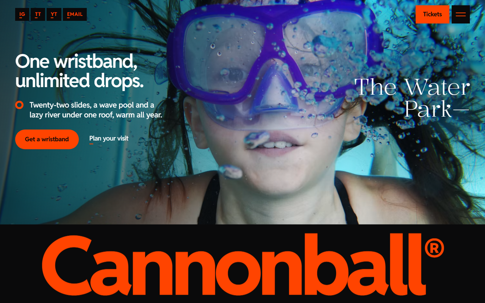
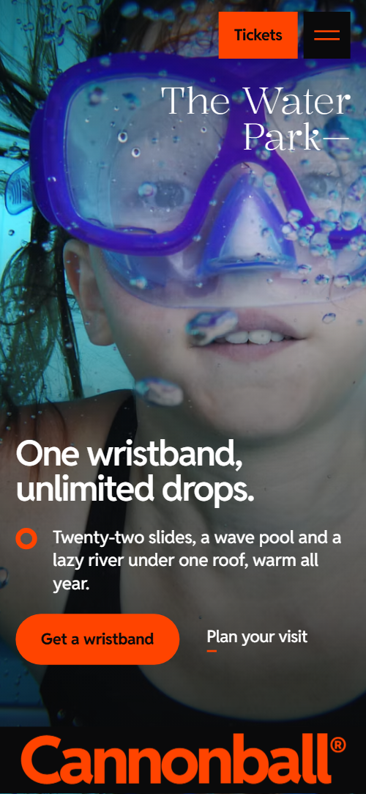
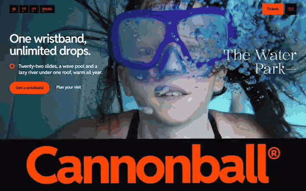

# Free HTML water park website template with scroll animations and no libraries

Water park website template: a free one-page site for a water park or leisure pool with four full-screen ride sheets, day and season prices, a Friday night session and a swim school. A giant orange wordmark on black shrinks into the header. It is one HTML file with no animation libraries that Claude Code can edit.

[](LICENSE)  

**[Live demo](https://8bsite.github.io/water-park-website-template/)** · **[Use this template](https://github.com/new?template_name=water-park-website-template&template_owner=8bsite)** · **[Download ZIP](https://github.com/8bsite/water-park-website-template/archive/refs/heads/main.zip)** · **[Template page on 8b.com](https://8b.com/templates/cannonball/)**

<a href="https://8bsite.github.io/water-park-website-template/"></a> <a href="https://8bsite.github.io/water-park-website-template/"></a>

<p align="center"><a href="https://8bsite.github.io/water-park-website-template/"></a><br><sub>Scroll animation</sub></p>

## Use it with Claude Code, Cursor or Codex

Download the four files into your project folder (`curl.exe` in Windows PowerShell):

```bash
curl -LO https://raw.githubusercontent.com/8bsite/water-park-website-template/main/index.html
curl -LO https://raw.githubusercontent.com/8bsite/water-park-website-template/main/AGENTS.md
curl -LO https://raw.githubusercontent.com/8bsite/water-park-website-template/main/LICENSE
curl -LO https://raw.githubusercontent.com/8bsite/water-park-website-template/main/CREDITS.md
```

Then fill in the angle brackets and give your agent this prompt:

```text
Read AGENTS.md, then edit index.html. Make it the site for <my water park: name, address, opening hours and late nights, rides with heights and lengths, zones, day and season prices, swim school classes with ages, party packages, lifeguard and water facts>. Replace the name, copy, photos and contacts first. Keep the section ids, the classes AGENTS.md lists, four evening hours, lanes and lifeguards, and set each --len to its line's character count; add no animation library. Ask for any missing fact; never invent prices, heights, hours or safety claims.
```

Give Claude Code, Cursor or Codex the facts only the park has: ticket and season prices, height limits, the ride list, opening hours, the Friday session and the swim school classes. The demo invents all of them, including the lifeguards. Replace the name, then set --len on the opening and footer wordmarks to its character count, the ® included. This is the light build: about 27 KB gzipped with no script from a CDN, against 73 KB for the GSAP version.

No agent? Click **[Use this template](https://github.com/new?template_name=water-park-website-template&template_owner=8bsite)**, edit `index.html` on GitHub and turn on **Settings > Pages**.

## Sections and motion

- **Navigation**: top bar: four small black social tags, the Cannonball logo tab (appears after the first section), a Tickets button and a menu button; full-screen menu overlay. The logo tab stays hidden until you reach the end of the opening, where the wordmark lands on it, and the menu button opens a full-screen overlay at every width that Escape closes.
- **One wristband, unlimited drops.**: two screens: a full-bleed underwater photo with headline, lead, buttons and a serif tagline over a giant orange wordmark strap, then a black screen with a framed photo, a statement and five floating photo cards (four on phones). On load the photo eases in, the wordmark lifts and the copy rises; tied to scroll, the orange wordmark then shrinks and lands on the header's logo tab while the framed photo settles and five cards rise past the statement at different speeds.
- **The big four**: four full-screen ride sheets that stack as you scroll, each with a photo, name, zone, spec and one line. Four full-screen sheets stack with CSS sticky, each photo settling from larger to its frame while the sheet it covers shrinks, rounds its corners and darkens.
- **what's in the water**: a huge lowercase heading that pool-blue water rises through, a lead, three zone rows with ride lists and a closing serif line with two links. Pool-blue water rises through the giant lowercase heading, arriving tilted and settling level, until white letters sit on blue; each zone row rises and its hairline spreads.
- **One band. Every slide, all season.**: black section: heading and text above one long orange strap holding six perks and three photos that travels sideways while the stage is held. The stage holds while one long orange strap arrives tilted, levels out and travels sideways past six perks and three photos.
- **After Dark**: Friday night session: head with a serif line, text and button beside four hours (19:00 to 22:30), each with a photo, title and sentence. From 900 px wide the ground darkens from dusk navy to black as each hour's photo drops in over the last and the coming hours light up in turn; below that each photo drops in as it arrives.
- **Pick your band**: one ticket card with a Day ticket / Season band tab switch, price, what is included and two actions beside a tall photo. The Day ticket and Season band tabs switch by click or arrow keys, and the card rises while its photo settles.
- **Swim school**: pool-blue section with heading, lead and a Book a trial button above four swimming lanes, each with a number, photo, class name, ages and sentence. Each of the four lane blocks swims from the start wall to the far wall at its own pace, and its number circle fills orange when it arrives.
- **Before you jump**: six questions in native details elements beside a lifeguard photo and a Still unsure? block with the desk number. The questions open and close natively, and the icon's two orange lines close into one by CSS.
- **Forty lifeguards. Eyes on every lane.**: black section: heading and text above four lifeguard portraits with name, role and note; an orange frame walks the row. An orange frame walks along the four portraits, and each person turns from grey to colour as it reaches them while the name rises.
- **Find the deep end**: Find the deep end: aerial photo, where, when and talk-to-us blocks, and a party booking form. The heading, address blocks and party form rise as they arrive, and the aerial photo settles.
- **Footer**: black footer: giant orange wordmark, serif line, two link lists, opening hours and legal line.

## Design

 the page ground and the white zones, prices, questions and visit sections, input fields, and text on black, blue and navy  
 black grounds of the opening, rides, season band, lifeguards and footer, the wordmark strap and button text  
 the one warm accent: the opening and footer wordmarks, button fills, the header logo tab text, the season strap, After Dark times, lane numbers, rope lines and focus rings  
 pool blue: the water that floods the zones heading and the swim school ground  
 secondary text on light grounds  
 quiet fills of the ticket card and the party form  
 secondary text on black and navy grounds  
 dusk navy where After Dark begins, darkening to black as it scrolls  
 hairlines on light grounds  
 hairlines on the black footer

**Reddit Sans**: wordmark, headings, body, buttons and capital labels, from weight 400 to 800; display lines run very heavy and tight, and the zones heading is set all lowercase. **Kalnia**: light weight 300 serif lines such as the tagline and the Fridays line, usually ending in a dash; never used for body text (Google Fonts). Black and white grounds alternate with pool blue and dusk navy bands. The first screen is a full-bleed underwater photo over a giant wordmark strap, followed by a framed photo with floating cards. Rides are four full-height sheets, zones are three rows under a huge lowercase heading, the season band is one long orange strap and swim school is four lanes split by rope lines. Buttons and ticket tabs are pills; the header buttons and form fields are square.

## Questions

**Do the ticket buttons and the party form work?**  
Not as shipped. Tickets, Buy online and Book a trial only scroll to the prices or visit section, and the party form posts to # and sends nothing. Point the buttons at your ticket shop and connect Formspree or Netlify Forms, or remove the form.

**Can I get a site like this without editing code?**  
Yes, in a different way. [8B's AI website builder](https://8b.com/) designs a new site from a sentence describing your park; it will not be this template. Designing and restyling are free. Publishing with hosting and SSL, full HTML export and AI edits in chat are on Pro at $9 a month billed yearly. It also runs inside Claude and ChatGPT.

**Does it need GSAP, and what happens in Firefox, with reduced motion or with scripts off?**  
No libraries: the scenes are CSS scroll-driven animations plus a short inline script. In Firefox today the opening still plays its load-in, but nothing moves with the scroll: rides still stack, the strap wraps into panels. Reduced motion turns the load-in off too. Without JavaScript the menu button does nothing and the Season band tab stays hidden.

## Is it the right base?

This is the right base for one venue that sells tickets at its gate or through a single shop, with rides as the draw. A [lido or swim club](https://8b.com/templates/splosh/) that sells timed sessions fits a pool template better. Weak spots: the ticket buttons jump to a section instead of a checkout, there is no live queue or capacity, and the party form sends nothing until connected. Without code, 8B's builder is the other route.

## Before you publish

- Replace what is marked `data-8b-placeholder` (social preview image, favicon, social, email, phone, form) and the invented demo facts; [AGENTS.md](AGENTS.md) lists them.
- The form sends nothing yet: connect it to Formspree or Netlify Forms, or remove it.

## Tech

No JavaScript libraries: CSS scroll-driven animations and a small inline motion script with its own smooth wheel scrolling, 111 KB, no build step. Chrome and Edge 111+, Safari 16.2+, Firefox 113+ (it uses color-mix(), cascade layers, small/dynamic viewport units). Without scroll-driven animations (Firefox today) the scroll motion and the smooth wheel are off and each section shows its finished layout (a load-in or a loop may still play); with "reduce motion" on, the page is complete and nothing moves on its own (hover effects stay).

A GSAP build of the same page is [`index.gsap.html`](index.gsap.html): GSAP 3.13.0, ScrollTrigger, Lenis 1.3.27 from jsDelivr, 101 KB; its scroll motion also plays in Firefox. Use one of the two files.

## License

MIT, see [LICENSE](LICENSE). Photos, fonts and libraries keep their own licences: [CREDITS.md](CREDITS.md). More free templates: [8b.com/templates](https://8b.com/templates/) · [github.com/8bsite](https://github.com/8bsite).
