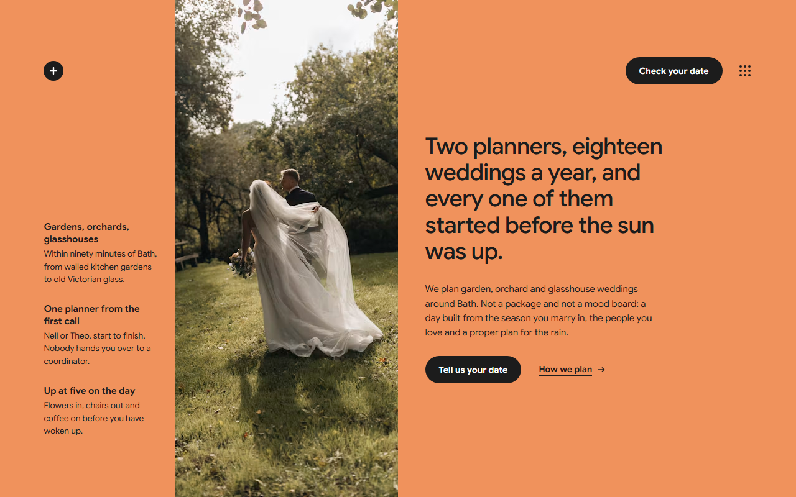
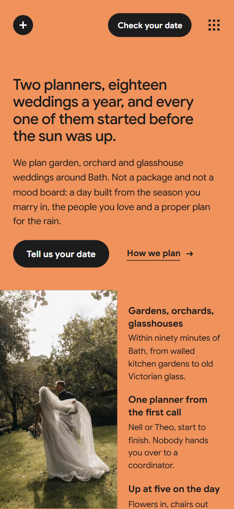
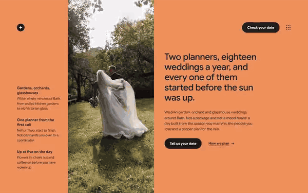

# Free HTML wedding planner website template with GSAP scroll animations

Wedding planner website template: one free HTML file for a studio that plans garden weddings, with three priced packages, a four-season flower scroll, a timed wedding day, four wedding stories and an enquiry form. Orange colour fields on a pale grey ground carry the garden photography. AGENTS.md is included, so Claude Code, Cursor or Codex can adapt it.

[](LICENSE)  

**[Live demo](https://8bsite.github.io/wedding-planner-website-template/)** · **[Use this template](https://github.com/new?template_name=wedding-planner-website-template&template_owner=8bsite)** · **[Download ZIP](https://github.com/8bsite/wedding-planner-website-template/archive/refs/heads/main.zip)** · **[Template page on 8b.com](https://8b.com/templates/aubade/)**

<a href="https://8bsite.github.io/wedding-planner-website-template/"></a> <a href="https://8bsite.github.io/wedding-planner-website-template/"></a>

<p align="center"><a href="https://8bsite.github.io/wedding-planner-website-template/"></a><br><sub>Scroll animation</sub></p>

## Use it with Claude Code, Cursor or Codex

Download the four files into your project folder (`curl.exe` in Windows PowerShell):

```bash
curl -LO https://raw.githubusercontent.com/8bsite/wedding-planner-website-template/main/index.html
curl -LO https://raw.githubusercontent.com/8bsite/wedding-planner-website-template/main/AGENTS.md
curl -LO https://raw.githubusercontent.com/8bsite/wedding-planner-website-template/main/LICENSE
curl -LO https://raw.githubusercontent.com/8bsite/wedding-planner-website-template/main/CREDITS.md
```

Then fill in the angle brackets and give your agent this prompt:

```text
Read AGENTS.md, then edit index.html. Make this the site for <my studio: name, town and the area I cover, packages with prices and lead times, team, real weddings, couples' quotes, reply time, how people enquire>. Replace first the studio name, the logo SVG, the packages, the timed day, the weddings, the planners and the journal. Keep the section ids, the classes AGENTS.md lists, the --len numbers and one season field per slide. Ask me for missing facts and never invent prices, weddings, quotes or contacts.
```

Vibe coding with Claude Code, Cursor or Codex starts with facts only the studio has: package names, prices and lead times, the team, venues, real weddings, quotes and a reply time. The demo invents all of them, plus a Bath address and three journal posts. Swap the name, the logo SVG and the prices first. Keep the section ids, the listed classes and each --len number, and update --len when a name changes.

No agent? Click **[Use this template](https://github.com/new?template_name=wedding-planner-website-template&template_owner=8bsite)**, edit `index.html` on GitHub and turn on **Settings > Pages**.

## Sections and motion

- **Navigation**: top bar with the logo, a Check your date button and a dot-grid menu button; full-screen menu with ten links, email and phone. The header bar hides when you scroll down and returns when you scroll up, and the nine dots of the menu button shift on hover.
- **Two planners, eighteen weddings a year, and every one of them started before the sun was up.**: orange colour field with the h1, a booking button, a tall couple photo and three facts. On load the heading, paragraph, buttons and facts rise in turn and the photo settles from a slight zoom.
- **Three ways to plan a garden wedding**: three planning packages as rows with price, inclusions and timing. The heading rises line by line and a hairline above each package draws across as the row arrives.
- **Every wedding starts with a flower in season**: four colour fields in a horizontal track, one per season, with a flower photo and a giant season word. Pinned: the four season fields slide left as a track for three screen widths of scroll; from the second field on, each photo opens from a narrow strip to full width while the giant season word slides against the track.
- **Hand it over**: a heap of ten task labels carried into an ordered list, beside what stays with the couple. Pinned on wide screens: ten task labels start scattered and tilted over the couple's half and are carried one by one into the list on the right; on phones each label slides in as it rises.
- **From first light to the last song**: a wedding day hour by hour beside a sticky frame of eight photos that change with the hour. Each hour's time swells to display size while its row crosses the screen, and the sticky photo frame slides the previous photo up to uncover the next.
- **Weddings we have planned**: four weddings as a mosaic of colour cards and photos. In each pair the colour card and the photo start swapped and slide past each other into the mosaic as they rise.
- **Two planners, both on the day**: two portraits and short bios of the planners. The heading rises and each portrait is revealed in four stair steps.
- **In their words**: four couples' notes as colour cards that stack like a deck. The four quote cards stick at stepped offsets, and each covered card shrinks slightly as the next slides over it.
- **Questions couples ask first**: six questions in native &lt;details&gt; with hairline rules. The heading rises and a hairline draws across above each question.
- **Journal**: three journal notes with a photo, date, title and link, rising onto one line. On wide screens the three notes start at different heights and settle onto one line as the section crosses the screen, their photos easing out of a close crop; on phones each note rises on its own.
- **Tell us the date and the garden**: an enquiry form beside the studio's email, phone, address and a gazebo photo. The heading rises and the gazebo photo is revealed in stair steps.
- **Footer**: wordmark, studio address, contact links and the copyright with the Design: 8B credit.

## Design

 page ground and the grounds of the packages, weddings, quotes and contact sections, the spring field  
 text, buttons, rules, the black day and journal sections, the winter field, one wedding card and one quote card  
 the handover and footer grounds, the summer field, one wedding card, the grey quote card  
 the opening field, the autumn field, the logo chip, button hover fills, question markers, hour times on black, one wedding card and the orange quote  
 text on black and grey, the planners and questions grounds, the handover labels, one wedding card and one quote card, the footer wordmark  
 secondary paragraphs and captions on light grounds  
 secondary text on the black sections and in the menu overlay

**Google Sans**: the only typeface, loaded as a variable font from weight 400 to 700 for every heading, label, paragraph and button, with an Arial based fallback (Google Fonts). A four-column grid with wide side margins. The opening puts three facts on the left, a tall couple photo next, and the heading in the right half, all on one flat orange field. Later sections swap flat grounds: pale grey, white, mid grey and black. Each heading sits left with a short paragraph in the right half, and hairline rules open the package rows and the questions. The season words and the footer wordmark are sized by their character count.

## Questions

**Does the enquiry form send anything?**  
No. The script checks the required fields, clears the form and shows a thank-you line, and nothing leaves the page. Connect it to Formspree or Netlify Forms, or your own handler. The Check your date and Tell us your date buttons only jump to the form.

**Can I use it for an event planner or a florist?**  
Yes, with new copy. The packages, the four seasons and the timed day work for any studio selling tiers around dates, such as an event planning template for parties. The wording is about weddings throughout, so an agent rewrites every section, not only the prices.

**Can I get a site like this without editing code?**  
Yes, with [8B's AI website builder](https://8b.com/templates/8b/). You describe the site in a sentence and it designs a new one, not this template. Designing and restyling are free. Publishing with hosting and SSL, full HTML export and AI edits in chat are on Pro at $9 a month billed yearly. It also runs inside Claude and ChatGPT through the 8B connector.

## Is it the right base?

As a wedding planning website it fits a small studio that sells fixed packages and wants an editorial feel. A party or celebration business with a lineup and ticket passes is closer to the [festival and event](https://8b.com/templates/ondo/) template. The weak spots: the journal links lead to pages that do not exist, and the enquiry form sends nothing. A studio that wants no code can use the 8B builder.

## Before you publish

- Replace what is marked `data-8b-placeholder` (social preview image, favicon, email, phone, form, social) and the invented demo facts; [AGENTS.md](AGENTS.md) lists them.
- The form sends nothing yet: connect it to Formspree or Netlify Forms, or remove it.

## Tech

GSAP 3.13.0, ScrollTrigger, SplitText, Lenis 1.3.27 from jsDelivr, 108 KB, no build step. Chrome and Edge 108+, Safari 15.4+, Firefox 101+ (it uses cascade layers, small/dynamic viewport units). With "reduce motion" on, the page is complete and still.

## License

MIT, see [LICENSE](LICENSE). Photos, fonts and libraries keep their own licences: [CREDITS.md](CREDITS.md). More free templates: [8b.com/templates](https://8b.com/templates/) · [github.com/8bsite](https://github.com/8bsite).
