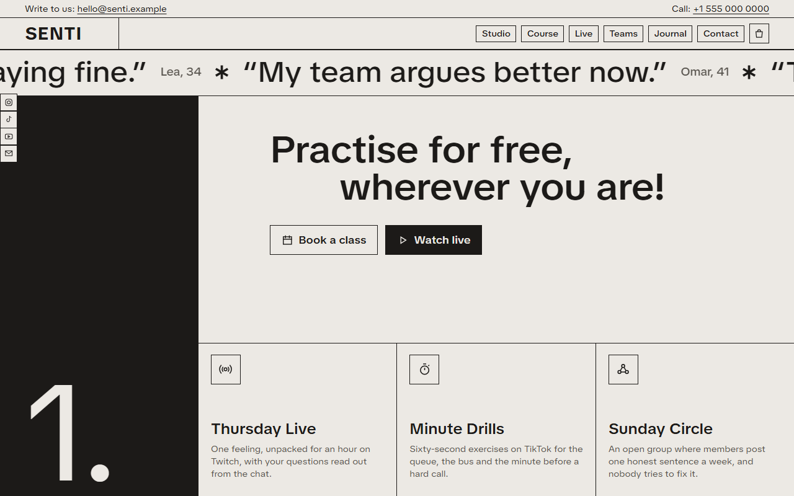
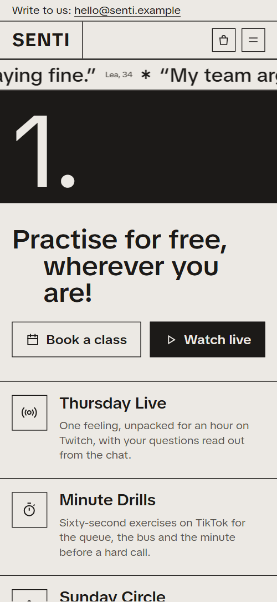
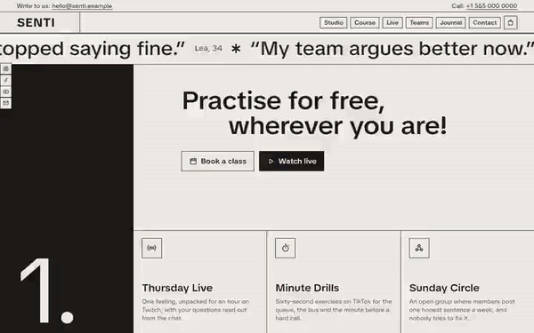

# Free HTML wellness studio website template with scroll animations and no libraries

Wellness studio website template: one free HTML file for an emotional fitness studio, coach or course creator who sells a six-week course, live sessions, team workshops and a printed journal. The look is quiet and typographic: warm grey, near-black ink and giant words. Its scroll motion runs on CSS with no JavaScript library.

[](LICENSE)  

**[Live demo](https://8bsite.github.io/wellness-studio-website-template/)** · **[Use this template](https://github.com/new?template_name=wellness-studio-website-template&template_owner=8bsite)** · **[Download ZIP](https://github.com/8bsite/wellness-studio-website-template/archive/refs/heads/main.zip)** · **[Template page on 8b.com](https://8b.com/templates/senti/)**

<a href="https://8bsite.github.io/wellness-studio-website-template/"></a> <a href="https://8bsite.github.io/wellness-studio-website-template/"></a>

<p align="center"><a href="https://8bsite.github.io/wellness-studio-website-template/"></a><br><sub>Scroll animation</sub></p>

## Use it with Claude Code, Cursor or Codex

Download the four files into your project folder (`curl.exe` in Windows PowerShell):

```bash
curl -LO https://raw.githubusercontent.com/8bsite/wellness-studio-website-template/main/index.html
curl -LO https://raw.githubusercontent.com/8bsite/wellness-studio-website-template/main/AGENTS.md
curl -LO https://raw.githubusercontent.com/8bsite/wellness-studio-website-template/main/LICENSE
curl -LO https://raw.githubusercontent.com/8bsite/wellness-studio-website-template/main/CREDITS.md
```

Then fill in the angle brackets and give your agent this prompt:

```text
Read AGENTS.md, then edit index.html. Make this the site for <my studio: what I teach, course length, price and start date, live slot, event dates, team prices, the journal, founder story, contacts>. Motion is CSS scroll-driven animation plus the inline motion kit: keep the gate script in the head, the data-8b-section, data-8b-motion and data-8b-items attributes and three journal photos, set --len on each giant word to its character count, and add no animation library. Ask me for missing facts; never invent outcomes, qualifications, quotes, prices, dates or contacts.
```

Vibe coding with Claude Code, Cursor or Codex goes fastest when you hand the agent the facts only the studio has: course length, price and start date, the live slot, event dates, team prices, journal details, the founder's story, contacts. The demo invents all of them, along with the four member quotes and the claims about thirty feeling words. Keep the 24-cell word wall or check it again, and never let the agent invent a quote. It is [a single coaching page](https://8b.com/templates/one-page/), so the agent reads it end to end.

No agent? Click **[Use this template](https://github.com/new?template_name=wellness-studio-website-template&template_owner=8bsite)**, edit `index.html` on GitHub and turn on **Settings > Pages**.

## Sections and motion

- **Navigation**: top bar with email and phone, a sticky bar with a boxed wordmark, six boxed links and a cart, a left rail of social icons, a phone menu overlay.
- **Practise for free, wherever you are!**: a running band of four member quotes, a black column with the numeral 1, the heading "Practise for free, wherever you are!", two buttons and three free ways to practise. The four member quotes clone into a running line that loops and pauses on hover or off screen, while on load the heading's second line steps in and the buttons rise; the mouse wheel scrolls smoothly throughout.
- **Make it a game!**: giant word Motivation with an asterisk, a boxed heading, text, three rules, a link, a footnote and a tall portrait. On scroll the letters of the giant word start at jagged heights and settle into one line as the asterisk turns, and the photo drifts inside its frame against the boxed heading.
- **Fine is not a feeling.**: giant struck word Fine, the heading "is not a feeling.", a wall of 24 feeling words and a footnote. Pinned: every cell shows "fine" and flips in a diagonal wave to its feeling word while the strike line draws through the giant word.
- **Six weeks, one feeling a week**: black column with the numeral 2, a stepped heading, a six-row weekly ledger, price and a Reserve a seat button. A black arm grows out of the numeral column into the row being read, steps down the six weeks and lights each row in turn.
- **A letter from Mara**: a portrait and a short letter from the founder with a sign-off and a link. The portrait opens from an inset clip and its image settles from a zoom as the section arrives, and the heading steps in.
- **Next on the calendar**: host photo with a caption, and a dated table of six events with free and paid formats and a link on each row. The six calendar rows start in a staircase of offsets and straighten into one table as the section rises.
- **Bring your team**: giant word Together, a black column with the numeral 3, a team photo and three formats with prices. Pinned: the photo starts full screen and shrinks into its cell while the giant word slides in, the numeral rises and the offer column with the three formats rises into place.
- **Fair questions**: heading with a note and five questions as native details elements.
- **The Feelings Journal**: heading, lead, three photos, four product facts, price and an Add to cart button that feeds the header count. The three photos start as a rotated pile and spread into a row while turning straight.
- **Say it to us first**: details on the left (email, phone, studio, hours) and a form with a topic select on the right.
- **Footer**: giant wordmark, four link columns, social icons and a legal line with the Design: 8B credit. The wordmark arrives stretched wide and thickened by an outline, and relaxes to its regular width and weight as the footer rises.

## Design

 page ground, nav bar, button and card fills, text on black columns  
 text, hairlines, borders, black numbered columns, filled buttons  
 secondary text: captions, footnotes, labels, form labels, FAQ answers  
 photo frame ground behind images and the hover fill of small boxed links

**TikTok Sans**: the only family, a variable face at 110 percent width: giant words and the footer wordmark at regular weight, headings semibold, body regular (Google Fonts). A warm light grey page ruled with hairlines. Three black numbered columns (1., 2., 3.) mark the steps of joining: free practice, the course, a team session. Giant words (Motivation, Fine, Together) span the width, each with an asterisk and a footnote. Heading lines step to the right, and the course and live sections pair a narrow column with a wide one. Cells, rows and fact boxes are divided by one pixel lines.

## Questions

**Which parts of the demo text must a coach replace?**  
All of it, but check the claims first: the four member quotes, thirty feeling words, most people speaking up by week three and led by certified coaches are invented. Keep the footer line that this is training, not therapy, and adapt the emergency-number advice to your country.

**Does the contact form or the Add to cart button work?**  
Not yet. The form checks name and email, shows a thank-you line and clears the fields without sending anything; connect Formspree or Netlify Forms with the steps in AGENTS.md. Add to cart only raises the header cart count and shows a line of text, so link it to your shop or a payment page.

**Can I get a site like this without editing code?**  
Yes, with [8B's AI website builder](https://8b.com/). You describe the site in a sentence and its engine designs a new site, its own design and not this template. Designing is free; publishing with hosting and SSL, full HTML export and AI edits in chat are on Pro at $9 a month billed yearly. It also runs in Claude and ChatGPT.

## Is it the right base?

As a wellness studio website template for Claude Code, this suits a course plus free content in a colourless, typographic look, the kind of coaching website designs where words do the work. Single classes sold by the slot suit the [Pilates](https://8b.com/templates/hundred/) type. This build looks and moves the same with no script from a CDN: about 26 KB of code gzipped, against 74 KB and four more requests for the GSAP version. Commerce is the weak spot: the journal button only counts items.

## Before you publish

- Replace what is marked `data-8b-placeholder` (social preview image, favicon, email, phone, social, form) and the invented demo facts; [AGENTS.md](AGENTS.md) lists them.
- The form sends nothing yet: connect it to Formspree or Netlify Forms, or remove it.

## Tech

No JavaScript libraries: CSS scroll-driven animations and a small inline motion script with its own smooth wheel scrolling, 100 KB, no build step. Chrome and Edge 108+, Safari 16+, Firefox 110+ (it uses container query units, cascade layers, small/dynamic viewport units). Without scroll-driven animations (Firefox today) the scroll motion and the smooth wheel are off and each section shows its finished layout (a load-in or a loop may still play); with "reduce motion" on, the page is complete and nothing moves on its own (hover effects stay).

A GSAP build of the same page is [`index.gsap.html`](index.gsap.html): GSAP 3.13.0, ScrollTrigger, SplitText, Lenis 1.3.27 from jsDelivr, 88 KB; its scroll motion also plays in Firefox. Use one of the two files.

## License

MIT, see [LICENSE](LICENSE). Photos, fonts and libraries keep their own licences: [CREDITS.md](CREDITS.md). More free templates: [8b.com/templates](https://8b.com/templates/) · [github.com/8bsite](https://github.com/8bsite).
